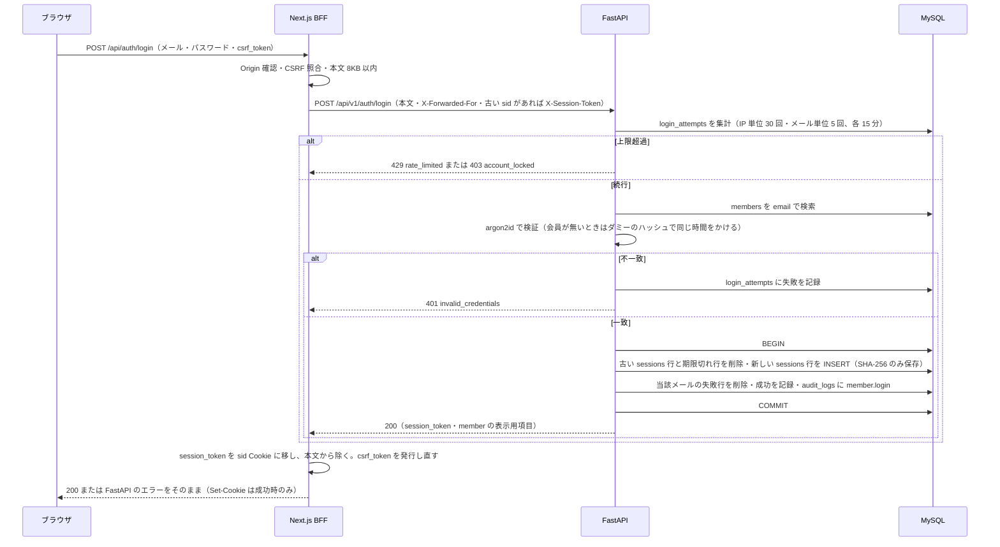
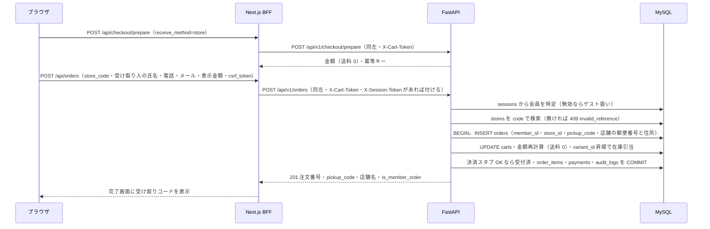
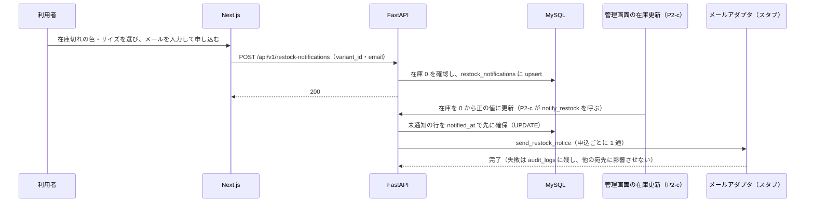
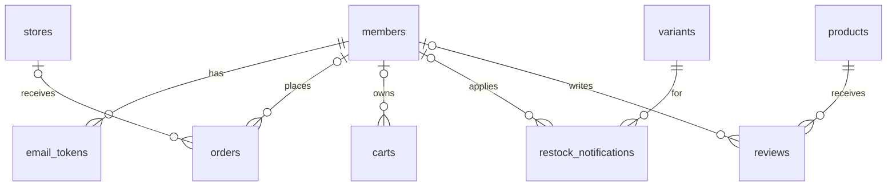

# GU EC サイト 設計仕様書（P2 追補b）

| 項目 | 内容 |
| --- | --- |
| 文書番号 | GUEC-SD-01-P2b |
| 版 | draft-v1 |
| 作成者 | Claude |
| 作成日 | 2026-10-20 |
| 入力 | 本編 `GU_ECsite_設計仕様書_P1_draft-v3.md`（2026-10-19 追補まで）、P2 追補a `GU_ECsite_設計仕様書_P2追補a_draft-v1.md`、テスト設計書 P1 draft-v2 と P2 追補a、要求仕様書 with_ai v2.4、要件定義書 with_ai v1.3、`実装フェーズ計画.md`、ADR-0001・0004・0005・0006、`P2_事前レビュー観点_v1.md`、`セキュリティ点検記録_20261019.md`、実装（`apps/api/app/`・`apps/web/`）の 2026-10-20 時点の状態 |
| 対象 | ADR-0001 の P2-b：F-024 会員登録・認証、F-017 注文履歴・状況確認、F-013／F-014 の店舗受け取りと受け取りコード（REQ-FR-501・508）、F-007 再入荷通知の申込（REQ-FR-205）、F-005 サイズ感の集計（REQ-FR-208）。あわせて P2-c が使うテーブルの先出し |

## 改訂履歴

| 版 | 日付 | 内容 | 作成 | 承認 |
| --- | --- | --- | --- | --- |
| draft-v1 | 2026-10-20 | 初稿。P2-b の追補設計を本編との差分として作成。DS-DEC-68〜89、DS-API 15 本、DS-TBL 8 表、実装レーンの分け方（11 章）を含む。オーナーは「実装し切ってから最後にまとめて承認」と決めている（ADR-0006）ため、実装担当が迷わない粒度まで決定を書いた | Claude | — |
| draft-v1.1 | 2026-10-20 | 実装と手元の検収で見つかった食い違いを修正。6.3 の `/login`（`sid` があっても `GET /me` が有効なときだけ `/mypage` へ移す）、6.6 の再入荷フォーム（variant が無い組み合わせでは出さない） | Claude | — |

## 0. 本書の位置づけ

本書は本編（`GU_ECsite_設計仕様書_P1_draft-v3.md`。以下「本編」）の追補であり、**本編との差分だけ**を書く。章番号は本編の 1〜10 章に対応させ、末尾に 11 章（実装レーンの分け方）を足した。本編と P2 追補a に書いてあって変わらない事項（BFF と FastAPI の 2 層、エラー応答の判定順序、金額計算、冪等キーなど）は再掲しない。

### 0.1 対象範囲

| 区分 | 内容 |
| --- | --- |
| 対象 | ①F-024 会員登録・ログイン・ログアウト・セッション・メール確認・パスワード再設定（REQ-FR-801・802・803・807）<br>②F-017 注文履歴と注文状況の確認（REQ-FR-601・602）。ゲスト注文と会員の紐づけ<br>③F-013／F-014 の店舗受け取りと受け取りコード（REQ-FR-501・508）<br>④F-007 再入荷通知の申込（REQ-FR-205）<br>⑤F-005 サイズ感の集計（REQ-FR-208）<br>⑥P2-c が使うテーブル（管理者 `staff`）の先出し |
| 対象外（P3 以降） | F-010 カート引き継ぎ（REQ-FR-404）、F-026 会員情報管理（住所の複数登録・退会・削除請求）、F-018 キャンセル、F-019 返品、F-020 レビュー投稿、F-038 店舗受け渡し管理（コード照合の画面）、BAT-01・BAT-02、F-039 手動解除 |
| ADR-0006 による除外 | IF-01 Stripe テストモードは P3 へ送る。注文確定の決済は P2 の間もスタブで閉じる。本書は Stripe に関する設計を書かない |

### 0.2 設計 ID の追加・変更

本編の ID 体系をそのまま使う。本書が新設・詳細化・変更する ID は次のとおり。

| 種別 | ID | 区分 |
| --- | --- | --- |
| API（15 本） | DS-API-030・031・032・033・034 | 本編に概要のみ。4.1 で詳細化（034 は要求と確定の 2 本に分割） |
| API | DS-API-035・036 | 新設（パスワード再設定の確定、会員情報の取得） |
| API | DS-API-024 | 本編に概要のみ。4.2 で詳細化 |
| API | DS-API-024a | 新設（注文履歴の詳細。P2 追補a の 004a と同じ枝番の付け方） |
| API | DS-API-007・026 | 新設（再入荷通知の申込、受け取り店舗の一覧） |
| API | DS-API-003・021・022・023 | 変更（応答・要求に項目を追加。4.4・4.6） |
| 処理（12 件） | DS-PRC-030・031・032・034・035 | 会員登録、メール確認、ログインとセッション発行、パスワード再設定、セッション検証（4.7） |
| 処理 | DS-PRC-024・024a | 注文履歴、注文状態の表示名と表示条件 |
| 処理 | DS-PRC-007・007a・003a | 再入荷の申込、再入荷通知の送信、サイズ感の集計 |
| 処理 | DS-PRC-014-3・021a | 注文確定の P2-b 差分（受け取り方法・会員の紐づけ）、金額計算の送料の差分 |
| テーブル（8 表） | DS-TBL-01・03・04・10・19・20・26 | 本編に概要のみ。5 章で定義 |
| テーブル | DS-TBL-27 `email_tokens` | 新設（メール確認とパスワード再設定のトークン） |
| テーブル（変更 2 表） | DS-TBL-12 `carts`・DS-TBL-14 `orders` | 外部キー・索引の追加（5.3） |
| 画面 | DS-SCR-007・008・009 | 本編に概要行のみ。6 章でワイヤーを新設 |
| 画面（変更） | DS-SCR-003・005・006、共通レイアウト（ヘッダー） | 6 章で差分を書く |
| 外部 IF | DS-IF-02（メール） | スタブのメール種別を 5 つ追加（4.10） |
| 判断 | DS-DEC-68〜89（22 件） | 9.1 に一覧 |

## 1. 構成への影響（本編 1 章の差分）

構成図（本編 1 章）の要素と矢印は変わらない。差分は次の 3 点。

1. ブラウザが送る Cookie に会員セッション用の `sid`（HttpOnly）が加わる。BFF は `sid` の値を `X-Session-Token` ヘッダに移して FastAPI を呼ぶ。`X-Cart-Token` と同じ方式で、FastAPI が `sessions` 表で検証する（DS-DEC-72）。BFF は `sid` の中身を解釈しない。
2. 会員向けのページ（`/mypage` 以下）は Server Component が FastAPI を直接呼ぶ（本編 4.3 の原則）。このときも `X-Session-Token` を付ける。
3. FastAPI のメールアダプタ（IF-02）が扱うメール種別が増える。P2-b はすべてスタブ（開発はファイル出力、本番はログに種別だけ）。実送信は P2-c（ADR-0006 の削る順番の①）。

## 2. 版・依存の追加（本編 2 章の差分）

| 領域 | 追加・変更 | 根拠 |
| --- | --- | --- |
| バックエンド | `argon2-cffi`（25.1 系）を `apps/api/pyproject.toml` の dependencies に追加する。`uv add` で解決した版を `uv.lock` に固定し、本表の「実装版」は実装後に追記する | 本編 2 章の「認証」の行（自前の argon2id ＋ サーバー側セッション、argon2-cffi）と DS-DEC-11 の実装。DS-DEC-68 |
| バックエンド | 上記以外の追加なし。メール形式の検査は既存の `pydantic[email]`（`email-validator`）、乱数は標準ライブラリ `secrets`、正規化は `unicodedata` | 依存を増やさない（DS-DEC-24） |
| フロント | 追加なし。フォームは既存の `Form.tsx` の部品と `useState` で作る | `apps/web/package.json` を変えない |
| 実行時の注意 | `argon2-cffi` はネイティブ拡張（cffi）を含む。Python 3.13 の wheel が macOS（arm64）・Windows（x86_64）・Linux（x86_64。App Service）にあることを、Lane A の最初に `uv sync` と最小コード（ハッシュ化 1 回）で確かめる（9.2 の観点 3） | 本編 2 章の `cryptography` と同じ型の失敗（接続して初めて要る依存）を防ぐ |

## 3. シーケンス／アクティビティ（本編 3 章の差分）

### 3.1 ログイン（DS-PRC-032）



### 3.2 会員の店舗受け取り注文（DS-PRC-014-3）

本編 3.3.1 との差分だけを示す。決済スタブ・在庫引当・冪等キーの手順は変えない。



### 3.3 再入荷通知（DS-PRC-007・007a）



## 4. API 設計（本編 4 章の差分）

### 4.0 共通方針

- FastAPI のパスはすべて `/api/v1` の下で、内部トークン（`X-Internal-Token`）必須（本編 4.1）。以下の表のパスは `/api/v1` を省いて書く。
- 状態を変える BFF（POST）は、先頭で `verifyCsrf`（Origin の確認 → Double Submit Cookie の照合。本編 7.7 S6）を通し、本文を 8192 バイトまでに制限する（S2）。GET は CSRF 不要。
- 会員セッションは、BFF が Cookie `sid` を `X-Session-Token` ヘッダに移して渡す。FastAPI の依存関数は 2 種類（`app/core/session.py`）。`get_current_member` は有効な会員セッションが無ければ 401 `unauthorized`。`get_optional_member` は無効でも例外にせず `None` を返す。**スタッフのセッション（`subject_type=staff`）は会員の依存関数では常に無効**として扱う（DS-DEC-72）。
- BFF はブラウザへ返す本文から `session_token` を除く（`cart_token` と同じ扱い。DS-DEC-60 の方針）。
- 応答に内部 ID（会員 ID・注文 ID・店舗 ID）を出さない。店舗は `code`、注文は注文番号で指す（本編 7.5）。商品側の `variant_id` は本編どおり出してよい。
- 日時は UTC の ISO 8601 で返し、画面で JST に直す（DS-DEC-16）。
- 新しいエラーコード（`invalid_credentials`・`account_locked`・`weak_password`・`invalid_reference`・`in_stock`）は 4.9 にまとめる。
- 回数制限の種類は 3 つ。BFF の全体制限（本編 7.7 S1、IP ごとに `/api/*` 120 回/分）に加え、FastAPI の個別制限（プロセス内メモリのスライディングウィンドウ。DS-API-023 と同じ `SlidingWindowRateLimiter`）、ログインだけは DB の `login_attempts`（DS-DEC-70）。個別制限の数値は DS-DEC-84。

### 4.1 認証 API（DS-API-030〜035）

#### DS-API-030 会員登録

| 項目 | 内容 |
| --- | --- |
| メソッド・パス | `POST /auth/register`。BFF の窓口は `POST /api/auth/register` |
| 要求 | `{"email", "password", "name", "birth_date"?, "gender"?, "personalize_opt_in"?}`。email は 254 文字以内で、NFKC 正規化・前後空白除去・小文字化のあと `EmailStr` で検査する（DS-DEC-69）。password は NFKC 正規化のあと 8〜128 文字。name は前後空白除去のあと 1〜50 文字で、全角空白のみは不可。birth_date は `YYYY-MM-DD`（1900-01-01 以上・今日以下）。gender は `female`・`male`・`other`・`no_answer` のいずれか。personalize_opt_in は真偽値で既定 false |
| 応答 | **202** `{"status": "accepted"}`。メールが新規でも既登録でも同じ（DS-DEC-71）。セッションは発行しない（DS-DEC-76） |
| エラー | 400 `validation_error`（形式・長さ・範囲。`fields` に項目名と reason）／422 `weak_password`（`field: "password"`。DS-DEC-69 の禁止パターン）／422 `unsupported_value`（`field: "email"`。環境変数 `DEMO_EMAIL_DOMAINS` を設定した環境で、許可外のドメイン。DS-DEC-88）／429 `rate_limited` |
| 副作用 | 新規メールのときだけ `members` と `email_tokens`（verify_email）を INSERT し、確認メールを後処理で送る。既登録のときは「すでに登録されています」のメールを後処理で送る（DB は変えない） |
| CSRF・回数制限 | CSRF 必須。IP ごとに 10 回/時 |

#### DS-API-031 メール確認

| 項目 | 内容 |
| --- | --- |
| メソッド・パス | `POST /auth/verify-email`。BFF の窓口は `POST /api/auth/verify-email` |
| 要求 | `{"token"}`。形は `^[A-Za-z0-9_-]{43}$` |
| 応答 | 200 `{"verified": true}`。`members.email_verified_at` を現在時刻にし、トークンを使用済みにする |
| エラー | 400 `validation_error`（token の形）／404 `not_found`（存在しない・期限切れ・使用済みを区別しない。期限は 24 時間） |
| CSRF・回数制限 | CSRF 必須（リンクを開いただけで確認が進まないよう、画面のボタンで POST する。DS-DEC-74）。IP ごとに 20 回/時 |

#### DS-API-032 ログイン

| 項目 | 内容 |
| --- | --- |
| メソッド・パス | `POST /auth/login`。BFF の窓口は `POST /api/auth/login` |
| 要求 | `{"email", "password"}`。email は DS-API-030 と同じ正規化。password は NFKC 正規化のあと 1〜128 文字（最小長は 8 にしない。ポリシー改定前の短いパスワードの会員を締め出さないため）。BFF は Cookie `sid` があれば `X-Session-Token` に載せる（古いセッションの削除に使う）。BFF は `X-Forwarded-For` に利用者の IP を載せる（`order-proxy.ts` の `clientIp` と同じ） |
| 応答 | 200 `{"session_token", "member": {"name", "email_verified"}}`。BFF は `session_token` を Cookie `sid` にし、ブラウザへ返す本文から除く |
| エラー | 400 `validation_error`／401 `invalid_credentials`（会員がいない・パスワード違い・匿名化済みを区別しない）／403 `account_locked`（メール単位で 15 分に 5 回失敗。正しいパスワードでも返す。`locked_until` や残り回数は返さない）／429 `rate_limited`（IP 単位で 15 分に 30 回失敗） |
| 副作用 | DS-PRC-032。成功時、そのメールの失敗行を削除し、セッションを再発行する |
| CSRF・回数制限 | CSRF 必須。DB の `login_attempts` で制限する（DS-DEC-70）。BFF はログイン成功時と失敗時のどちらも `Cache-Control: no-store` を付ける |

#### DS-API-033 ログアウト

| 項目 | 内容 |
| --- | --- |
| メソッド・パス | `POST /auth/logout`。BFF の窓口は `POST /api/auth/logout`（GET にしない） |
| 要求 | 本文なし。`X-Session-Token` |
| 応答 | **204**。セッションが無効・不明でも 204（冪等） |
| 副作用 | `sessions` の該当行を削除する。BFF は成功・失敗にかかわらず `sid` の削除 Cookie（`Max-Age=0`）を返し、`csrf_token` を発行し直す |
| CSRF・回数制限 | CSRF 必須。BFF の全体制限のみ |

#### DS-API-034 パスワード再設定の要求

| 項目 | 内容 |
| --- | --- |
| メソッド・パス | `POST /auth/password-reset/request`。BFF の窓口は `POST /api/auth/password-reset/request` |
| 要求 | `{"email"}`（DS-API-030 と同じ正規化） |
| 応答 | **200** `{"status": "accepted"}`。会員がいてもいなくても同じ（DS-DEC-71） |
| エラー | 400 `validation_error`（メールの形）／422 `unsupported_value`（`DEMO_EMAIL_DOMAINS` 外）／429 `rate_limited` |
| 副作用 | 会員がいるときだけ `email_tokens`（reset_password。有効 1 時間）を INSERT し、同じ会員の未使用の再設定トークンを使用済みにしてから、再設定メールを後処理で送る。リンクは環境変数 `PUBLIC_WEB_BASE_URL` から作り、リクエストの `Host` ヘッダは使わない（DS-DEC-75） |
| CSRF・回数制限 | CSRF 必須。IP ごとに 5 回/時、メールごとに 3 回/時 |

#### DS-API-035 パスワード再設定の確定

| 項目 | 内容 |
| --- | --- |
| メソッド・パス | `POST /auth/password-reset/confirm`。BFF の窓口は `POST /api/auth/password-reset/confirm` |
| 要求 | `{"token", "password"}`。password は DS-API-030 と同じポリシー |
| 応答 | 200 `{"status": "ok"}`。自動ログインはしない |
| エラー | 400 `validation_error`／404 `not_found`（無効・期限切れ・使用済みを区別しない）／422 `weak_password`（このとき**トークンは消費しない**）／429 `rate_limited` |
| 副作用 | パスワードのハッシュを更新し、トークンを使用済みにし、当該会員の `sessions` を**すべて**削除し、そのメールの失敗行を削除し、`audit_logs` に `member.password_reset` を記録する。1 トランザクション |
| CSRF・回数制限 | CSRF 必須。IP ごとに 10 回/時 |

### 4.2 会員情報・注文履歴 API（DS-API-036・024・024a）

#### DS-API-036 会員情報の取得

| 項目 | 内容 |
| --- | --- |
| メソッド・パス | `GET /me`。BFF の窓口なし（Server Component が直接呼ぶ） |
| 要求 | `X-Session-Token` |
| 応答 | 200 `{"name", "email", "email_verified": bool, "personalize_opt_in": bool}`。パスワードのハッシュ・内部 ID・生年月日・性別は返さない |
| エラー | 401 `unauthorized`（セッション無し・不明・期限切れ・匿名化済み会員） |

#### DS-API-024 注文履歴の一覧

| 項目 | 内容 |
| --- | --- |
| メソッド・パス | `GET /me/orders?page=1&per_page=10`。BFF の窓口なし（Server Component が直接呼ぶ） |
| 要求 | `page` は 1 以上（既定 1）、`per_page` は 1〜50（既定 10）。範囲外は 400 `validation_error`。`X-Session-Token` |
| 応答 | 200 `{"items": [{"order_number", "status", "status_label", "ordered_at", "total", "receive_method", "item_count", "first_item_name"}], "page", "per_page", "total", "has_more"}`。自分の `member_id` の注文だけを `created_at` の新しい順（同時刻は `id` の降順）に返す。`item_count` は数量の合計。決済失敗（`payment_failed`）の注文も含める。ゲスト注文は含めない（DS-DEC-77） |
| エラー | 401 `unauthorized`／400 `validation_error` |
| 備考 | 注文が 0 件でも 200 で `items` は空配列（本編 4.5 の「一覧の空結果は 200」） |

#### DS-API-024a 注文履歴の詳細

| 項目 | 内容 |
| --- | --- |
| メソッド・パス | `GET /me/orders/{order_number}`。BFF の窓口なし（Server Component が直接呼ぶ） |
| 要求 | パスの `order_number` は `^GU-[0-9]{6}-[A-HJ-NP-Z2-9]{8}$`。形が違えば 404（本編 4.5 の「存在しない」と区別しない） |
| 応答 | 200 `OrderOut`（4.4。DS-API-022 と同じ型）。`status_label`・`store`・`pickup_code`・`tracking_number` を含む |
| エラー | 401 `unauthorized`／404 `not_found`（存在しない・他人の注文・ゲスト注文・形が不正を区別しない） |

### 4.3 受け取り店舗 API（DS-API-026）

| 項目 | 内容 |
| --- | --- |
| メソッド・パス | `GET /stores`。BFF の窓口なし（注文手続きのページが Server Component で取得し、フォームへ props で渡す） |
| 応答 | 200 `{"items": [{"code", "name", "prefecture", "address"}]}`。`pickup_enabled` が真の店舗を `sort_order`・`id` の順に返す。郵便番号・内部 ID は返さない |
| エラー | なし（認証不要。一覧が空でも 200） |

### 4.4 注文系 API の変更（DS-API-021・022・023）

#### 要求の変更

| API | 変更 |
| --- | --- |
| DS-API-021 `POST /checkout/prepare` | 本文を任意で受ける。`{"receive_method": "delivery"/"store"}`（既定 `delivery`）。`store` のとき送料を 0 として返す（DS-PRC-021a）。応答に `receive_method` を足す。本文が無い呼び出しは従来どおり `delivery` |
| DS-API-022 `POST /orders` | `receive_method` に `store` を許す。`store_code`（`^[a-z0-9-]{1,32}$`。ASCII の小文字・数字・ハイフンのみ）を足す。`receive_method=delivery` では `ship_postal_code`・`ship_address` を必須のままとし、`store` では**この 2 項目を無視する**（店舗の値で上書きする。mass assignment を許さない）。`ship_name`・`ship_phone`・`guest_email` は両方で必須（店舗受け取りでは受け取る人の氏名・連絡先）。任意ヘッダ `X-Session-Token` を受け、有効なら注文を会員に紐づける（DS-PRC-014-3） |
| DS-API-023 `POST /orders/{n}/lookup` | 要求は変えない |

#### 応答（`OrderOut`）の変更。DS-API-022・023・024a 共通

| 項目 | 型 | 内容 |
| --- | --- | --- |
| `receive_method` | `"delivery"` または `"store"` | これまで固定値だったものを実際の値にする |
| `store` | オブジェクトまたは null | `{"name", "prefecture", "address"}`。`store` のときだけ。内部 ID・郵便番号は含めない |
| `pickup_code` | 文字列または null | 8 文字。`store` で状態が `accepted`・`preparing`・`shipped` のときだけ値を入れ、それ以外は null（DS-PRC-024a） |
| `tracking_number` | 文字列または null | `delivery` で状態が `shipped`・`delivered` かつ登録済みのときだけ |
| `status_label` | 文字列 | 受付から受け取り可能までの区分の表示名（DS-PRC-024a） |
| `is_member_order` | 真偽値 | 注文に会員が紐づいているか。完了画面の案内の出し分けに使う |

既存の項目（`order_number`・`status`・`items`・金額・`ship_*`・`guest_email`・`payment_method`・`ordered_at` など）は変えない。`guest_email` は会員の注文では連絡先メールを入れる（名前は互換のため変えない）。

### 4.5 DS-API-007 再入荷通知の申込

| 項目 | 内容 |
| --- | --- |
| メソッド・パス | `POST /restock-notifications`。BFF の窓口は `POST /api/restock-notifications` |
| 要求 | `{"variant_id": int, "email": str}`。`variant_id` は 1 以上 9223372036854775807 以下（本編 7.7 S7）。email は DS-API-030 と同じ正規化。`X-Session-Token` が有効なら `member_id` を記録する |
| 応答 | **200** `{"status": "registered"}`。新規でも、同じ（variant, email）の再申込でも同じ。再申込では `notified_at` を NULL に戻し、通知済みだった申込を再び有効にする（DS-PRC-007） |
| エラー | 400 `validation_error`／404 `not_found`（variant が無い・商品が非公開）／409 `in_stock`（在庫が 1 以上。カートに入れられる）／422 `limit_exceeded`（`field: "email"`, `limit: 10`。未通知の申込が 1 つのメールで 10 件に達している）／422 `unsupported_value`（`DEMO_EMAIL_DOMAINS` 外）／429 `rate_limited` |
| CSRF・回数制限 | CSRF 必須。IP ごとに 20 回/時 |

### 4.6 DS-API-003 商品詳細の変更（サイズ感の集計）

応答に `fit_summary` を足す。レビューが 0 件でもキーは常に出す。

```json
"fit_summary": { "total": 10, "small": 2, "just": 6, "large": 2 }
```

- 集計の元は `reviews` のうち `approved` が真で、`fit` が NULL でないもの。`total` は `small + just + large` に等しい。
- 割合は API で計算しない（画面が件数を並べ、棒の幅だけを比率で描く。丸めで合計が 100 にならない問題を避ける。DS-DEC-81）。
- 非公開商品・存在しない商品は従来どおり 404。

### 4.7 BFF の窓口（本編 4.3 の差分）

| パス | メソッド | 取り次ぎ先 | 備考 |
| --- | --- | --- | --- |
| `/api/auth/register` | POST | DS-API-030 | 本文の項目を白リストで拾う（email・password・name・birth_date・gender・personalize_opt_in） |
| `/api/auth/verify-email` | POST | DS-API-031 | token のみ |
| `/api/auth/login` | POST | DS-API-032 | 成功時に `sid` を発行し、本文から `session_token` を除く。`csrf_token` を発行し直す |
| `/api/auth/logout` | POST | DS-API-033 | `sid` を削除する。`csrf_token` を発行し直す |
| `/api/auth/password-reset/request` | POST | DS-API-034 | email のみ |
| `/api/auth/password-reset/confirm` | POST | DS-API-035 | token・password のみ |
| `/api/restock-notifications` | POST | DS-API-007 | variant_id・email のみ。有効な `sid` があれば `X-Session-Token` を付ける |
| `/api/checkout/prepare` | POST | DS-API-021（変更） | 本文の `receive_method` を白リストで通す |
| `/api/orders` | POST | DS-API-022（変更） | 白リストに `store_code` を足す。`sid` があれば `X-Session-Token` を付ける。`ship_postal_code`・`ship_address` は `receive_method=store` のとき必須としない |
| Server Component から直接 | GET | DS-API-036・024・024a・026・003 | `lib/server/member.ts`（新設）が `sid` を読み、`X-Session-Token` を付けて呼ぶ。`/me` 系が 401 のとき `redirect("/login?next=…")` |

BFF の新規 Route Handler は 7 本（認証 6 本と再入荷 1 本）。変更は 2 本（prepare・orders）。

### 4.8 処理仕様

#### DS-PRC-035 セッション検証（`app/core/session.py`）

1. `X-Session-Token` が無い、または `^[A-Za-z0-9_-]{43}$` でなければ「セッションなし」。
2. `token_hash = SHA-256(token)` の 16 進 64 文字で `sessions` を検索する。`subject_type = member` かつ `expires_at > 現在時刻（UTC）` の行だけを有効とする。
3. 行の `subject_id` で `members` を主キー検索する。無い、または `anonymized_at` が NULL でなければ「セッションなし」。
4. `last_seen_at` は更新しない（GET が DB に書かない方針。本編 7.7.3 の DS-DEC-59 と同じ）。ログインのときの時刻のまま残す。
5. 有効なら会員を返す。無効なら、`get_current_member` は 401 `unauthorized`、`get_optional_member` は `None`。

#### DS-PRC-030 会員登録

1. 入力検査（Pydantic。形・長さ・範囲）。email と password は検査の前に NFKC 正規化する（`mode="before"`）。
2. サービス層で、パスワードポリシー（DS-DEC-69。DB を見ない）と `DEMO_EMAIL_DOMAINS`（DS-DEC-88）を検査する。**ここまでは、メールが登録済みかどうかに依存させない。**
3. パスワードをハッシュ化する（argon2id。スレッドプールで実行し、同時実行は 2 本まで。DS-DEC-68）。**既登録のメールでも同じ処理をして結果を捨てる**（応答時間を揃える）。
4. `INSERT members`。UNIQUE 違反なら「既登録」の枝に入る。新規なら `email_tokens`（verify_email）を INSERT し、`audit_logs` に `member.register` を記録して COMMIT する。
5. 202 を返す。確認メール（新規）または「すでに登録されています」メール（既登録）は、応答のあとに後処理で送る。

#### DS-PRC-031 メール確認

1. token を SHA-256 にして `email_tokens` を検索する。`purpose = verify_email`、`used_at` が NULL、`expires_at > 現在時刻` のものだけを有効とする。無ければ 404。
2. 1 トランザクションで `members.email_verified_at` を設定（既に設定済みなら上書きしない）し、`used_at` を設定し、`audit_logs` に `member.email_verified` を記録する。

#### DS-PRC-032 ログインとセッション発行

図は 3.1。判定の順序と数値は次のとおり。

1. 入力検査（Pydantic）。
2. `ip` を `client_ip(request)` で決める。`identifier` は正規化したメールの SHA-256（16 進 64 文字）。
3. `login_attempts` を集計する。`ip` が一致する失敗が直近 15 分で 30 件以上なら 429 `rate_limited`（`Retry-After: 900`）。`identifier` が一致する失敗が直近 15 分で 5 件以上なら 403 `account_locked`。この 2 つはパスワードの検証より**前**に判定する。
4. `members` をメールで検索する（匿名化済みは「いない」扱い）。**会員がいない場合も、固定のダミーハッシュに対して検証する**（DS-DEC-71）。
5. 検証が失敗したら `login_attempts` に失敗（`succeeded=false`）を INSERT して COMMIT し、401 `invalid_credentials` を返す。この失敗でメール単位の失敗がちょうど 5 件目に達し、かつ会員がいるときは、ロック通知メール（`send_account_locked`）を後処理で 1 回送る。5 件目の失敗の応答自体は 401 で、ロックは次の試行から有効になる。
6. 検証が成功したら、ハッシュのパラメータが現在の設定と違うか（`check_needs_rehash`）を調べ、違うときは再ハッシュする（更新は手順 7 の最初の文で行う）。
7. 1 トランザクション（分離レベルは READ COMMITTED。5.6）で、文を `members` → `sessions` → `login_attempts` の順に発行する。①再ハッシュがあれば `members.password_hash` を UPDATE する。②`X-Session-Token` が指す古い `sessions` 行を削除する（再発行）。③この会員の期限切れの行を削除する。④この会員の有効なセッションが 10 件に達していれば、古い順に削除して 9 件にする。⑤新しい `sessions` 行を INSERT する（`expires_at` は現在 + 24 時間の固定。延長しない）。⑥`identifier` の失敗行を削除し、成功を 1 件記録する。⑦`audit_logs` に `member.login` を記録する。ロック競合（MySQL の 1213・1205）が起きたときは、ROLLBACK して手順 7 を 1 回だけやり直す（本編 DS-PRC-014-1 の実装時の補足と同じ方針）。
8. 24 時間より古い `login_attempts` の行を最大 1000 件、ついでに削除する（定期ジョブが P2 に無いための措置。DS-DEC-84）。
9. 新しいセッショントークン（32 バイト乱数の base64url 43 文字）を応答に入れる。DB には SHA-256 だけを保存する。

#### DS-PRC-034 パスワード再設定

要求（DS-API-034）は DS-PRC-030 の 2 を踏まえ、会員の有無に依存しない処理にする。会員がいるときだけトークンを INSERT する。トークンは 32 バイト乱数の base64url で、DB には SHA-256 だけを保存する。メールのリンクは `{PUBLIC_WEB_BASE_URL}/password-reset/confirm?token=<token>`。確定（DS-API-035）の手順は 4.1 の副作用欄のとおり。

#### DS-PRC-024 注文履歴

`SELECT … FROM orders WHERE member_id = :me ORDER BY created_at DESC, id DESC LIMIT :per_page OFFSET :offset`。総件数は別の COUNT。`item_count` と `first_item_name` は、ページ内の注文 ID に対する 1 回の集計クエリ（`order_items` を `order_id IN (…)` で取得）で求め、注文ごとの N+1 にしない。索引は `(member_id, created_at)`（5.3）。

#### DS-PRC-024a 注文状態の表示名と表示条件

`status_label` は `(status, receive_method)` から決める。

| status | delivery | store |
| --- | --- | --- |
| pending_payment | 決済待ち | 決済待ち |
| accepted | 受付済 | 受付済 |
| preparing | 出荷準備中 | 店舗へ準備中 |
| shipped | 出荷済（配送中） | 店舗に到着（受け取り可能） |
| delivered | 配達完了 | 受け渡し済 |
| pickup_expired | 受取期限切れ | 受取期限切れ |
| cancelled | キャンセル済 | キャンセル済 |
| payment_failed | 決済失敗 | 決済失敗 |

`pickup_code` は `receive_method=store` かつ `status` が `accepted`・`preparing`・`shipped` のときだけ返す。`tracking_number` は `receive_method=delivery` かつ `status` が `shipped`・`delivered` のときだけ返す。判定は `app/services/order_status.py` の関数 1 か所に置く（DS-API-022・023・024a が同じ関数を使う）。

#### DS-PRC-007 再入荷の申込

1. 入力検査（variant_id の範囲、email の正規化・形・`DEMO_EMAIL_DOMAINS`）。
2. variant を公開商品の分だけ検索する。無ければ 404。`stock > 0` なら 409 `in_stock`。
3. 同じメールの未通知の申込が 10 件以上（今回の variant を除く）なら 422 `limit_exceeded`。
4. `INSERT … ON DUPLICATE KEY UPDATE notified_at = NULL, member_id = COALESCE(VALUES(member_id), member_id)` を 1 文で実行する（同時申込でも 1 行。UNIQUE は `(variant_id, email)`）。
5. 200 を返す。申込確認のメールは送らない（P2-b の範囲外）。

#### DS-PRC-007a 再入荷通知の送信（`app/services/restock.py` の `notify_restock`）

呼び出し元は P2-c の管理画面の在庫更新で、在庫が 0 から正の値に変わったときに、更新のトランザクションを COMMIT した**あと**で `notify_restock(variant_id)` を呼ぶ。P2-b では次の 2 つで動作を確かめる。①IT から関数を直接呼ぶ。②手動確認用に `uv run python -m app.restock_notify --sku <SKU>`（CLI。`APP_ENV=production` では実行を拒否する）。

1. `variants.stock > 0` でなければ何もしない。
2. `UPDATE restock_notifications SET notified_at = now WHERE variant_id = :v AND notified_at IS NULL` で未通知の行を**先に確保**し、確保した行を取得する（**至多 1 回**の送信。重複送信より取りこぼしを選ぶ。DS-DEC-80）。
3. 行ごとに `send_restock_notice` を呼ぶ。1 件の失敗（例外）は他の宛先に影響させず、`audit_logs` に `restock.mail_failed`（宛先は書かない）を残す。
4. 送信数を `audit_logs` に `restock.notified`（`detail` は件数）で記録する。

#### DS-PRC-003a サイズ感の集計

`SELECT fit, COUNT(*) FROM reviews WHERE product_id = :p AND approved = 1 AND fit IS NOT NULL GROUP BY fit`。商品詳細の取得と同じセッションで 1 回だけ実行する（索引 `(product_id, approved)`）。

#### DS-PRC-021a 金額計算の差分

`calc_totals(lines, settings, receive_method="delivery")` とする。`receive_method="store"` のとき送料を 0 にする。それ以外の計算（小計・内税・閾値の判定）は変えない。DS-API-021 の応答と DS-API-022 の手順 3（金額の照合）が同じ関数を同じ引数で呼ぶ。

#### DS-PRC-014-3 注文確定の P2-b 差分

本編 DS-PRC-014-1（実装時の補足を含む）の手順に、次の変更を加える。変更しない手順は書かない。

| 手順 | 変更 |
| --- | --- |
| 0 | カート特定に加え、`get_optional_member` で会員を得る（無効ならゲスト）。`_check_supported` を拡張する：`receive_method` が `delivery`・`store` 以外なら 422 `unsupported_value`（従来どおり）。`store` で `store_code` が無ければ 400（reason `required`。Pydantic のモデル検証）。`delivery` で `store_code` があれば 422 `unsupported_value`（`field: "store_code"`） |
| 0.5（新設） | `store` のとき `stores` を `code` かつ `pickup_enabled` で検索する（トランザクションの前の読み取り）。無ければ 409 `invalid_reference`（`field: "store_code"`。DB の状態に依存するため 409） |
| 1 | `INSERT orders` に `member_id`（会員なら ID、ゲストなら NULL）、`receive_method`、`store_id`、`pickup_code` を加える。`store` のとき `ship_postal_code`・`ship_address` は店舗の値（`stores.postal_code`・`stores.address`）をコピーする。`pickup_code` は 8 文字（注文番号と同じ文字集合 `ORDER_NUMBER_ALPHABET`、`secrets.choice`）で、UNIQUE 違反なら注文番号と同様に 1 回だけ再生成する。冪等キーの再送では既存注文の `pickup_code` をそのまま返す |
| 3 | 金額の再計算で DS-PRC-021a を使う（`store` は送料 0）。表示金額の照合は従来どおり |
| 6 | `audit_logs` の `order.confirm` の `detail` に `receive_method` と `member_linked`（真偽値）を足す。メールアドレス・氏名・受け取りコードは書かない |
| 7 | 確認メールの本文は `receive_method` で分ける。`store` では、受け取り方法として店舗名・住所と受け取りコードを書く。`delivery` の本文は変えない |
| 応答 | `OrderOut` に 4.4 の項目を入れる。`is_member_order` は `member_id` が NULL でないか |

決済 NG の経路（手順 6-ng）で注文が `payment_failed` になったとき、`pickup_code` は DB に残るが、`OrderOut` では DS-PRC-024a により null にする。

### 4.9 エラー応答（本編 4.5 への追記）

判定順序（DS-DEC-32）は変えない。次の点を足す。

| 項目 | 内容 |
| --- | --- |
| 新しいコード | 401 `invalid_credentials`（ログイン失敗）／403 `account_locked`（ログインのロック中）／422 `weak_password`（`field`）／409 `invalid_reference`（`field`。存在しない店舗など。本編 4.5 の管理 API の例と同じ使い方を顧客側にも広げる）／409 `in_stock` |
| 403 の細分 | 本編 4.5 の 403 は「CSRF 不一致、ロール不足、アカウントロック中、Origin 不一致」を `forbidden` としていた。ロック中だけ `account_locked` に分ける（画面で「しばらくしてから」の案内を出すため）。メール単位で数えるため、会員の有無に関係なく同じ応答になる |
| ログインの順序 | ログインは、認証を試す前に回数（429・403）を判定する。本編 4.5 の順序 6（回数）を認証の前に前倒しする例外とする。理由は、上限を超えた試行ではパスワードを検証しないため |
| 適用例（本編 4.5 の表への追記） | 次表のとおり |

| API | 400 | 422 | 409 |
| --- | --- | --- | --- |
| DS-API-030 会員登録 | メール形式不正、パスワード 7 文字以下・129 文字以上、氏名が空または 51 文字以上、生年月日が未来 | `weak_password`、`unsupported_value`（許可外ドメイン） | —（既登録は 202 で隠す） |
| DS-API-032 ログイン | 必須欠落、パスワード 129 文字以上 | — | —（失敗は 401、ロックは 403、IP 超過は 429） |
| DS-API-035 再設定の確定 | token の形、パスワードの長さ | `weak_password` | —（無効なトークンは 404） |
| DS-API-007 再入荷の申込 | variant_id の範囲、メール形式不正 | `limit_exceeded`、`unsupported_value` | `in_stock` |
| DS-API-022 注文確定（追加分） | `store` で `store_code` なし | `delivery` で `store_code` あり、`unsupported_value`（未知の `receive_method`） | `invalid_reference`（存在しない店舗）、既存の `out_of_stock`・`price_changed`・`already_ordered` |
| DS-API-024 注文履歴 | `page`・`per_page` の範囲外 | — | — |

### 4.10 DS-IF-02 メールアダプタの追加（DS-DEC-89）

`app/adapters/mail.py` の `MailAdapter`（Protocol）に次の 5 つを足す。既存の `send_order_confirmation` は、店舗受け取りのとき本文を分ける（DS-PRC-014-3 手順 7）。

| メソッド | 引数 | 本文の要点 | 呼び出し元 |
| --- | --- | --- | --- |
| `send_email_verification` | `to`, `name`, `link` | 確認リンク（24 時間有効）。心当たりがなければ無視してよい | DS-PRC-030（後処理） |
| `send_password_reset` | `to`, `name`, `link` | 再設定リンク（1 時間有効）。心当たりがなければ無視してよい | DS-PRC-034（後処理） |
| `send_account_locked` | `to`, `name` | ログインの失敗が続いたため 15 分間ログインを止めた。心当たりがなければパスワードの再設定を勧める | DS-PRC-032 手順 5（後処理） |
| `send_account_exists` | `to` | すでに登録されている。パスワードを忘れた場合は再設定できる | DS-PRC-030（後処理） |
| `send_restock_notice` | `to`, `product_name`, `color`, `size`, `url` | 再入荷した商品の名前・色・サイズと商品ページのリンク | DS-PRC-007a |

共通の取り決め：

- リンクのホストは環境変数 `PUBLIC_WEB_BASE_URL`（リクエストの `Host` は使わない）。
- 開発環境：`apps/api/.mail-outbox/` に `<種別>-<yyyymmddHHMMSS>-<乱数 6 文字>.txt` で書く。本文に宛先とリンクを含める（開発専用。ディレクトリは gitignore 済み）。
- 本番（`APP_ENV=production`）：ファイルを書かない。ログに種別だけを 1 行出し、宛先・リンク・トークンは出さない。
- テスト：宛先・種別・引数を保持する記録用アダプタを `dependency_overrides` で差し替える。
- 「後処理」は FastAPI の `BackgroundTasks` で、応答を返したあとに実行する。例外は握り、種別とマスク済みのメール（`t***@example.com`）だけをログに出す。応答や DB の結果には影響させない。

## 5. DB 設計（本編 5 章の差分）

共通の規約（主キー `BIGINT AUTO_INCREMENT`、`created_at`・`updated_at`、utf8mb4、`MYSQL_TABLE_ARGS`、制約名の命名規則）は本編 5.2 と `app/models/base.py` のとおり。列挙は `Enum(…, native_enum=False, length=20)` で実装する（既存モデルと同じ）。

### 5.1 テーブル一覧

P2-b で**新規に作る表は 8 表**。P1 の 12 表と P2-a の `contents` 1 表（計 13 表）に足して、**P2-b 完了時は 21 表**になる。

| DS-TBL | テーブル | 区分 | 関連 F | 備考 |
| --- | --- | --- | --- | --- |
| DS-TBL-01 | members | 新規 | F-024 | 会員。パスワードは argon2id のハッシュ |
| DS-TBL-03 | sessions | 新規 | F-024 | 会員と管理者の共用。`subject_type` で分ける。P2-b は member だけを使う |
| DS-TBL-04 | staff | 新規（P2-c 先出し） | F-035 | 管理者。P2-b では行を入れず、API も作らない |
| DS-TBL-10 | stores | 新規（P3 から前倒し） | F-013 | 受け取り店舗。ダミー 3 件 |
| DS-TBL-19 | reviews | 新規 | F-005 | サイズ感の集計の元。P2-b は seed だけが入れる。投稿は P3 の F-020 |
| DS-TBL-20 | restock_notifications | 新規 | F-007 | 再入荷通知の申込 |
| DS-TBL-26 | login_attempts | 新規 | F-024 | ログイン試行。ロックと IP 制限の判定元 |
| DS-TBL-27 | email_tokens | 新規（本編に無い） | F-024 | メール確認・パスワード再設定のトークン |
| DS-TBL-12 | carts | 変更 | F-009 | `member_id` に外部キーを張る（P2-b では使わない） |
| DS-TBL-14 | orders | 変更 | F-014 | 外部キー 2 本、UNIQUE 1 本、索引 3 本を足す |

作らない表：DS-TBL-02 `member_addresses`（F-026、P3）、DS-TBL-11 `store_stocks`（F-006、P3）、DS-TBL-17 `stripe_events`（IF-01 が P3 のため）、DS-TBL-18 `coupons`（F-015、P3）。

### 5.2 テーブル定義

#### DS-TBL-01 members

| 列 | 型 | 制約 | 備考 |
| --- | --- | --- | --- |
| email | VARCHAR(254) | NOT NULL, UNIQUE | NFKC 正規化・小文字化・前後空白除去の後の値（DS-DEC-69）。照合順序 `utf8mb4_0900_ai_ci` は大文字小文字を区別しないため、UNIQUE も同じ基準で働く |
| password_hash | VARCHAR(255) | NOT NULL | argon2id のエンコード済み文字列（`$argon2id$…`） |
| name | VARCHAR(50) | NOT NULL | |
| birth_date | DATE | NULL 可 | |
| gender | Enum（length 20） | NULL 可 | `female`・`male`・`other`・`no_answer` |
| personalize_opt_in | BOOLEAN | NOT NULL, 既定 false | |
| email_verified_at | DATETIME | NULL 可 | UTC。メール確認の完了時刻 |
| locked_until | DATETIME | NULL 可 | **P2-b は使わない**（ロックは `login_attempts` の集計で判定する。DS-DEC-70）。P3 の F-039（手動解除）のために残す |
| anonymized_at | DATETIME | NULL 可 | 削除請求時の匿名化（F-026、P3）。NULL でなければログインもセッションも無効 |

#### DS-TBL-03 sessions

| 列 | 型 | 制約 | 備考 |
| --- | --- | --- | --- |
| token_hash | CHAR(64) | NOT NULL, UNIQUE | Cookie 値（43 文字）の SHA-256 の 16 進。生の値は保存しない |
| subject_type | Enum（length 20） | NOT NULL | `member`・`staff` |
| subject_id | BIGINT | NOT NULL | `members.id` または `staff.id`。**外部キーを張らない**（2 つの表を指すため。ログインの同時実行で親行を共有ロックしないという副次効果もある） |
| expires_at | DATETIME | NOT NULL | 作成から 24 時間（会員）。管理者は 8 時間（P2-c） |
| last_seen_at | DATETIME | NOT NULL | 作成時刻。P2-b は更新しない（4.8 DS-PRC-035） |

索引：`(subject_type, subject_id)`、`(expires_at)`。

#### DS-TBL-04 staff（P2-c 先出し）

| 列 | 型 | 制約 | 備考 |
| --- | --- | --- | --- |
| login_id | VARCHAR(50) | NOT NULL, UNIQUE | |
| password_hash | VARCHAR(255) | NOT NULL | 会員と同じ argon2id（`app/core/passwords.py` を共用） |
| role | VARCHAR(20) | NOT NULL, 既定 `staff` | 本編 5.2 の「単一ロール」。P2-c で値の扱いを決める |
| locked_until | DATETIME | NULL 可 | `members` と同じく予約 |

P2-b は表だけを作る。seed に管理者は入れない（P2-c が `SEED_STAFF_PASSWORD` 必須の方針で入れる。DS-DEC-87 と同じ考え方）。

#### DS-TBL-10 stores

| 列 | 型 | 制約 | 備考 |
| --- | --- | --- | --- |
| code | VARCHAR(32) | NOT NULL, UNIQUE | 英小文字・数字・ハイフン。API が店舗を指す値 |
| name | VARCHAR(100) | NOT NULL | |
| prefecture | VARCHAR(20) | NOT NULL | |
| postal_code | CHAR(7) | NOT NULL | ハイフンなし 7 桁。注文の `ship_postal_code` にコピーする |
| address | VARCHAR(200) | NOT NULL | 注文の `ship_address` にコピーする |
| pickup_enabled | BOOLEAN | NOT NULL, 既定 true | 受け取りを止める店舗は false |
| sort_order | INTEGER | NOT NULL, 既定 0 | |

#### DS-TBL-19 reviews

| 列 | 型 | 制約 | 備考 |
| --- | --- | --- | --- |
| product_id | BIGINT | NOT NULL, FK → products.id, ON DELETE CASCADE | |
| member_id | BIGINT | NULL 可, FK → members.id, ON DELETE SET NULL | seed のレビューは NULL。投稿（P3）で会員を入れる |
| rating | SMALLINT | NOT NULL, CHECK 1〜5 | |
| body | TEXT | NOT NULL, 既定 `''` | |
| fit | Enum（length 20） | NULL 可 | `small`・`just`・`large`。NULL は「サイズ感の回答なし」で集計に入れない |
| approved | BOOLEAN | NOT NULL, 既定 false | 真のものだけを集計・表示する |

索引：`(product_id, approved)`。

#### DS-TBL-20 restock_notifications

| 列 | 型 | 制約 | 備考 |
| --- | --- | --- | --- |
| variant_id | BIGINT | NOT NULL, FK → variants.id, ON DELETE CASCADE | |
| email | VARCHAR(254) | NOT NULL | DS-API-030 と同じ正規化 |
| member_id | BIGINT | NULL 可, FK → members.id, ON DELETE SET NULL | 申込時に有効なセッションがあれば入れる |
| notified_at | DATETIME | NULL 可 | NULL は未通知。通知の直前に設定する（DS-PRC-007a） |

制約：`UNIQUE (variant_id, email)`。索引：`(variant_id, notified_at)`、`(email)`（未通知件数の上限判定用）。

#### DS-TBL-26 login_attempts

| 列 | 型 | 制約 | 備考 |
| --- | --- | --- | --- |
| subject_type | Enum（length 20） | NOT NULL | `member`・`staff` |
| identifier | CHAR(64) | NOT NULL | 正規化したメール（会員）またはログイン ID（管理者）の SHA-256 の 16 進。**会員の有無に関係なく記録する**（DS-DEC-71）。平文のメールは保存しない |
| succeeded | BOOLEAN | NOT NULL | |
| ip | VARCHAR(45) | NOT NULL | IPv6 の最大長。IP 単位の制限の判定に使う個人関連情報。24 時間を過ぎた行は削除する（DS-PRC-032 手順 8） |
| at | DATETIME | NOT NULL, 既定 now | `created_at` と同じ値。本編の `audit_logs` と同じ形で、判定条件に使う |

索引：`(subject_type, identifier, at)`、`(ip, at)`、`(at)`。外部キーは張らない。

#### DS-TBL-27 email_tokens

| 列 | 型 | 制約 | 備考 |
| --- | --- | --- | --- |
| member_id | BIGINT | NOT NULL, FK → members.id, ON DELETE CASCADE | |
| purpose | Enum（length 20） | NOT NULL | `verify_email`・`reset_password` |
| token_hash | CHAR(64) | NOT NULL, UNIQUE | トークン（43 文字）の SHA-256 の 16 進 |
| expires_at | DATETIME | NOT NULL | `verify_email` は 24 時間、`reset_password` は 1 時間 |
| used_at | DATETIME | NULL 可 | 使用済みの時刻 |

索引：`(member_id, purpose)`。

### 5.3 既存表の変更（DS-TBL-12・14）

| 表 | 変更 | 理由 |
| --- | --- | --- |
| carts | `member_id` に外部キー `fk_carts_member_id_members`（→ `members.id`、ON DELETE SET NULL）を張る | 本編 5.2 の「P2 で FK を張る」を実施。P2-b ではこの列に書かない（DS-DEC-73） |
| orders | `member_id` に外部キー `fk_orders_member_id_members`（→ `members.id`、ON DELETE RESTRICT）を張る | 会員の注文の整合。会員は匿名化で残すため削除しない前提 |
| orders | `store_id` に外部キー `fk_orders_store_id_stores`（→ `stores.id`、ON DELETE RESTRICT）を張る | 店舗受け取りの整合 |
| orders | `pickup_code` に UNIQUE 制約 `uq_orders_pickup_code` を足す（NULL は重複可） | 受け取りコードの一意性（DS-DEC-79） |
| orders | 索引 `ix_orders_member_id_created_at (member_id, created_at)` を足す | 注文履歴（DS-PRC-024） |
| orders | 索引 `ix_orders_created_at (created_at)`、`ix_orders_guest_email (guest_email)` を足す | **P2-c の管理画面の注文検索（期間・メール）のため先出し**（DS-DEC-82） |

既存の `orders` の行はすべて `member_id`・`store_id`・`pickup_code` が NULL のため、外部キーの追加は既存データを壊さない。列の追加はない（`pickup_code`・`store_id`・`tracking_number` は P1 から列がある）。

### 5.4 ER 図（P2-b で足す関係）



`sessions`・`login_attempts` は、会員と管理者の両方を指す（`subject_id`）、またはメール・IP のハッシュを使うため、外部キーを張らない。`staff` は P2-b では他の表と外部キーで結ばれない（`sessions` から `subject_type=staff` で論理的に参照される）。

### 5.5 Alembic のマイグレーション方針（DS-DEC-83）

| 順 | リビジョン（ファイル名の接尾辞） | 内容 | downgrade |
| --- | --- | --- | --- |
| 1 | `p2b_auth_tables`。`down_revision = "ad00074244c2"` | `members`・`sessions`・`staff`・`stores`・`reviews`・`restock_notifications`・`login_attempts`・`email_tokens` を、外部キーで参照される順（`members`、`stores` が先、`email_tokens`・`restock_notifications`・`reviews` が後）に作る | 逆順に `DROP TABLE` |
| 2 | `p2b_orders_pickup_fk`。`down_revision` は 1 | 5.3 の外部キー・UNIQUE・索引を `carts`・`orders` に足す | 足したものを逆順に削除（外部キー → 索引 → UNIQUE） |

- リビジョン ID は `uv run alembic revision -m …` が生成する 12 桁の 16 進で、実装後に本表へ追記する。
- 2 つに分ける理由：1 を適用しただけの状態でも既存機能が動くこと、2 で既存表に触る変更だけを `downgrade` で個別に戻せること。
- **同じ時期に F-029（AI アシスタント）が別ブランチで Alembic のリビジョンを足す**。両方が `ad00074244c2` を `down_revision` にすると、マージ後に head が 2 本になる。取り決め：P2-b を先にマージし、F-029 側は `down_revision` を `p2b_orders_pickup_fk` に付け替えてからマージする。F-029 の表（`chat_sessions` など）の `member_id` は `members` を参照してよい（P2-b が先に入るため）。CI に「head が 1 本」の検査を足す（テスト IT-SCHEMA-10）。
- テスト用 DB の schema は、これまでどおり `alembic upgrade head` で作る（`create_all` は使わない。テスト設計書 1.4 #4）。

### 5.6 ロック表と同時実行（P2 事前レビュー観点 2）

トランザクションごとに、触る行（外部キーの参照先を含む）と順序を表にする。

| 処理 | 文の順序と取るロック | 同時に走る相手 | 結果・対策 |
| --- | --- | --- | --- |
| 会員登録（同じメール 2 本） | ①`INSERT members`（UNIQUE `email` に排他） ②`INSERT email_tokens`（外部キーで `members` の自分の行を参照） | 同じメールの登録 | 2 本目は ① で UNIQUE 違反（1062）になり、「既登録」の枝へ入る。待ちはあるが循環しない。IT-030-08 |
| ログイン（同じ会員 2 本以上） | `members`（再ハッシュ時のみ UPDATE）→ `sessions`（DELETE・INSERT）→ `login_attempts`（DELETE・INSERT）。`audit_logs` は最後 | 同じ会員のログイン、再設定の確定 | **READ COMMITTED で実行する**。REPEATABLE READ では、範囲条件の DELETE がギャップロックを取り、同じ範囲へ INSERT する 2 本が互いに待ってデッドロックする。READ COMMITTED はギャップロックを取らない。それでも 1213・1205 が出たら 1 回だけやり直す。`sessions`・`login_attempts` に外部キーが無いので、親行の共有ロックによる循環は起きない。IT-032-13 |
| パスワード再設定の確定 | `email_tokens`（SELECT … FOR UPDATE）→ `members`（UPDATE）→ `email_tokens`（UPDATE）→ `sessions`（DELETE）→ `login_attempts`（DELETE） | 同じ会員のログイン、同じトークンの確定 2 本 | READ COMMITTED で実行する。`members` → `sessions` → `login_attempts` の順をログインと揃えるので循環しない。トークンは FOR UPDATE で直列化し、2 本目は使用済みで 404。IT-035-06 |
| 注文確定（会員。別カートの 2 本） | ①`INSERT orders`（外部キーで `carts`・`members`・`stores` の行を共有ロック） ②`UPDATE carts`（排他） ③`UPDATE variants`（`variant_id` 昇順、排他） | 同じ会員の別カートの注文 | `members`・`stores` の共有ロックどうしは両立するので待たない。`carts` は別の行。本編 DS-PRC-014-1 の既存の対策（`variant_id` 昇順・1213 の再試行）をそのまま使う。IT-014-19 |
| 注文確定 × ログインの再ハッシュ | 注文：`members` を共有ロックしたまま `carts`・`variants` の排他を待つことがある。再ハッシュ：`members` を排他 | 同じ会員の注文とログイン | 再ハッシュ側は `carts`・`variants` を取らないため、待ちはあっても循環しない。再ハッシュはパラメータが変わった最初のログインでしか起きない |
| 再入荷の申込 | `INSERT … ON DUPLICATE KEY UPDATE`（1 文。`variants` を共有ロック） | 在庫引当（`variants` を排他）、管理画面の在庫更新（P2-c） | 1 文で終わるため `variants` の共有ロックは短い。待ちのみで循環しない |
| 再入荷通知の送信 | `UPDATE restock_notifications … WHERE variant_id = ? AND notified_at IS NULL`（排他）→ SELECT | 同じ variant への通知 2 本、同じ（variant, email）の再申込 | UPDATE が直列化するため、通知が二重に送られない（至多 1 回）。再申込が先なら `notified_at` が NULL のまま通知対象になり、後なら通知済みから NULL へ戻る。どちらも矛盾しない。IT-007a-02 |
| 注文履歴・会員情報の読み取り | ロックなし（一貫性のある読み取り） | すべて | — |

### 5.7 P2-c 向けの先出し（DS-DEC-82）

P2-c（管理画面）が必要とするテーブル・索引のうち、**P2-b のマイグレーションに含めるもの**と**P2-c で作るもの**を分ける。

| 項目 | 場所 | 理由 |
| --- | --- | --- |
| `staff` 表、`sessions.subject_type = staff`、`login_attempts.subject_type = staff` | P2-b | 認証の表を 1 回のマイグレーションにまとめ、管理認証（F-035）が `sessions`・`login_attempts` を再利用できるようにする |
| `orders` の索引 `(created_at)`・`(guest_email)` | P2-b | 注文検索（F-033）に要る。既存表への変更を P2-b の 1 回にまとめる（ADR-0001 の基準 2） |
| `stripe_events`、`orders.stripe_session_id`・`expires_at` の運用 | 作らない（列は P1 からある） | IF-01 が P3 のため |
| 管理者の seed、管理 API、管理画面 | P2-c | |
| 注文の状態遷移で増える列（出荷日時、受取期限など） | 作らない | P2-b の時点で必要な列が決まらない。P2-c の設計で必要が出れば P2-c で 1 リビジョン足す。受取期限（14 日）は BAT-02（P3）の設計で決める。出荷・状態変更の時刻は `audit_logs.at` で追える |

### 5.8 初期データ（seed）の追加（DS-DEC-87）

`seed_data.py` に定数を足し、`seed.py` が投入する。個人情報は入れず、すべてダミーである。

| 対象 | 件数 | 内容 |
| --- | --- | --- |
| members | 5 件 | メール `demo-member1@example.com`〜`demo-member5@example.com`、氏名 `デモ 一郎`・`デモ 二郎`・`デモ 三子`・`デモ 四郎`・`デモ 五子`。3 番目（`demo-member3`）だけ `email_verified_at` が NULL（メール未確認の表示確認用）。それ以外は確認済み。パスワードは `seed_data.py` の定数 `DEMO_MEMBER_PASSWORD`（ダミー値。本書には書かない）。環境変数 `SEED_MEMBER_PASSWORD` があればそれを使う。**`APP_ENV=production` のときは `SEED_MEMBER_PASSWORD` が必須で、無ければ会員の seed を行わない**（既知のパスワードの会員を公開環境に残さない。点検の B-07 への対応） |
| stores | 3 件 | `demo-tokyo`「デモ店 東京」、`demo-osaka`「デモ店 大阪」、`demo-fukuoka`「デモ店 福岡」。都道府県は東京都・大阪府・福岡県、郵便番号は `0000001`・`0000002`・`0000003`、住所は架空（例：`東京都千代田区デモ町1-2-3 デモビル1階`）。実在の店舗・住所に似せない（DS-DEC-41） |
| reviews | 43 行（承認済み 42 行・未承認 1 行） | 商品番号 1〜8 の公開商品に、下表の件数を `member_id` NULL で入れる。商品番号 1 には、集計から外れることを確かめるための未承認の 1 行（`fit=large`、`approved=false`）を足す。`rating` は 3〜5。`body` は短いダミー文 |

reviews の承認済みの内訳（`fit` ごとの件数）：

| 商品番号 | small | just | large | 合計 |
| --- | --- | --- | --- | --- |
| 1 | 2 | 6 | 2 | 10 |
| 2 | 0 | 5 | 1 | 6 |
| 3 | 4 | 3 | 0 | 7 |
| 4 | 1 | 1 | 1 | 3 |
| 5 | 0 | 2 | 5 | 7 |
| 6 | 3 | 0 | 0 | 3 |
| 7 | 1 | 4 | 0 | 5 |
| 8 | 0 | 1 | 0 | 1 |
| 合計 | 11 | 22 | 9 | 42 |

商品番号 9 以降は 0 件（「サイズ感のレビューはまだありません」の確認用）。

- `seed.py` の `P2B_TABLES`（8 表）を `models/__init__.py` に足し、`ALL_TABLES` を P1 + P2-a + P2-b の 21 表にする。`truncate_all_tables` の順序は、子から親へ `email_tokens`・`restock_notifications`・`reviews`・`sessions`・`login_attempts`・（既存の）`payments`・`order_items`・`orders`・`cart_items`・`carts` …・`members`・`stores`・`staff` とし、`FOREIGN_KEY_CHECKS=0` で囲う既存の方式は変えない。
- 既存の seed の冪等性（`products` に行があれば何もしない）は変えない。既に P1・P2-a の seed が入っている DB に P2-b の seed だけを足す場合は、`uv run python -m app.seed --reset`（開発・テスト DB）を使う。共用の講義 DB では `--reset` を使わない（ADR-0002）ため、`uv run python -m app.seed --only-p2b`（会員・店舗・レビューの 3 種だけを、各表が空のときに限って投入する。新設）を用意する。

## 6. 画面設計（本編 6 章の差分）

見た目（色・書体・余白・部品の形）は `付録_デザイン基準_v1.md` に従い、既存の部品（`Button`・`Form` の `TextField`・`SelectField`・`Toast`・`ConfirmDialog`・`Breadcrumb`・`LoadError`・`Price`）を使う。375px 幅で 1 カラム、横スクロールなし、タッチターゲット 44px 以上（REQ-NFR-09）。送信中はボタンを無効化して処理中表示を出し、成功・失敗はトーストまたはフォーム上部の `role="alert"` で示す（DS-PRC-036）。

### 6.1 画面一覧の変更

| DS-SCR | 画面 | パス | 区分 |
| --- | --- | --- | --- |
| DS-SCR-007 | ログイン・会員登録・パスワード再設定・メール確認 | `/login`・`/register`・`/password-reset`・`/password-reset/confirm`・`/verify-email` | 新設（5 ページで 1 画面 ID） |
| DS-SCR-008 | マイページ（会員情報と注文履歴の一覧） | `/mypage` | 新設 |
| DS-SCR-009 | 注文詳細（履歴の詳細） | `/mypage/orders/[orderNumber]` | 新設 |
| DS-SCR-003 | 商品詳細 | `/products/[id]` | 変更（サイズ感の集計、再入荷通知の申込） |
| DS-SCR-005 | 注文手続き | `/checkout` | 変更（ログイン導線、受け取り方法の選択） |
| DS-SCR-006 | 注文確認・完了 | `/checkout/confirm`・`/orders/complete` | 変更（受け取り方法・受け取りコードの表示） |
| 共通レイアウト | ヘッダー | 全ページ | 変更（ログイン状態） |

### 6.2 ヘッダーのログイン状態（本編 6.2 の差分。DS-DEC-86）

右上の「会員」アイコン（本編では `href="#"`）を、ログイン状態で切り替える。

| 状態 | リンク先 | `aria-label` |
| --- | --- | --- |
| 未ログイン（Cookie `sid` なし） | `/login` | `ログイン` |
| ログイン済み（Cookie `sid` あり） | `/mypage` | `マイページ` |

- 判定は、`app/layout.tsx`（Server Component）が `cookies().has("sid")` で行い、`HeaderWithCart` を通して `Header` に `signedIn` を渡す。**FastAPI は呼ばない**（全ページで DB を引かないため）。
- `sid` が残っていてセッションが失効している場合：ヘッダーは「マイページ」のまま。押すと `/mypage` が 401 を受けて `/login?next=/mypage` へ移る（`sid` は次のログインかログアウトで置き換わる）。
- ログイン・ログアウトの成功後は、クライアントが `router.refresh()` を呼んでレイアウトを描き直す。

### 6.3 DS-SCR-007 ログイン・登録・再設定・確認

デモの注意書き（DS-DEC-47 の延長）を登録・パスワード再設定の要求・ログインの 3 ページに `role="note"` で常時表示する：「講義演習用のデモです。実在のメールアドレス・氏名は入力せず、`demo@example.com` のようなダミーの値を使ってください。」登録のメール欄の入力例（placeholder）は `demo@example.com`。

```
/login                                  /register
┌──────────────────────────────┐        ┌──────────────────────────────┐
│ ログイン                      │        │ 会員登録                      │
│ [注意書き: デモです]           │        │ [注意書き: デモです]           │
│ メールアドレス [          ]    │        │ メールアドレス [          ]    │
│ パスワード    [          ]    │        │ パスワード(8〜128文字) [   ]    │
│ ⚠ エラー（role="alert"）       │        │ 氏名 [          ]             │
│ [ログイン]                    │        │ 生年月日(任意) [    ] 性別(任意)│
│ パスワードをお忘れの方 → …     │        │ ☐ おすすめの表示に使う(任意)    │
│ 会員登録はこちら → /register   │        │ ⚠ 項目ごとのエラー             │
└──────────────────────────────┘        │ [登録する]                    │
                                        └──────────────────────────────┘
```

| ページ | 振る舞い |
| --- | --- |
| `/login?next=…` | 送信前にクライアントで必須だけを検査する。成功したら `next` の遷移先（`safeNext`。下記）へ `router.replace` して `router.refresh()`。`next` が無ければ `/mypage`。**401** は「メールアドレスまたはパスワードが違います」（どちらが違うかは書かない）。**403** は「ログインを一時的に止めています。しばらくしてからもう一度お試しください」。**429** は「試行が多すぎます。しばらくしてからお試しください」。**503** は「接続できません」。入力済みのメールは残し、パスワードは空にする。すでにログイン済みで開いたときは、`sid` があるときは `GET /me` で確かめ、200（有効）のときだけ `/mypage`（`next` があればその遷移先）へ移す。401 のとき（失効した `sid`）は移さず、ログインフォームを出す（失効した `sid` でリダイレクトが往復するのを防ぐため。2026-10-20 の実装で判明）|
| `/register` | クライアントでも、メール形式・パスワード 8〜128 文字・氏名 1〜50 文字を検査し、サーバーの 400 の `fields` は項目ごとに表示する。422 `weak_password` はパスワード欄に「よくあるパスワードやメールアドレスと同じ値は使えません」。422 `unsupported_value`（メール）は「このサイトでは使えないメールアドレスです」。**202 のとき**は、フォームを消して「登録を受け付けました。ログイン画面からログインしてください。確認メールを送っています」と `/login` へのリンクを出す（メールの新規・既登録を区別しない。DS-DEC-71・76） |
| `/password-reset` | メール 1 欄。送信後はメールの有無を区別せず「入力されたメールアドレスが登録されていれば、再設定のメールを送りました」を表示する |
| `/password-reset/confirm?token=…` | 新しいパスワードと確認入力（クライアントだけで一致を検査）。`token` が無い・形が違うときは `/password-reset` へのリンクつきの案内。送信が 404 のときは「リンクが無効か、期限が切れています」と `/password-reset` へのリンク。成功したら `/login?reset=1` へ移し、ログイン画面に「パスワードを変更しました。ログインしてください」を出す |
| `/verify-email?token=…` | 「メールアドレスを確認する」ボタンを 1 つ置く。押すと POST する（ページを開いただけでは確認しない。DS-DEC-74）。成功は「確認が完了しました」と `/mypage` へのリンク、404 は「リンクが無効か、期限が切れています」 |

`safeNext(raw)`（`apps/web/lib/safe-next.ts`、新設）：`next` に使えるのは**サイト内の既定の遷移先だけ**。`raw` から先頭の `/` で始まるパス部分だけを取り出し（クエリ・フラグメントは捨てる）、`/mypage`・`/checkout`・`/cart` のいずれか、または `/products/<数字のみ>` に完全一致するときだけそれを返す。それ以外（`//evil.example`、`/\evil.example`、`https://…`、`javascript:…`、`%2F%2F` を含む値、未指定）は `/mypage` にする（オープンリダイレクトを防ぐ。7 章）。

### 6.4 DS-SCR-008 マイページ

```
┌──────────────────────────────────────────────┐
│ マイページ                       [ログアウト]  │
│ ┌ 会員情報 ──────────────────────────────┐  │
│ │ デモ 一郎 様  demo-member1@example.com     │  │
│ │ メール: 確認済み / 未確認（⚠ バナー）        │  │
│ └────────────────────────────────────────┘  │
│ ご注文履歴（全 12 件）                          │
│ ┌────────────────────────────────────────┐  │
│ │ 2026/10/24  GU-261024-XXXXXXXX   受付済   │  │
│ │ ○○ほか 2 点   店舗受け取り   ¥4,530      │  │ → 詳細へ
│ └────────────────────────────────────────┘  │
│ [前へ]  1 / 2  [次へ]                         │
└──────────────────────────────────────────────┘
```

- 未ログイン（API が 401）：`redirect("/login?next=/mypage")`。
- 注文が 0 件：「まだご注文がありません」と、ホームへのリンク。
- 一覧の 1 件：注文日（JST）、注文番号、`status_label`、先頭の商品名と「ほか N 点」（N は `item_count` - 1。1 点のときは付けない）、受け取り方法（配送／店舗受け取り）、合計（`Price`）。タップで DS-SCR-009 へ。
- ページング：`?page=N`（10 件ずつ）。「前へ」「次へ」は `has_more` と `page` で出し分ける。範囲外の `page`（そのページに注文が無い）では、「このページには注文がありません」と 1 ページ目へのリンクを出す。
- メール未確認のとき：「メールアドレスの確認が済んでいません。届いたメールのリンクを開いてください」（P2-b に再送の機能はない。DS-DEC-74）。
- 「ログアウト」：確認ダイアログなしで `POST /api/auth/logout` を呼び、成功したら `/` へ `router.replace` して `router.refresh()`。

### 6.5 DS-SCR-009 注文詳細（履歴）

```
┌──────────────────────────────────────────────┐
│ ホーム > マイページ > 注文 GU-261024-XXXXXXXX    │
│ ご注文日 2026/10/24 10:15   状態: 店舗に到着     │
│ ●──●──●──○   受付 / 準備中 / 受け取り可能 / 受渡済 │
│ ┌ 受け取り方法: 店舗受け取り ─────────────┐   │
│ │ デモ店 東京（東京都千代田区デモ町1-2-3 …）   │   │
│ │ 受け取りコード  ABCD-EFGH （大きな文字）     │   │
│ │ ご来店時にこのコードと注文番号をお伝えください │   │
│ └────────────────────────────────────────┘   │
│ ┌ お届け先 / 追跡番号（配送のとき）──────────┐   │
│ ご注文内容（商品名 / 色 / サイズ / 単価 × 数量）  │
│ 小計 / 送料 / 合計（うち消費税）                 │
│ [マイページへ戻る]                              │
└──────────────────────────────────────────────┘
```

- 進捗バーは `status` から決める：配送は「受付 → 出荷準備 → 出荷済 → 配達完了」、店舗は「受付 → 準備中 → 受け取り可能 → 受渡済」。`pending_payment` は 0 段目、`accepted` は 1、`preparing` は 2、`shipped` は 3、`delivered` は 4 を完了とする。`cancelled`・`pickup_expired`・`payment_failed` は進捗バーを出さず、状態名のバッジだけを出す。
- 受け取りコードは API が返したときだけ表示する（返さないときは枠ごと出さない）。表示は 4 文字ずつハイフンで区切る（`ABCD-EFGH`）。API の値は区切りなし 8 文字。
- 追跡番号は API が返したときだけ表示する。
- API が 404 のときは Next.js の `notFound()`（他人の注文・ゲスト注文・存在しない番号を区別しない）。401 のときは `/login?next=/mypage` へ。

### 6.6 DS-SCR-003 商品詳細の差分

```
色・サイズ・数量 …（既存）
在庫: 在庫切れ
┌ 再入荷のお知らせ（在庫切れの組み合わせを選んだときだけ表示）──┐
│ 入荷したらメールでお知らせします。                              │
│ メールアドレス [                ]   [お知らせを申し込む]         │
└────────────────────────────────────────────────────┘
（商品説明・素材・サイズ）
┌ サイズ感（購入者の声）────────────────────────────┐
│ 全 10 件   小さめ 2 / ちょうどよい 6 / 大きめ 2          │
│ ■■░░░░░░░░ ■■■■■■░░ ■■░░（件数に比例した棒）            │
└────────────────────────────────────────────────────┘
関連商品
```

- **サイズ感**：商品説明の後、関連商品の前に置く（「レビュー欄の先頭」。レビュー本体は P3）。`fit_summary.total` が 1 以上なら、件数 3 つと、件数に比例した幅の積み上げ棒（色だけに頼らず、棒の中と下に「小さめ」「ちょうどよい」「大きめ」の文字を出す）、「全 N 件」を表示する。0 件なら「サイズ感のレビューはまだありません」。
- **再入荷のお知らせ**：色とサイズの両方が選ばれ、その組み合わせが存在し（variant がある）、その `in_stock` が偽のときだけ、在庫表示の下に出す。組み合わせが存在しない（variant が無い）ときは出さない（申し込み先の variant が無く、404 になるため。2026-10-20 の実装で判明）。メール欄とボタン。送信中は無効化。**200** は欄を消して「申し込みました。入荷したらメールでお知らせします」。**409 `in_stock`** は「在庫が入りました。ページを読み込み直して、カートに入れてください」。**404** は「この商品は申し込めません」。**422 `limit_exceeded`** は「申し込みの上限（10 件）に達しています」。**422 `unsupported_value`** は「このサイトでは使えないメールアドレスです」。**400** は欄の下に「メールアドレスの形式を確認してください」。**429** は「しばらくしてからお試しください」。
- 375px：固定バー（`pb-28`）に隠れない位置（購入パネルの内側）に置く。

### 6.7 DS-SCR-005 注文手続きの差分（本編 6.7・P2 追補a 6.6 の差分）

```
┌ 会員の方 ──────┐ ┌ ゲストで購入 ─────────┐
│ [ログイン]       │ │ 登録せずに進む          │   ← 未ログイン
└───────────────┘ └──────────────────────┘
┌ ログイン中: デモ 一郎 様 ──────────────────┐ ← ログイン済み（ゲストのカードは出さない）
│ 氏名・メールを会員情報から入れています（変更できます）│
└──────────────────────────────────────────┘
受け取り方法: (●) 配送   ( ) 店舗受け取り
  店舗受け取りのとき: 受け取り店舗 [デモ店 東京 ▾]（店舗名・住所を選択肢に出す）
お届け先 / 受け取る方: 氏名 / 電話 / メール    ← 郵便番号・都道府県・住所の欄は配送のときだけ
支払い方法: (●) クレジットカード（テスト決済）
```

- 未ログイン：「ログイン」のボタンを `/login?next=/checkout` へのリンクにする（P1 では押せなかったカード）。「ゲストで購入」の挙動は変えない。
- ログイン済み：`/checkout` の Server Component が `GET /me` で氏名とメールを取り、`CheckoutForm` に props で渡す。復元値（`sessionStorage` の `guapp.checkout`）が無いとき、氏名とメールをその値で初期化する（ダミー値 DS-DEC-47 より優先。会員情報もダミーの前提）。変更はできる。
- 受け取り方法：「店舗受け取り」を有効にする。選ぶと、郵便番号・都道府県・市区町村・番地・建物の欄を隠し（送信もしない）、受け取り店舗のセレクトを出す。店舗の一覧は `/checkout` の Server Component が `GET /stores` で取り、props で渡す。取得に失敗したときは店舗受け取りを選べない（無効のまま、案内を出す）。店舗を未選択のまま「確認画面へ」を押すとエラー表示（クライアント検査）。
- 「確認画面へ」：`POST /api/checkout/prepare` に `receive_method` を渡す。応答（金額・冪等キー）と、受け取り方法・店舗コード・フォーム値を `sessionStorage` に保存する（保存形式に `receive_method` と `store_code` を足す）。
- 配送へ戻したときは `store_code` を送らない。

### 6.8 DS-SCR-006 注文確認・完了の差分（本編 6.8 の差分）

- 確認：受け取り方法の行に「配送」または「店舗受け取り（店舗名・住所）」を出す。店舗受け取りでは送料の行を「¥0」で出し、「店舗受け取りのため送料はかかりません」と添える。
- 完了：`receive_method=store` のときは、注文番号の下に「受け取りコード」を大きく表示し、「ご来店時にこのコードと注文番号をお伝えください。マイページ（会員のとき）でも確認できます」と添える。`is_member_order` が真のときは「ご注文はマイページの注文履歴で確認できます」を、偽のときは「ゲストでのご注文です。注文番号とメールアドレスで照会できます」を出す。
- 照会フォーム（DS-API-023）の結果にも、受け取り方法・受け取りコード・店舗を同じ形で出す。


## 7. セキュリティ設計（本編 7 章の差分）

認証・会員データ・注文履歴が入ることで、本編 7 章が扱っていなかった攻撃面が増える。2026-10-19 のセキュリティ点検（53 項目）で「該当なし」または「ログインが無い」ため OK としていた項目が、P2-b 以降は該当する。

### 7.1 P2-b で増える攻撃面と対策

| 脅威（点検の項目） | 想定される攻撃 | 対策（決定） | 検証 |
| --- | --- | --- | --- |
| パスワードの保存（E-03） | DB が漏れたとき、辞書攻撃で平文を復元される | argon2id（OWASP の最小構成。メモリ 19 MiB・反復 2・並列 1）。ソルトは自動。ハッシュのパラメータが古くなったらログイン時に再ハッシュ（DS-DEC-68） | ST-SEC-36、UT-AUTH-01〜03、ST-NFR-03 |
| パスワードポリシー（B-05） | 弱いパスワードの登録、全角と半角の食い違いによるログイン不能 | 8〜128 文字、構成ルールなし、禁止リスト 20 語・メールと同一・同一文字の繰り返しを拒否、NFKC 正規化（DS-DEC-69） | IT-030-03〜06、UT-AUTH-04〜08 |
| ユーザー列挙（B-03） | 登録・ログイン・再設定の応答差、応答時間の差で、メールの登録有無を調べる | ログインは会員の有無にかかわらず同じ 401 と同じ処理時間（ダミーのハッシュを検証）。登録は新規・既登録とも 202。再設定の要求は常に 200。メールは後処理で送る。ロックも会員の有無に関係なく同じ（DS-DEC-70・71） | ST-SEC-37〜40、UT-AUTH-11 |
| 総当たり・パスワードスプレー（B-04） | 1 つのメールへ連続試行、1 つの IP から多数のメールへ試行 | メール単位で 15 分に 5 回失敗でロック（403）、IP 単位で 15 分に 30 回失敗で 429。登録・再設定・再入荷は IP 単位の回数制限（DS-DEC-70・84）。BFF の全体制限（S1）は変わらない | ST-SEC-40〜42・58、IT-032-03〜06 |
| ロックを悪用した妨害 | 他人のメールへ 5 回失敗を送り、本人のログインを 15 分止める | 受け入れる（要件 REQ-NFR-10 がロックを求めている）。IP 単位の制限で 1 つの IP からの大量の妨害は抑える。ロックは 15 分で自然に解ける。通知メールで本人に知らせる（実送信は IF-02 が入ってから） | ST-SEC-42 |
| セッション固定（B-06） | 攻撃者が選んだ `sid` を被害者のブラウザに入れさせ、ログイン後にその値で乗っ取る | セッションの値は FastAPI だけが発行する。ログインごとに必ず新しい値を発行し、提示された古い値の行は削除する（DS-DEC-72） | ST-SEC-43、IT-032-07 |
| セッションの盗用（B-01・A-07） | XSS で Cookie を読む、応答本文から取る | `sid` は HttpOnly・SameSite=Lax・Secure（production）。BFF が応答本文から `session_token` を除く。DB には SHA-256 だけを保存し、DB が漏れても値を再現できない（DS-DEC-72） | ST-SEC-44、IT-BFF-030a |
| ログアウト後・期限切れ後の再利用（J-04） | 盗んだ `sid` をログアウト後に使う | ログアウトで行を削除。有効期限は作成から 24 時間の固定で延長しない。パスワード再設定で当該会員の全セッションを削除。同時のセッションは 10 件まで（DS-DEC-72） | ST-SEC-45、IT-033、IT-035-01 |
| CSRF（C-03） | 外部サイトから、ログイン・ログアウト・登録・再入荷を送らせる（ログイン CSRF を含む） | 既存の Double Submit Cookie と Origin の確認（本編 7.7 S6）を 7 本の新しい POST に適用する。ログアウトは POST のみ。ログイン・ログアウトの成功時に `csrf_token` を発行し直す（DS-DEC-85） | ST-SEC-46、IT-BFF-030b |
| IDOR（A-01） | 他人の注文番号で履歴・詳細・受け取りコードを見る | 履歴 API は `member_id` を条件に含め、他人・ゲスト・不存在・形の不正を同じ 404 にする。受け取りコードは本人（確定直後、会員の詳細、番号＋メールの照会）以外に出さない。応答に内部 ID を出さない（DS-DEC-77・78） | ST-SEC-47・48・55、IT-024-05、IT-024a-02 |
| mass assignment（A-03） | 登録に `role` や `email_verified_at`、注文に `member_id`・`pickup_code` を付ける | Pydantic モデルに定義した項目だけを受け、BFF も白リストで落とす。会員の紐づけはセッションからだけ決める。店舗受け取りの住所は店舗の値で上書きする | ST-SEC-49、IT-030-07、IT-BFF-030f |
| 権限の分離（A-02 の準備） | 管理者のセッションで会員の API を呼ぶ、またはその逆 | 会員の依存関数は `subject_type=member` の行だけを有効とする。管理者は `asid` Cookie と別の依存関数（P2-c）。`sessions` は共用だが検証は種別で分ける（DS-DEC-72） | ST-SEC-59、IT-036-03 |
| パスワード再設定の悪用 | 他人のメールへ再設定メールを大量に送る、リンクの横取り、Host ヘッダ攻撃 | トークンは 32 バイト乱数、SHA-256 保存、有効 1 時間・1 回限り。同じ会員の新しい要求で古いトークンは使用済みになる。リンクのホストは環境変数 `PUBLIC_WEB_BASE_URL` で、リクエストの `Host` を使わない。メール単位で 3 回/時の制限（DS-DEC-75・84） | ST-SEC-50、IT-034、IT-035 |
| アカウントの事前登録（pre-hijacking） | 攻撃者が被害者のメールで先に登録しておく | メール確認の完了前でもログインは許すが、パスワード再設定の確定で既存セッションをすべて削除する。被害者が後から「再設定」でパスワードを決めると、攻撃者のセッションは使えなくなる。ゲスト注文を後から会員に紐づけない（DS-DEC-77）ので、攻撃者は被害者の過去の注文を得られない | ST-F017-06、IT-035-01 |
| オープンリダイレクト（C-04） | `/login?next=https://evil.example` で外部へ誘導する | `next` は 4 つの内部パスの完全一致だけを許し、それ以外は `/mypage`（DS-DEC-85） | ST-SEC-52、UT-WEB-14 |
| 既知のパスワードの会員の残存（B-07） | seed の会員が公開環境に残る | `APP_ENV=production` では `SEED_MEMBER_PASSWORD` を必須にし、無ければ会員の seed をしない（DS-DEC-87） | UT-SEED-08 |
| 実在の個人情報の入力 | 登録フォームに実在のメール・氏名を入れる | デモの注意書きを登録・再設定・ログインに常時表示（DS-DEC-47 の延長）。環境変数 `DEMO_EMAIL_DOMAINS` で許可ドメインを制限できる（公開環境で設定する。DS-DEC-88） | ST-SEC-57 |
| メールを使った攻撃・個人情報のログ流出（F-05） | ログ・監査・ファイル名にパスワード・トークン・メールが残る | ログはメールを `t***@example.com` の形に隠す。`audit_logs` の `detail` にメール・氏名・受け取りコード・トークンを入れない。outbox のファイル名にメールを使わない。本番は種別だけをログに出す（DS-DEC-89） | ST-SEC-53、UT-RESTOCK-03 |
| 入力経由のインジェクション（C-01・C-02） | 氏名・メール欄に SQL・スクリプトを入れる | SQLAlchemy のパラメータ束縛だけを使う。React の既定のエスケープに任せ、`dangerouslySetInnerHTML` を使わない | ST-SEC-54 |

### 7.2 点検（2026-10-19）で「該当なし」だった項目の P2-b 以降の扱い

| 点検の項目 | 点検時の判定 | P2-b 以降 | 対応する節 |
| --- | --- | --- | --- |
| B-03 ユーザー列挙 | OK（注文照会のみ。会員もパスワードリセットも無い） | **該当**。登録・ログイン・再設定の 3 経路が増える | 7.1、DS-DEC-71 |
| B-04 総当たり対策 | OK（注文照会の 429。ログインは無い） | **該当**。ログインが増える | 7.1、DS-DEC-70 |
| B-05 パスワードポリシー | 該当なし | **該当** | DS-DEC-69 |
| B-06 セッション固定 | OK（`cart_token` のみ。ログイン前後の切り替えは対象外） | **該当**。ログインでセッションを再発行する | DS-DEC-72 |
| B-07 テスト用アカウントの残存 | OK（seed に会員なし） | **該当**。seed に会員 5 件が入る | DS-DEC-87 |
| E-03 パスワードのハッシュ方式 | 該当なし | **該当** | DS-DEC-68 |
| J-04 ログアウト・期限切れ後の失効 | 該当なし | **該当**（JWT ではなくサーバー側セッションで満たす） | DS-DEC-72 |
| B-01 Cookie の属性 | OK（`cart_token`・`csrf_token`） | **該当が増える**（`sid`） | DS-DEC-72 |
| A-04 未ログインでの保護ページ・API | OK（保護ページ無し） | **該当**。`/mypage` 以下と `/api/v1/me*` が保護対象 | 4.2、6.4 |
| A-01 IDOR／BOLA | OK（カート・注文照会） | **対象が増える**（注文履歴・受け取りコード） | DS-DEC-77・78 |
| C-04 オープンリダイレクト | OK（`redirect()` 系が無い） | **該当**。`next` パラメータが増える | DS-DEC-85 |
| M-01 メール送信ドメイン認証 | 該当なし（ファイル出力のみ） | P2-b はスタブのため該当しない。**IF-02 の実送信（P2-c）で該当する**（SPF・DKIM・DMARC。Azure 管理ドメインの扱いを P2-c で決める） | P2-c |
| A-02 BFLA（管理権限） | 該当なし（管理 API が無い） | P2-b では管理 API を作らない。**P2-c で該当**。P2-b は `subject_type` の分離で準備する | DS-DEC-72、ST-SEC-59 |

### 7.3 セッション設計（本編 7.3 の確定）

本編 7.3 の表のうち会員の分を、P2-b で次の値に確定する（管理者は P2-c）。

| 項目 | 確定内容 |
| --- | --- |
| 方式 | サーバー側セッション。`sessions` に Cookie 値の SHA-256 を保存（DS-TBL-03） |
| Cookie | 名前 `sid`。`HttpOnly`・`SameSite=Lax`・`Path=/`・`Max-Age=86400`。`Secure` は `APP_ENV=production` のみ（本編 7.3 の理由は変えない）。`Domain` は `SESSION_COOKIE_DOMAIN` があれば付ける（既存の値） |
| 期限 | 作成から 24 時間の固定。アクセスで延長しない（`last_seen_at` も更新しない） |
| 値の発行 | FastAPI が 32 バイト乱数の base64url（43 文字）を発行。BFF が Cookie に載せ、応答本文から除く |
| BFF → FastAPI | ヘッダー `X-Session-Token`。BFF は値を解釈しない |
| 固定攻撃対策 | ログインごとに新しい値を発行し、提示された古い値の行を削除する |
| 同時セッション | 会員ごとに 10 件まで。超えたら古い順に削除 |
| 失効 | ログアウト・期限切れ・パスワード再設定の確定・（P3）退会。ロックはセッションを失効させない（ロックはログインの試行を止めるもの） |
| ロック | `login_attempts` の集計（メール単位 5 回/15 分、IP 単位 30 回/15 分）。通知メールは 5 回目の失敗で 1 回 |
| CSRF | 既存の Double Submit Cookie と Origin の確認を流用。ログイン・ログアウトの成功時に `csrf_token` を発行し直す |

### 7.4 P2-b で受け入れる残余リスク

| # | リスク | 受け入れる理由・緩和策 |
| --- | --- | --- |
| 1 | 回数制限（ログイン以外）がプロセス内メモリで、再起動・複数ワーカーで共有されない | F1 は 1 インスタンス・1 ワーカー（ADR-0005）。本編 9.4 と同じ扱い。ログインだけは DB に記録する |
| 2 | IF-02 が実送信でないため、公開環境ではメール確認・パスワード再設定を完了できない | ADR-0006 の削る順番の①。ローカルでの AT 実施結果を検収記録に残し、公開環境は未実施と明記する |
| 3 | メール確認が未完了でもログインと注文ができる | DS-DEC-74。確認を必須にすると、IF-02 が無い環境で会員が使えなくなるため |
| 4 | ロックによる妨害（7.1 の「ロックを悪用した妨害」の行） | 要件がロックを求めている |
| 5 | 公開環境が Basic 認証なしの場合（ADR-0005）、誰でも登録できる | 回数制限（10 回/時/IP）、デモの注意書き、`DEMO_EMAIL_DOMAINS` で緩和する。それでも登録のスパムは防げない。F1 の資源と共用 DB を使い切らないよう、BFF の全体制限（S1）が上限になる |
| 6 | `X-Session-Token` と内部トークンが漏れると、FastAPI を直接呼んで会員になりすませる | 内部トークンが漏れる前提は本編 DS-DEC-27 と同じ（api の直接到達は Week10 の閉域化で閉じる。G-07） |

## 8. インフラ・デプロイ設計（本編 8 章の差分）

### 8.1 環境変数の追加

| 名前 | 置き場 | 用途 | 既定・備考 |
| --- | --- | --- | --- |
| `PUBLIC_WEB_BASE_URL` | api | メールのリンクのホスト部（確認・再設定・再入荷のリンク）。リクエストの `Host` ヘッダは使わない（DS-DEC-75） | ローカルは `http://localhost:3000`。公開環境は web の URL。末尾の `/` は付けない。未設定のときは、リンクを含むメールを送る処理が 500 になる（設定漏れを黙って許さない） |
| `DEMO_EMAIL_DOMAINS` | api | 登録・再設定の要求・再入荷の申込で許すメールのドメイン（カンマ区切り、小文字化して完全一致）。DS-DEC-88 | 未設定は制限なし。公開環境では `example.com` を設定する（2026-10-20 統括決定。`scripts/azure-deploy/02-settings.sh` で投入） |
| `SEED_MEMBER_PASSWORD` | api（seed 実行時のみ） | seed の会員のパスワード。DS-DEC-87 | 開発・テストでは未設定でよい（seed_data の定数を使う）。`APP_ENV=production` では必須 |

web 側に新しい環境変数はない（`SESSION_COOKIE_DOMAIN`・`TRUSTED_PROXY_HOPS`・`APP_ENV` は既存）。`.env.example` の api 節に上の 3 つを足す（値は空）。

### 8.2 配備・運用の注意

- **ワーカー数 1**（ADR-0005）。argon2id の同時実行は 2 本まで（DS-DEC-68）で、メモリは最大 19 MiB × 2。F1 のメモリ（1 GB）に収まる。
- **`argon2-cffi` の wheel**：Python 3.13 の Linux x86_64 の wheel が PyPI にあることを、`uv export` で作る `requirements.txt` を App Service（Oryx）が `pip install` する手順で確かめる（9.2 の観点 3）。ビルドで PyPI に到達できることは既存の依存と同じ条件。
- **マイグレーション**：配備前に `alembic upgrade head`（2 リビジョン）。共用の講義 DB ではロールバック用に `downgrade` を試した記録を残す（ADR-0002）。seed は `--only-p2b`（5.8）。
- **公開環境の確認**：`PUBLIC_WEB_BASE_URL`・`SESSION_COOKIE_DOMAIN`（空でよい）・`DEMO_EMAIL_DOMAINS` の 3 つがアプリ設定に入っていること。`SEED_MEMBER_PASSWORD` は seed 実行時だけ渡し、アプリ設定には残さない。


## 9. 設計上の決定・申し送り

### 9.1 設計判断（DS-DEC-68〜89）

本編 9.1 の最大は 67（2026-10-19 追補）。続きの 68 から振る。22 件。

| DS-DEC | 決定 | 理由 | 次善策 |
| --- | --- | --- | --- |
| 68 | パスワードのハッシュは **argon2id**、ライブラリは **`argon2-cffi`**（`argon2.PasswordHasher(time_cost=2, memory_cost=19456, parallelism=1)`。OWASP の最小構成。ハッシュ長 32・ソルト 16 は既定）。計算はスレッドプールで実行し、同時に走る数を 2 に制限する（`asyncio.Semaphore(2)`）。ハッシュは `app/core/passwords.py` に集め、会員と管理者（P2-c）が共用する。ログインのたびに `check_needs_rehash` を調べ、パラメータが古ければ再ハッシュして更新する | 本編 DS-DEC-11 で argon2id と決めた。F1 はメモリ 1 GB・CPU 時間に 1 日の上限があり（ADR-0005）、argon2 の既定（メモリ 64 MiB・反復 3・並列 4）はリクエストごとの負荷が大きい。19 MiB・反復 2・並列 1 は OWASP が最小として挙げる構成の 1 つ。同時 2 本の制限でメモリの最大を約 40 MiB に抑える | bcrypt（cost 12）。72 バイトの入力上限があり、メモリ困難性が無い。argon2 の wheel が App Service で入らない場合の退避先として残す |
| 69 | パスワードのポリシーは「**NFKC で正規化した後に 8〜128 文字、構成ルールなし**」。禁止リスト 20 語（大文字・全角を同一視）、正規化後のメールアドレスと同一、同一文字の繰り返し（8 文字以上で全文字が同じ）を 422 `weak_password` にする。メールは NFKC・前後空白除去・小文字化のあと `EmailStr`（254 文字以内）で検査する。ログインではパスワードの下限を 8 にしない（1 文字以上） | 日本語環境では全角・半角の入力の食い違いが起きるため、正規化して同じ値に揃える（観点 5）。構成ルール（大小文字・記号の必須）は NIST SP 800-63B が推奨せず、禁止リストと長さで足りる。ログインで下限を課さないのは、将来ポリシーを強めたときに既存の会員を締め出さないため | 構成ルールを課す／禁止リストを大きくする（外部の漏えいパスワード照合を使う）。演習の範囲では過剰 |
| 70 | ログインの制限は `login_attempts` の集計で行う。**メール単位**で直近 15 分に失敗 5 件以上なら 403 `account_locked`（正しいパスワードでも）、**IP 単位**で直近 15 分に失敗 30 件以上なら 429 `rate_limited`（`Retry-After: 900`）。判定はパスワードの検証より前。成功したらそのメールの失敗行を削除する。`members.locked_until` は P2-b では使わない（F-039 のために残す） | 要件 REQ-NFR-10（5 回/15 分でロック）。ロックを会員の列ではなく試行の集計で決めると、会員がいないメールにも同じ判定が働き、ロックの有無から登録の有無が分からない（DS-DEC-71）。DB で数えるので再起動・複数ワーカーでも一貫する | `members.locked_until` を使う（会員のいないメールを数えられず列挙の手がかりになる）。メモリ上の制限器（再起動で消える） |
| 71 | **ユーザー列挙を防ぐ**。①ログイン：会員がいない・パスワード違い・匿名化済みを同じ 401 `invalid_credentials` にし、会員がいないときは固定のダミーハッシュを検証して処理時間を揃える。②登録：新規も既登録も 202（既登録には「すでに登録されています」のメールを送る）。③再設定の要求：常に 200。④確認・再設定のメールは応答のあとに後処理で送る。⑤`login_attempts.identifier` は SHA-256 | 点検の B-03 が P2-b 以降に該当する。応答の本文・ステータス・時間のどれにも登録の有無を出さない。メールの実送信（IF-02）は遅く、既存会員だけで遅くなると時間差になるため、後処理にする | 登録で既登録を 409 にして画面でわかりやすく伝える（使い勝手は良いが列挙できる）。回数制限だけで守る |
| 72 | **セッション設計**。`sessions` に Cookie 値の SHA-256 だけを保存し、作成から **24 時間の固定期限**（延長しない）、会員ごとに 10 件まで。ログインのたびに新しい値を発行し、提示された古い行を削除する。値は FastAPI が発行し、BFF が Cookie `sid`（HttpOnly・SameSite=Lax・Path=/・Max-Age=86400・production で Secure）にして応答本文から除く。BFF → FastAPI は `X-Session-Token`。ログアウトは行の削除。パスワード再設定の確定で当該会員の全行を削除。検証は `subject_type` で分け、会員の依存関数は member だけを通す。`last_seen_at` は更新しない | 本編 DS-DEC-14・要件 REQ-NFR-07（24 時間）。DB に生の値を置かないので漏えいしても使えない。値を FastAPI が発行する方式は `cart_token` と同じで、実装と検証の方式が揃う。GET が DB に書かない方針（DS-DEC-59）に合わせ `last_seen_at` を更新しない。`subject_type` の分離は管理認証（P2-c）が再利用するため | JWT（失効が難しい。本編 DS-DEC-11 で不採用）。スライディング期限（盗用された値の寿命が延び続ける） |
| 73 | ゲストのカートは、**ログインしてもそのまま使い続ける**（`cart_token` Cookie を変えない）。ログイン時のカートの統合・引き継ぎはしない。`carts.member_id` は外部キーだけ張り、P2-b では書かない | カートの引き継ぎ（F-010）は計画上 P3（Should）。統合は数量上限（1 明細 10・合計 50）の再検査とロックが絡み、P2-b の期限では注文確定の回帰リスクを増やす。ログインで中身が消えないことは満たす | ログイン時に会員のカートへ統合する（F-010）。別の端末でも続きから買えるが、P3 で行う |
| 74 | **メール確認（REQ-FR-802）は実装するが、ログインや注文の条件にしない**。登録で確認トークン（24 時間・1 回限り）を作り、確認ページのボタン（POST）で `email_verified_at` を設定する。ページを開いただけでは確認しない。未確認はマイページに表示する。確認メールの再送は P2-b に作らない | IF-02 の実送信は削る順番の①（ADR-0006）。実送信が無い環境（本番のスタブはリンクを残さない）で確認を必須にすると、会員がログインできなくなる。確認を POST にするのは、メールのリンクを自動で開くセキュリティ製品やプレビューにトークンを消費させないため | 確認済みの会員だけログインさせる（IF-02 が動いてから）。ページを開いたときに自動で確認する（プレビューで消費される） |
| 75 | **パスワード再設定（REQ-FR-803）**：要求は常に 200。トークンは 32 バイト乱数・SHA-256 保存・**有効 1 時間・1 回限り**、同じ会員の新しい要求で未使用のものは使用済みにする。確定は 1 トランザクションで、パスワード更新・トークン使用済み・当該会員の全セッション削除・失敗行の削除を行い、自動ログインはしない。メールのリンクは環境変数 `PUBLIC_WEB_BASE_URL` から作り、リクエストの `Host` を使わない。弱いパスワードの拒否ではトークンを消費しない | 点検の B-03・M-01 に沿う。Host ヘッダ由来のリンクは、攻撃者が `Host` を差し替えて再設定リンクを自分のサイトへ向けさせる攻撃（reset poisoning）を許す。確定後に全セッションを消すのは、盗まれた可能性のある旧セッションを残さないため | リンクをリクエストの URL から作る（Host ヘッダ攻撃を許す）。確定後に自動ログインする（再設定リンクを得た人が即ログイン状態になる） |
| 76 | **会員登録は 202 で、自動ログインしない**。登録項目は、メール・パスワード・氏名（必須）と、生年月日・性別・パーソナライズ（任意）。住所・紹介コード・メルマガ登録は P2-b に含めない（REQ-FR-807 の一部は未実装として記録する） | 登録直後にセッションを発行すると、新規と既登録で応答が分かれ、列挙できる（DS-DEC-71）。住所の複数登録は F-026（P3）、紹介コードとメルマガは対応する表・機能が要件に無い。個人情報を増やさないことは DS-DEC-47 の方針にも合う | 新規のときだけ 201 とセッション発行（列挙できる）。住所を登録時に受ける（`member_addresses` が要る） |
| 77 | **注文と会員の紐づけ**：有効な会員セッション（`X-Session-Token`）がある注文だけ `orders.member_id` を入れる。セッションが無効・期限切れ・スタッフ種別のときは、エラーにせずゲストの注文として成立させる。**過去のゲスト注文を、登録・ログイン後に会員へ紐づけない**。ゲストの照会（番号＋メール）は従来どおり | 購入を止めない。後付けの紐づけは、メールの所有を確かめないまま登録した人が、他人のゲスト注文を自分の履歴に取り込める。メール確認が必須でない（DS-DEC-74）ため、安全に実装できない | メール確認済みの会員に限って、同じメールのゲスト注文を紐づける（IF-02 が動いてから） |
| 78 | **注文履歴の API**：自分の `member_id` の注文だけを新しい順に返し、他人・ゲスト・不存在・形の不正を同じ 404 にする。状態の表示名は API が返す（`status_label`。配送と店舗で言葉を分ける）。受け取りコードと追跡番号は状態に応じて出し分け、判定は `app/services/order_status.py` の 1 か所に置く。一覧は 1 ページ 10 件（最大 50）で、`item_count`・`first_item_name` は 1 回の集計で求める | 要求 REQ-FR-602「受付から受け取り可能までの区分」を画面ごとの実装にせず、API の 1 か所で決めて 3 つの応答（確定・照会・詳細）が同じ値を返す。404 の統一は本編 7.5 の方針 | 画面側で状態から表示名を決める（API ごとにずれる） |
| 79 | **店舗受け取り**：`stores` 表（DS-TBL-10）を P3 から前倒しして最小の列で作り、seed に 3 件のダミーを入れる。API は店舗を `code` で指す。店舗受け取りの注文は `ship_postal_code`・`ship_address` に店舗の値をコピーする（NOT NULL の列を変えない）。**送料は 0**（prepare・再計算とも）。受け取りコードは 8 文字（注文番号と同じ文字集合）、`secrets.choice` で作り、`orders.pickup_code` に UNIQUE を張り、衝突は 1 回だけ再生成する。表示は状態が `accepted`・`preparing`・`shipped` のときだけ | REQ-FR-501・508。コードは第三者が推測すると受け取りを横取りできるため、暗号論的乱数で 32^8（約 1.1×10^12）の空間にする。UNIQUE により店舗スタッフがコードだけで注文を引ける（F-038 は P3）。既存の NOT NULL 列を変えないことで、メール・照会・既存テストの変更を最小にする | 住所を NULL 可にする（既存の検査・表示を全部直す）。コードを数字 6 桁にする（総当たりに弱い） |
| 80 | **再入荷通知**：申込は `restock_notifications` に（variant_id, email）で upsert（同時でも 1 行）。在庫が 1 以上の variant は 409 `in_stock`。未通知の申込は同じメールで 10 件まで。通知は `notify_restock(variant_id)` が**先に `notified_at` を確保してから送る（至多 1 回）**。呼び出し元は P2-c の管理画面の在庫更新（COMMIT 後）。P2-b では IT と CLI（`python -m app.restock_notify --sku …`。production では拒否）で動作を確かめる | REQ-FR-205 は Could で、削る順番の③（ADR-0006）。至多 1 回にするのは、重複メールのほうが取りこぼしより利用者の不利益が大きいため（取りこぼしは再申込できる）。申込確認メールは範囲外で、メール欄の入力ミスは通知されないだけで済む | 送信してから `notified_at` を更新する（至少 1 回。クラッシュで重複送信）。定期バッチ（BAT-01、P3） |
| 81 | **サイズ感の集計**：DS-API-003 の応答に `fit_summary`（`total`・`small`・`just`・`large`）を足す。元は `reviews` の `approved` が真で `fit` が NULL でないもの。割合は返さず、画面が件数を並べる。seed のレビューは `member_id` を NULL にし、商品 1〜8 に 43 行（承認済み 42・未承認 1）入れる。レビューの投稿は P3（F-020） | REQ-FR-208 は Should で、削る順番の②。件数を返せば丸めの問題（合計 99% や 101%）が起きない。新しい API を足さず、商品詳細の取得に含めると BFF・画面の変更が最小になる。`member_id` を NULL にした seed は、会員の seed の有無（DS-DEC-87）に依存しない | 専用の API（`/products/{id}/fit-summary`）。画面の遅延読み込みが要るほどの量ではない |
| 82 | **P2-c 向けの先出しは `staff` 表と `orders` の索引 2 本だけ**。`staff`（DS-TBL-04）を P2-b のマイグレーションで作り、`sessions`・`login_attempts` は最初から `subject_type` に `staff` を許す。管理者の seed・API・画面は P2-c。`stripe_events`、状態遷移用の列は作らない | 認証の表を 1 回のマイグレーションにまとめると、P2-c の最初の作業（管理認証）が表の追加なしで始められる。`orders` の索引は既存表への変更なので、ADR-0001 の基準 2（同じ表の変更を 1 回にまとめる）に従って P2-b に入れる。`stripe_events` は IF-01 が P3 になった（ADR-0006）ので作らない。状態遷移で増える列は、この時点で必要なものが決まらない | 管理者の表を P2-c で作る（P2-c の最初に DB の変更が入る）。出荷日時などを今のうちに足す（使い道が決まっていない列は足さない） |
| 83 | **マイグレーションは 2 リビジョン**（`p2b_auth_tables` → `p2b_orders_pickup_fk`）。`down_revision` は `ad00074244c2`。**F-029 の別ブランチは、P2-b のマージ後に `down_revision` を最後のリビジョンへ付け替えてからマージする**。CI に「head が 1 本」の検査を足す | 並行する F-029 のブランチも `ad00074244c2` から分岐するため、そのままだと head が 2 本になり `alembic upgrade head` が失敗する。P2-b を先に入れる順序を決めて衝突を避ける。2 つに分けるのは、既存表に触る変更だけを個別に戻せるようにするため | `alembic merge` で 2 本を結ぶ（マージ用のリビジョンが増える）。F-029 が先（chat の表には `members` への参照があり、P2-b が先でないと参照できない） |
| 84 | 個別の回数制限の数値（IP ごと、プロセス内メモリ、スライディングウィンドウ）：会員登録 10 回/時、メール確認 20 回/時、再設定の要求 5 回/時（メールごとにも 3 回/時）、再設定の確定 10 回/時、再入荷の申込 20 回/時。ログインは DS-DEC-70。`login_attempts` の古い行（24 時間超）は、ログイン成功のたびに最大 1000 件を削除する | 本編 7.5 の注文照会（100 回/時/IP）と同じ仕組みを使い、新しい部品を増やさない。数値は演習の用途で人が手で操作する範囲の 2〜5 倍（意見）。定期ジョブ（DS-DEC-28）は IF-01 が P3 に移った結果 P2 に必須の周期処理が無いため、掃除をログイン処理に相乗りさせる | 共有ストアで数える（F1 は 1 インスタンスなので不要）。定期ジョブを P2 で実装する |
| 85 | **CSRF は既存の Double Submit Cookie と Origin の確認を流用**する（`verifyCsrf`）。新しい POST 7 本すべてに適用する。ログイン・ログアウトの成功時は `csrf_token` を発行し直す。ログイン後の遷移先（`next`）は `safeNext` で、`/mypage`・`/checkout`・`/cart`・`/products/<数字>` の完全一致だけを許し、それ以外は `/mypage` | 新しい仕組みを足さず、本編 7.7 S6 の検証済みの部品を使う。ログイン前後でトークンを替えるのは権限が変わる時点の定石。`next` を許可リストにすると、URL の解釈の差（`//`・`\`・`%2F`）に依存せずオープンリダイレクトを防げる | `next` を任意のパスに許し、先頭が `/` で `//` でないかを検査する（解釈の差で破られやすい） |
| 86 | **ヘッダーのログイン状態**は、Cookie `sid` の有無だけで切り替える（Server Component の `cookies().has("sid")`）。有るとき「マイページ」、無いとき「ログイン」のリンク。FastAPI は呼ばない。ログイン・ログアウトの後は `router.refresh()` | 全ページで会員の検証をすると、DB の読み取りが全リクエストに乗る（F1 の CPU 上限に不利）。失効した `sid` が残った場合のずれは、マイページを開いた時点で 401 → ログイン画面へ移ることで解消する（表示だけの不整合で、情報は漏れない） | 毎回 `GET /me` で確認し、名前を出す（全ページで API 呼び出しが増える） |
| 87 | **seed に会員 5 件・店舗 3 件・レビュー 43 行を足す**。会員のパスワードは `seed_data.py` の定数（ダミー値。本書には書かない）または環境変数 `SEED_MEMBER_PASSWORD`。`APP_ENV=production` では `SEED_MEMBER_PASSWORD` を必須とし、無ければ会員の seed を行わない。共用 DB 向けに `seed --only-p2b`（各表が空のときだけ投入）を用意する。管理者の seed は P2-c で同じ方針にする | 要件 REQ-NFR-05（会員 5 件・店舗 3 件）。既知のパスワードを公開環境に残さない（点検 B-07）。既存の seed は `products` に行があると何もしない設計のため、P2-a と同様に、既に seed 済みの共用 DB へ足す手段が要る | 本番でも固定のダミーパスワードで投入する（公開環境に既知の資格情報が残る） |
| 88 | 環境変数 **`DEMO_EMAIL_DOMAINS`**（カンマ区切り）を設定した環境では、登録・再設定の要求・再入荷の申込のメールを、そのドメインへの完全一致（小文字化後。サブドメインは不一致）に限り、外れたら 422 `unsupported_value`（`field:"email"`）にする。未設定は制限なし。公開環境で設定するかは統括が決める（推奨は `example.com`） | DS-DEC-47（デモに実在の個人情報を入れない）と ADR-0002（講義 DB に本物の個人情報を入れない）を、注意書きだけでなくサーバーでも守れるようにする。公開環境が Basic 認証なし（ADR-0005）だと、実在のメールが DB に入り、IF-02 実送信後は第三者へメールが飛ぶ。ゲストの注文（`guest_email`）は既存の挙動を変えない | 注意書きだけにする（実在のメールが入る余地が残る）。常に制限する（講義の確認者が自分のメールで試せない） |
| 89 | **IF-02（メール）のスタブを 5 種類広げる**。`send_email_verification`・`send_password_reset`・`send_account_locked`・`send_account_exists`・`send_restock_notice` を追加し、注文確認（既存）は店舗受け取りの本文を分ける。開発は `.mail-outbox/` にファイル出力し、ファイル名は `<種別>-<日時>-<乱数>.txt`（メール・トークンを入れない）。本番（`APP_ENV=production`）はファイルを書かず、ログに種別だけを出す（DS-DEC-66 と同じ方針）。登録・再設定・ロック通知・既登録通知は後処理で送る | 本番のスタブはリンクを残さない（DS-DEC-66）ので、公開環境ではリンクを要する操作を完了できない（7.4 の 2 番）。実送信は P2-c（ADR-0006 の削る順番の①）。ファイル名に宛先を使うと、Windows のファイル名の制約と個人情報の露出の両方に当たる | ファイル名を宛先にする（個人情報が出る）。1 つの汎用メソッド（種別ごとの検証が書きにくい） |

DS-DEC-68〜89 は 2026-10-20 に追加した。他の文書で使っている番号は 67 までのため、68 から振った。

### 9.2 P2 事前レビュー観点（8 問）記入表

| 観点 # | 該当 | 確認方法 | 結果・備考 |
| --- | --- | --- | --- |
| 1 数字と列挙の一致 | あり | 本書の「N 件」「N 表」「N 本」を、対応する列挙・表の行数と突き合わせた | DS-API 15 本（0.2。新設 5・詳細化 6・変更 4）、新規テーブル 8 表（5.1）、DS-DEC 68〜89 の 22 件（9.1 の行数）、DS-PRC 12 件（0.2）、禁止リスト 20 語（UT-AUTH-06）、seed 会員 5・店舗 3・レビュー 43（5.8。承認済み 42 は表の合計 11＋22＋9 と一致）、P2-b 完了時の表 21（13＋8）。テスト件数はテスト設計書 10 章の冒頭（226 件）。機械的に数え直して確認した |
| 2 ロック表と同時実行 | あり | 5.6 に処理ごとのロック表を書いた | ログイン・再設定の確定は READ COMMITTED と固定の文の順（`members` → `sessions` → `login_attempts`）、1213 の再試行。登録は UNIQUE 違反の枝。同時実行の IT を 5 本置いた（IT-030-08・032-13・035-06・007-09・014-19） |
| 3 実接続で表れる依存 | あり | `argon2-cffi` はネイティブ拡張を含む。Lane A の最初に、Mac・別 PC（Windows）・App Service（Linux）で最小のハッシュ化を実行する | wheel の有無は実接続（実インストール）まで分からない種類の依存。Python 3.13 の wheel が無い OS が見つかったら DS-DEC-68 の次善策（bcrypt）へ切り替える判断を、Lane A が統括に上げる。IF-02 の実送信（ACS Email）は P2-c |
| 4 開発 OS と本番 OS の差 | あり | outbox のファイル名、Cookie の `Secure`、argon2 の wheel を洗い出した | outbox のファイル名にメール（`@`・`.`）や `:` を使わない（Windows のファイル名の制約）。`Secure` は production のみ（既存の方針）。時刻は UTC 保存・JST 表示（既存の `tzdata`）。argon2 の wheel は上の 3 |
| 5 正規表現と文字種 | あり | メール・パスワード・店舗コード・`next`・受け取りコードの文字種を表にした | 全角・半角・前後空白・ゼロ幅・絵文字：メールとパスワードは NFKC 正規化（DS-DEC-69）、店舗コードは ASCII の `[a-z0-9-]` のみで `\d` を使わない、`next` は完全一致、受け取りコードは `[A-HJ-NP-Z2-9]`。氏名の全角空白のみは `required`（既存の方式）。UT・IT に全角・ゼロ幅・絵文字を含めた |
| 6 表示書式の文字コード | あり | 注文履歴・マイページの金額と日付 | 金額は既存の `Price`（`¥` は U+00A5。ST-F017-01 で確かめる）、日付は JST に変換して `YYYY/MM/DD HH:mm` の固定書式（`Intl.DateTimeFormat` の既定に任せない。既存の `lib/datetime.ts` を使う） |
| 7 フレームワークの制約 | あり | Next.js 16 の Server Component が Cookie を発行・削除できないこと | `sid` の発行と削除は Route Handler（BFF）だけが行う。layout は `cookies()` の読み取りだけ。保護ページは Server Component の `redirect()`。`params`・`searchParams` は Promise（`await`）。Cookie が無い初回訪問は「未ログイン」のヘッダーで描画する |
| 8 ビルド時の外部到達 | なし | 新しいフォント・外部レジストリ・イメージを追加しない | `argon2-cffi` は PyPI から取得する（既存の依存と同じ到達条件）。web に新しい依存はない。閉域化（Week10）でビルド時の PyPI 到達が必要なのは既存と同じ |

### 9.3 本編・要求との差分・矛盾

| # | 本編（または要求）の記載 | 本書での扱い | 状態 |
| --- | --- | --- | --- |
| 1 | 本編 4.2 の DS-API-034「再設定メール送信／再設定」（1 行） | 要求と確定の 2 本に分割した（034・035）。本編は改訂しない。本編と追補を統合する版で 4.2 の表に反映する | 追補で確定 |
| 2 | 本編 4.5 の適用例「DS-API-030：メール既登録 409 duplicate（列挙防止で 200 にする場合は 7.5 に明記）」 | 202 で同一応答に決めた（DS-DEC-71）。本編 7.5 への明記は、統合する版で行う。本書 7.1 が明記の場所 | 追補で確定 |
| 3 | 本編 4.5 の 403 は「CSRF 不一致、ロール不足、アカウントロック中、Origin 不一致」をすべて `forbidden` | ロック中だけ `account_locked` に分けた（4.9） | 追補で確定 |
| 4 | 本編 7.3「ロック：`login_attempts` で 5 回/15 分を判定し **`locked_until` を設定**」 | `login_attempts` の集計だけで判定し、`locked_until` は使わない（DS-DEC-70）。本編の設計意図（ロックの動作）は変わらない | 追補で確定。**統括の確認を推奨**（本編の文言と実装が異なるため） |
| 5 | 本編 5.2 の DS-TBL-10 `stores`（列は name, prefecture。初出 P3）、DS-TBL-26 の `identifier` | `stores` を P2-b に前倒しし、`code`・`postal_code`・`address`・`pickup_enabled`・`sort_order` を足した。`identifier` はハッシュ。DS-TBL-27 は本編に無い新設 | 追補で確定 |
| 6 | 本編 DS-DEC-26「P2 以降の Azure 環境では決済スタブ OFF（本番で `PAYMENT_STUB_RESULT` 未設定）をデプロイでチェック」、DS-DEC-28（期限切れ処理のスケジューラ） | ADR-0006 で IF-01 が P3 に移った。コードでは `PAYMENT_STUB_RESULT` 未設定は「スタブが ok を返す」意味で、スタブ OFF という状態は無い。P2 の間は本番もスタブのままで、注意書きで「テスト決済」と示す。DS-DEC-26 の決済待ち期限切れも P3 になる | ADR-0006 に記録。統合版で DS-DEC-26 を改訂する |
| 7 | 要求 REQ-FR-802（メール確認）・803（再設定）は Must | 仕組みは実装するが、本番のスタブでは完了できない（7.4 の 2 番）。ADR-0006 の削る順番の①（IF-02 実送信）を実行すると、これらの検収は「ローカルのみ」になる | **統括の確認が必要**（Must 要求の検収の扱い）。ADR-0006 に記載 |
| 8 | 要求 REQ-FR-807（登録項目）は Should | 住所・紹介コード・メルマガ登録は未実装（DS-DEC-76） | 検収記録に未実装と明記 |
| 9 | 要件定義書 5.5「会員：メール・氏名・住所（複数）・生年月日・性別・紹介コード・パーソナライズ設定」 | 同上。`members` に住所・紹介コードの列を作らない（F-026 で追加） | 追補で確定 |
| 10 | 要求 REQ-FR-404／F-010（カート引き継ぎ）は P3 | P2-b は「ログインしてもカートが消えない」だけ（DS-DEC-73） | 計画どおり |
| 11 | 本編 6.7 の SCR-005「会員の方 [ログイン](P2)」 | 有効にした（6.7） | 計画どおり |
| 12 | 実装フェーズ計画 4 章：F-007 は P1／P2、F-005 のサイズ感集計は P2 | P2-b に含めた。ADR-0006 の削る順番では ②③ に当たる | 計画どおり |

### 9.4 テスト設計書への申し送り

- 認証系の結合テストは MySQL 必須（READ COMMITTED・UNIQUE・ギャップロック）。同時実行は IT-030-08・032-13・035-06・007-09・014-19 で、本編 1.4 の条件を満たす。
- メールの取り出しは記録用アダプタ（`dependency_overrides`）。AT・ST の手動確認は `.mail-outbox/` のファイル。
- 期限・ロックの時刻は DB の時刻列を書き換えて境界を作る（待たない）。
- argon2 のコストは下げて検証しない（ST-NFR-03 が本番の設定の時間を測る）。
- 防御外し確認（本編 1.4 #8）に 6 件を足す（テスト設計書 8 章 #6）。

### 9.5 覆りうる判断の申し送り

| DS-DEC | 覆りうる条件 | 見直しの方向 |
| --- | --- | --- |
| 74（メール確認をログインの条件にしない） | IF-02 の実送信が動き、公開環境でも確認メールのリンクを使えるようになった場合 | 確認済みの会員だけを注文可能にする、またはログイン可能にする。DS-DEC-77（過去のゲスト注文の紐づけ）も、確認済みの会員に限って解禁できる |
| 73（カートを統合しない） | F-010 を P3 で実装するとき | ログイン時に会員のカートへ統合する。`carts.member_id` は P2-b で外部キーだけ張ってあるので、列の追加は不要 |
| 82（先出しは `staff` と索引だけ） | P2-c の設計で、注文の状態遷移に新しい列が必要と分かった場合 | P2-c で 1 リビジョン足す。P2-b の変更は不要 |
| 86（ヘッダーは Cookie の有無だけで切り替える） | 名前を表示したい、または失効した `sid` でのずれが問題になった場合 | layout で `GET /me` を呼ぶ。F1 の CPU 上限と相談 |
| 88（`DEMO_EMAIL_DOMAINS`） | 講義の確認者が自分のメールで登録する必要が出た場合 | 公開環境で未設定にする（コードの変更は不要） |
| 70（`locked_until` を使わない） | F-039（手動解除）を P3 で作るとき | 手動解除は当該メールの失敗行の削除で実現できる。`locked_until` を使う設計に変えるなら、会員のいないメールの扱いを別途決める |

## 10. トレーサビリティ表（P2-b 追加分）

本編 10 章の表に積み足す。テスト ID はテスト設計書追補b のもの。

| REQ | F／SCR | DS | AT | ST | IT | UT |
| --- | --- | --- | --- | --- | --- | --- |
| REQ-FR-801 | F-024／SCR-007・008 | DS-API-030・032・033・036、DS-PRC-030・032・035、DS-TBL-01・03・26、DS-DEC-68〜72・76 | AT-13、AT-18 | ST-F024-01〜06・11・12、ST-SEC-36〜46・59 | IT-030-01〜08、IT-032-01〜13、IT-033、IT-036 | UT-AUTH-01〜12、UT-SESS、UT-LOCK、UT-WEB-13〜17 |
| REQ-FR-802 | F-024／SCR-007 | DS-API-031、DS-PRC-031、DS-TBL-27、DS-DEC-74 | AT-20 | ST-F024-07・08、ST-SEC-51 | IT-031 | UT-AUTH-12、UT-WEB-19 |
| REQ-FR-803 | F-024／SCR-007 | DS-API-034・035、DS-PRC-034、DS-DEC-75 | AT-19 | ST-F024-09・10、ST-SEC-50 | IT-034、IT-035 | UT-AUTH-04〜08、UT-WEB-18 |
| REQ-FR-807 | F-024／SCR-007 | DS-API-030、DS-DEC-76 | AT-13 | ST-F024-01〜03 | IT-030-03〜06 | UT-AUTH-04〜09 |
| REQ-FR-601・602 | F-017／SCR-008・009 | DS-API-024・024a、DS-PRC-024・024a、DS-DEC-77・78 | AT-14 | ST-F017-01〜08、ST-SEC-47・55 | IT-024、IT-024a | UT-STATUS、UT-WEB-22 |
| REQ-FR-501 | F-013／SCR-005 | DS-API-021・026、DS-PRC-021a、DS-TBL-10、DS-DEC-79 | AT-15 | ST-F013-03〜06 | IT-021-03〜05、IT-026、IT-BFF-021 | UT-PRC、UT-VAL-03・04、UT-WEB-20 |
| REQ-FR-508（顧客が確認する部分） | F-014・F-017／SCR-006・009 | DS-API-022・023・024a、DS-PRC-014-3、DS-DEC-79 | AT-15 | ST-F014-07〜12、ST-F017-08、ST-SEC-48 | IT-014-10〜19、IT-023-03、IT-BFF-022 | UT-PICK、UT-WEB-21 |
| REQ-FR-205 | F-007／SCR-003 | DS-API-007、DS-PRC-007・007a、DS-TBL-20、DS-DEC-80 | AT-16 | ST-F007-02〜06、ST-SEC-58 | IT-007、IT-007a、IT-BFF-007 | UT-RESTOCK、UT-WEB-23 |
| REQ-FR-208 | F-005／SCR-003 | DS-API-003、DS-PRC-003a、DS-TBL-19、DS-DEC-81 | AT-17 | ST-F005-04〜07 | IT-003-03〜05 | UT-FIT、UT-SEED-10、UT-WEB-24 |
| REQ-FR-504（店舗の確認メール） | F-014 | DS-PRC-014-3 手順 7、DS-DEC-89 | AT-15 | ST-F014-11 | IT-014-10 | — |
| REQ-NFR-07・08 | — | 7 章、DS-DEC-72・77・85・89 | AT-18 | ST-SEC-43〜49・52〜56・59 | IT-BFF-030a〜f、IT-BFF-031 | UT-WEB-14・15・26 |
| REQ-NFR-10 | — | DS-DEC-70・84 | AT-18 | ST-SEC-40〜42・58 | IT-032-03〜06 | UT-LOCK |
| REQ-NFR-09 | — | 6 章 | AT-21 | ST-NFR-04、ST-F005-07 | — | UT-WEB-13・17・20〜24 |
| REQ-NFR-04 | — | DS-TBL-23（`audit_logs` の新しい action） | — | ST-SEC-53 | IT-030-01、IT-031-01、IT-032-01、IT-035-01、IT-007a-01 | UT-RESTOCK-03 |
| REQ-NFR-05 | — | 5.8 seed | — | — | IT-SCHEMA-13 | UT-SEED-08〜11 |
| （構造） | — | DS-TBL 8 表、5.5 | — | — | IT-SCHEMA-09〜12 | — |
| REQ-NFR-06（パスワード保存・通信） | — | DS-DEC-68 | — | ST-SEC-36、ST-NFR-03 | IT-032-08 | UT-AUTH-01〜03 |

## 11. 実装レーンの分け方（案）

Sonnet 3〜4 体で並行して実装するときの割り当て。コーディネーターがこの節で割り振る。原則は次のとおり。

- **担当ファイルは重ならない**。他のレーンのファイルを変えたいときは、変更せずコーディネーターに依頼する。
- **契約は本書の 4 章**（API）・5 章（DB）・6 章（画面）で固定している。レーンの間で食い違いが見つかったら、本書を直してから実装する。
- 各レーンは、自分の範囲のテスト（テスト設計書の UT・IT）を同時に書き、`ruff`・`pytest`・`pnpm lint`・`pnpm test`・型検査が緑の状態で報告する。
- ブランチは `p2b/members-pickup`（作業用 worktree `GUapp-fix-category`）から、レーンごとに枝を切る（例：`p2b/lane-a-foundation`）。Lane A を先にマージし、他のレーンは A の枝を取り込んでから作業を続ける。

### 11.1 レーンと順番

| 順 | レーン | 目安 | 内容 | 前提 |
| --- | --- | --- | --- | --- |
| 1 | **A 基盤・契約** | 10/23 午前〜昼 | マイグレーション 2 本、モデル、seed、設定、メール・回数制限の部品、契約の型（スキーマ）、ルーターの骨格、`core/session.py`。`argon2-cffi` の追加と 3 OS での動作確認（観点 3）。**先にマージする** | なし |
| 2 | **B 認証 API** | 10/23 午後〜24 | DS-API-030〜036 の実装（登録・確認・ログイン・ログアウト・再設定・会員情報）、パスワードの部品、ログインの制限とセッション | A のマージ |
| 2 | **C 注文・履歴・店舗・再入荷・サイズ感 API** | 10/23 午後〜24 | DS-API-024・024a・026・007・021・022・023・003 の実装、受け取りコード、状態の表示名、`notify_restock` と CLI | A のマージ（B の `core/session.py` は A が先に実装済み） |
| 2 | **D 画面・BFF** | 10/23 午前から開始、24 まで | Route Handler 7 本＋変更 2 本、`lib/server/*`、ページ・部品、ヘッダー。API の契約は本書 4 章を使い、API が未完のうちは `fetch` のモックで作る | 本書。A のマージ後に `apps/api/openapi.json` で契約を再確認 |
| 3 | 結合・検収 | 10/25〜26 | コーディネーターが B・C・D をマージし、IT 全件・AT・ST を実施。差し戻しは該当レーンへ | 2 の全部 |

Lane A は時間を最初に使うため、A の完了を待たずに B・C・D が**自分のファイルの下書き**を始めてよい（マージは A の後）。10/23 の A の完了が遅れる場合は、モデルとマイグレーション（5 章）だけを先にマージし、残り（seed・メールの部品）は B・C の作業と並行して仕上げる。

### 11.2 レーンごとの担当ファイル

#### Lane A 基盤・契約（apps/api と一部の共通設定）

| 区分 | ファイル |
| --- | --- |
| マイグレーション | `apps/api/alembic/versions/*_p2b_auth_tables.py`、`*_p2b_orders_pickup_fk.py` |
| モデル | `apps/api/app/models/member.py`（Member・EmailToken）、`session.py`（AuthSession・LoginAttempt）、`store.py`、`review.py`、`restock.py`、`staff.py`（新設）、`order.py`・`cart.py`（外部キー・UNIQUE・索引）、`__init__.py`（`P2B_TABLES`・`ALL_TABLES`） |
| seed | `apps/api/app/seed.py`（`--only-p2b`、`truncate_all_tables`）、`seed_data.py`（会員・店舗・レビューの定数） |
| 設定・起動 | `apps/api/app/core/config.py`（3 つの環境変数）、`app/main.py`（新しいルーターの登録、回数制限器の生成）、`pyproject.toml`・`uv.lock`（`argon2-cffi`）、`.env.example`（api 節。値は空） |
| 部品 | `apps/api/app/core/rate_limit.py`（名前つきの制限器と依存関数の生成）、`core/session.py`（`hash_token`・`get_current_member`・`get_optional_member`）、`core/errors.py`（必要なら新しいコードの追加）、`adapters/mail.py`（5 種の追加とアダプタ。`render_order_confirmation` の店舗分岐も A が書く。OrderOut の新項目は A が先にスキーマへ入れる） |
| 契約の型 | `apps/api/app/schemas/order.py`（`OrderOut` の新項目、`OrderCreateIn` の `store_code`・条件付き必須・`PrepareIn`）、`schemas/catalog.py`（`FitSummaryOut`） |
| ルーターの骨格 | `apps/api/app/routers/auth.py`・`me.py`・`me_orders.py`・`stores.py`・`restock.py`（空の `APIRouter` だけ。中身は B・C） |
| テスト | `apps/api/tests/conftest.py`・`tests/integration/conftest.py`（truncate の順序、記録用メールアダプタのフィクスチャ）、`tests/integration/test_it_schema_p2b.py`（IT-SCHEMA-09〜13）、`tests/unit/test_ut_seed_p2b.py`（UT-SEED-08〜11）、`tests/unit/test_ut_val_p2b.py`（UT-VAL-03・04） |
| 契約の再生成 | `apps/api/openapi.json`（A のマージ時点と、最後に統括が再生成する） |

#### Lane B 認証 API

| 区分 | ファイル |
| --- | --- |
| 部品 | `apps/api/app/core/passwords.py`（ハッシュ化・検証・再ハッシュ・ダミー検証・同時 2 本の制限）、`services/password_policy.py`、`services/email_normalize.py`（メールの正規化・`DEMO_EMAIL_DOMAINS`） |
| サービス | `apps/api/app/services/auth.py`（DS-PRC-030・031・032・034・035。後処理のメールの呼び出しを含む） |
| リポジトリ | `repositories/members.py`、`repositories/sessions.py`、`repositories/login_attempts.py`、`repositories/email_tokens.py` |
| スキーマ・ルーター | `schemas/auth.py`、`routers/auth.py`、`routers/me.py`（GET /me のみ） |
| テスト | `tests/unit/test_ut_auth_*.py`（UT-AUTH・UT-SESS・UT-LOCK）、`tests/integration/test_it_030_036_auth.py` |
| 優先順位 | ①登録・ログイン・ログアウト・`/me`（REQ-FR-801）→ ②メール確認（802）→ ③再設定（803）。時間が足りないときは ②③を後回しにし、検収記録に未実装と書く |

#### Lane C 注文・履歴・店舗・再入荷・サイズ感 API

| 区分 | ファイル |
| --- | --- |
| 注文 | `apps/api/app/services/orders.py`・`checkout.py`・`pricing.py`（DS-PRC-014-3・021a）、`services/pickup_code.py`、`services/order_status.py`、`repositories/orders.py`、`routers/orders.py`・`routers/checkout.py` |
| 履歴 | `services/order_history.py`、`repositories/order_history.py`、`routers/me_orders.py` |
| 店舗 | `services/stores.py`、`repositories/stores.py`、`schemas/store.py`、`routers/stores.py` |
| 再入荷 | `services/restock.py`、`repositories/restock.py`、`schemas/restock.py`、`routers/restock.py`、`app/restock_notify.py`（CLI） |
| サイズ感 | `services/catalog.py`、`repositories/reviews.py`（集計）。応答の型は A の `schemas/catalog.py` |
| テスト | `tests/integration/test_it_024_026_orders_stores.py`、`test_it_014_p2b_orders.py`、`test_it_007_restock.py`、`test_it_003_fit.py`、`tests/unit/test_ut_pick_*.py`・`test_ut_prc_*.py`・`test_ut_status_*.py`・`test_ut_fit_*.py`・`test_ut_restock_*.py` |
| 優先順位 | ①店舗受け取りと会員の紐づけ・履歴（REQ-FR-501・508・601・602）→ ②サイズ感（208）→ ③再入荷（205）。時間が足りないときは ③②の順に後回し（ADR-0006 の削る順番） |

#### Lane D 画面・BFF（apps/web のみ）

| 区分 | ファイル |
| --- | --- |
| BFF（新設） | `apps/web/app/api/auth/register/route.ts`・`verify-email/route.ts`・`login/route.ts`・`logout/route.ts`・`password-reset/request/route.ts`・`password-reset/confirm/route.ts`、`app/api/restock-notifications/route.ts` |
| BFF（変更） | `app/api/orders/route.ts`・`app/api/checkout/prepare/route.ts` |
| lib | `lib/server/auth-proxy.ts`・`member.ts`・`stores.ts`（新設）、`lib/server/order-proxy.ts`（`X-Session-Token`）、`lib/cookie.ts`（`sid` の組み立て）、`lib/safe-next.ts`・`lib/auth-messages.ts`・`lib/client/auth-api.ts`・`lib/client/restock-api.ts`（新設）、`lib/types.ts`、`lib/checkout-session.ts`・`checkout-validation.ts`（受け取り方法の項目） |
| ページ | `app/login/page.tsx`・`register/page.tsx`・`password-reset/page.tsx`・`password-reset/confirm/page.tsx`・`verify-email/page.tsx`・`mypage/page.tsx`・`mypage/orders/[orderNumber]/page.tsx`（新設）、`app/layout.tsx`・`app/checkout/page.tsx`・`app/products/[id]/page.tsx`（変更） |
| 部品 | `components/Header.tsx`・`HeaderWithCart.tsx`・`CheckoutForm.tsx`・`OrderConfirm.tsx`・`OrderComplete.tsx`・`OrderSummary.tsx`・`PurchasePanel.tsx`（変更）、`LoginForm.tsx`・`RegisterForm.tsx`・`PasswordResetForms.tsx`・`VerifyEmailButton.tsx`・`OrderHistoryList.tsx`・`OrderDetail.tsx`・`RestockForm.tsx`・`FitSummary.tsx`（新設） |
| テスト | `apps/web/tests/ut-web-13-26.*.test.ts(x)`、`it-bff-030.*.test.ts`、`it-bff-007/021/022.*.test.ts`、`st-sec-p2b-*.test.ts` |
| 優先順位 | ①ヘッダー・ログイン・登録・マイページ・履歴・注文手続きの店舗受け取り（REQ-FR-801・601・501・508）→ ②再設定・確認の画面 → ③サイズ感 → ④再入荷。ADR-0006 の削る順番では ④③ が先に削られる |

### 11.3 受け渡しのルール

| 項目 | 内容 |
| --- | --- |
| A → 他レーン | A の枝をマージした時点で、コーディネーターが B・C・D に通知する。通知までの間、他のレーンは自分のファイルだけを編集する |
| 共有ファイルの変更依頼 | `main.py`・`config.py`・`mail.py`・`models/*`・`schemas/order.py`・`schemas/catalog.py`・`rate_limit.py`・`session.py` の変更が必要になったら、変更せずコーディネーターに依頼する（A の担当） |
| 契約の食い違い | 見つけたレーンは作業を止めずに本書の該当箇所を引用して報告する。コーディネーターが本書を直し、関係するレーンに伝える |
| 終了条件 | 各レーンの UT・IT が緑。担当ファイル以外に差分がない（`git diff --stat` で確認）。テスト設計書 11 章の対応表に載せる関数名を報告に含める |
| 差し戻し | 検収で見つかった不具合は該当レーンへ差し戻す。差し戻しの回数を完了報告に含める |
