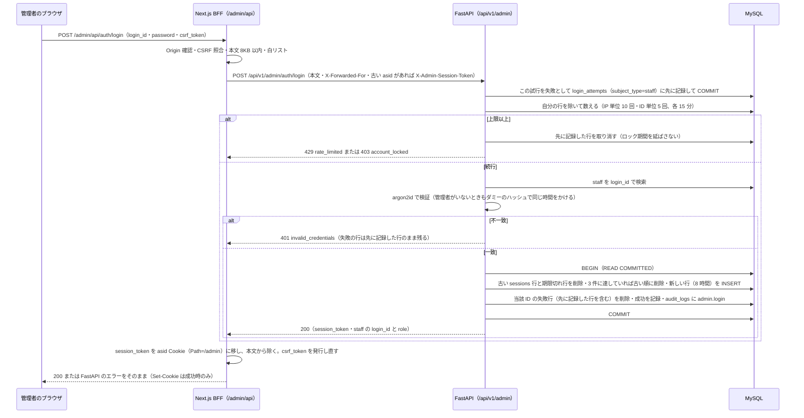
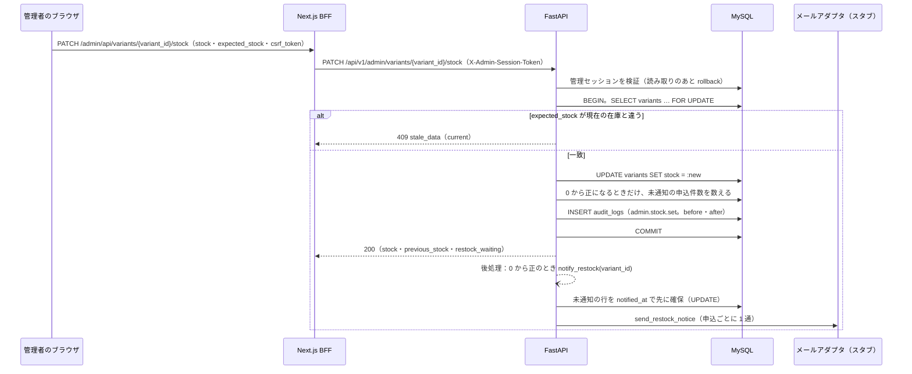
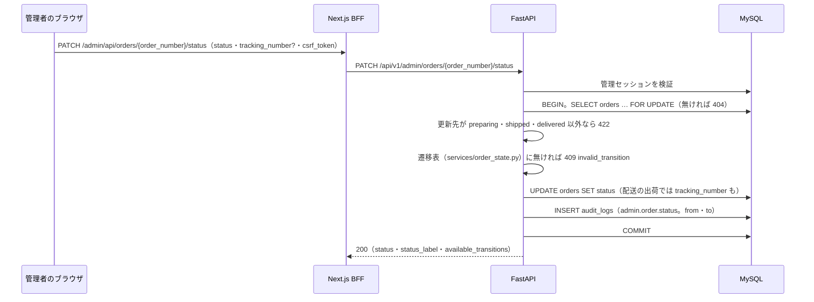

# GU EC サイト 設計仕様書（P2 追補c）

| 項目 | 内容 |
| --- | --- |
| 文書番号 | GUEC-SD-01-P2c |
| 版 | draft-v1 |
| 作成者 | Claude |
| 作成日 | 2026-10-20 |
| 入力 | 本編 `GU_ECsite_設計仕様書_P1_draft-v3.md`（2026-10-19 追補まで）、P2 追補a・追補b（`GU_ECsite_設計仕様書_P2追補a_draft-v1.md`・`GU_ECsite_設計仕様書_P2追補b_draft-v1.md`）、テスト設計書 P1 draft-v2 と P2 追補a・追補b、要求仕様書 with_ai v2.4、要件定義書 with_ai v1.3、`実装フェーズ計画.md`、ADR-0001・0004・0005・0006、`P2_事前レビュー観点_v1.md`、`セキュリティ点検記録_20261019.md`、実装（`apps/api/app/`・`apps/web/`）の 2026-10-20 時点の状態（P2-b のレーン A・D がコミット済み。B・C は作業中のため、関数名は追補b の記述を正とした） |
| 対象 | ADR-0006 の P2-c のうち、F-035 管理認証と分離（REQ-FR-1105）、F-031 管理：商品・在庫（REQ-FR-1101）、F-033 管理：注文（REQ-FR-1103）、F-032 管理：設定（REQ-FR-1102）。あわせて、F-007 再入荷通知の送信側（追補b の `notify_restock` を管理画面の在庫更新から呼ぶ） |

## 改訂履歴

| 版 | 日付 | 内容 | 作成 | 承認 |
| --- | --- | --- | --- | --- |
| draft-v1 | 2026-10-20 | 初稿。P2-c の追補設計を本編との差分として作成。DS-DEC-107〜126、DS-API 12 本、DS-PRC 11 件、マイグレーション 1 本（新規テーブルなし）、実装レーンの分け方（11 章）を含む。オーナーは「実装し切ってから最後にまとめて承認」と決めている（ADR-0006）ため、実装担当が迷わない粒度まで決定を書いた | Claude | — |
| draft-v1.1 | 2026-10-20 | 実装と手元の検収で見つかった食い違いを修正。6.2 の管理画面のレイアウトは redirect せず、各ページがデータ取得の 401・403 で `/admin/login` へ移す（レイアウトは現在のパスを知れず、ログイン画面が自分へ戻り続けるため）。注文一覧の期間は「両端を含む暦日数で 366 日まで、367 日以上は 422」と明記した。モックと範囲の記述の seed の商品数を 30 から 31 にした | Claude | — |
| draft-v1.2 | 2026-10-22 | セキュリティ点検 2026-10-21 の G-16・G-17・G-19 に合わせて更新。管理ログインの処理順（3.1 の図と DS-PRC-050）を追補b の DS-PRC-032 と同じ「試行を先に記録・COMMIT → 数える（自分を除く）→ 上限以上なら取り消して拒否 → 照合」にした。DS-DEC-110 に先に記録する方式と拒否ログの `subject` を足した | Claude | — |

## 0. 本書の位置づけ

本書は本編（`GU_ECsite_設計仕様書_P1_draft-v3.md`。以下「本編」）の追補であり、**本編・追補a・追補b との差分だけ**を書く。章番号は本編の 1〜10 章に対応させ、末尾に 11 章（実装レーンの分け方）を足した。本編・追補に書いてあって変わらない事項（BFF と FastAPI の 2 層、エラー応答の判定順序、CSRF と Origin の確認、argon2id、セッションの保存方式、メールアダプタの構造など）は再掲しない。

### 0.1 対象範囲

| 区分 | 内容 |
| --- | --- |
| 対象 | ①F-035 管理認証と分離：管理者のログイン・ログアウト、管理用セッション、会員のセッションで管理 API に入れない仕組み、ロック・回数制限、初期の管理者の作り方（REQ-FR-1105）<br>②F-031 管理：商品・在庫：商品の一覧・検索、公開と非公開の切り替え、価格の変更、バリエーションごとの在庫の変更、在庫が 0 から 1 以上になったときの再入荷通知の起動（REQ-FR-1101、REQ-FR-205 の送信側）<br>③F-033 管理：注文：一覧（状態・期間・注文番号・メールで絞る）、詳細、状態の更新（配送の出荷・配達完了、店舗受け取りの受け取り可能・受け渡し済）（REQ-FR-1103）<br>④F-032 管理：設定：税率・送料・送料無料の閾値の表示と更新（REQ-FR-1102）。ADR-0006 の削る順番の④。F-031・F-033 の後に作る<br>⑤管理操作の監査ログ（REQ-NFR-04） |
| 対象外（P3 以降または別の追補） | 商品の新規登録・商品名や説明の編集・画像のアップロード・カテゴリ割当の編集（DS-DEC-116）、クーポン・キャンペーンの設定（F-015。`coupons` 表が P3）、注文のキャンセル・期限切れ・返品・返金（F-018・F-019・F-037、BAT-02）、店舗でのコード照合による引き渡し（F-038）、不正検知の手動解除（F-039）、コンテンツ管理（F-034）、管理者の追加・削除・パスワード変更の画面、監査ログの閲覧画面と 90 日削除ジョブ（DS-DEC-120） |
| ADR-0006 の他の項目 | IF-02 メールの実送信（削る順番の①）は、メールアダプタの差し替えで行う別作業であり、本書は `app/adapters/mail.py` を変更しない。再入荷通知は追補b のスタブ（開発はファイル出力、本番はログに種別だけ）で送る |

### 0.2 設計 ID の追加・変更

本編の ID 体系をそのまま使う。本書が新設・詳細化・変更する ID は次のとおり。

| 種別 | ID | 区分 |
| --- | --- | --- |
| API（12 本） | DS-API-050 | 本編に概要のみ。4.1 で詳細化（管理ログイン） |
| API | DS-API-050a・050b | 新設（管理ログアウト、管理者情報の取得） |
| API | DS-API-051 | 本編に概要のみ（GET/POST/PATCH を 1 行にまとめていた）。4.2 で「商品一覧」に詳細化。POST（新規登録）は作らない（DS-DEC-116） |
| API | DS-API-051a・051b・051c | 新設（商品詳細、商品の更新、在庫の更新） |
| API | DS-API-052 | 本編に概要のみ。4.3 で「設定の取得」に詳細化 |
| API | DS-API-052a | 新設（設定の更新） |
| API | DS-API-053 | 本編に概要のみ。4.4 で「注文の検索」に詳細化 |
| API | DS-API-053a・053b | 新設（注文詳細、注文状態の更新） |
| BFF | 7 本 | 4.5。管理者のログイン・ログアウト・CSRF トークンの発行・商品の更新・在庫の更新・設定の更新・注文状態の更新 |
| 処理（11 件） | DS-PRC-050・050b | 管理ログインとセッション発行、管理セッションの検証 |
| 処理 | DS-PRC-051・051b・051c | 商品一覧の検索、商品の更新、在庫の変更と再入荷通知の起動 |
| 処理 | DS-PRC-052 | 設定の更新 |
| 処理 | DS-PRC-053・053b・053c | 注文の検索、注文状態の更新、個人情報のマスク |
| 処理 | DS-PRC-054・055 | 管理操作の監査ログ、更新前の値の照合 |
| テーブル（変更 2 表。新規なし） | DS-TBL-04 `staff`・DS-TBL-23 `audit_logs` | 制約と索引の追加（5.2） |
| テーブル（使い方の確定 2 表） | DS-TBL-03 `sessions`・DS-TBL-26 `login_attempts` | `subject_type=staff` の使い方（5.3） |
| 画面 | DS-SCR-014・015・016 | 本編・要件定義書 5.2 に概要行のみ。6 章でワイヤーを新設（015 は 015-1〜015-4 に分ける） |
| 画面（変更） | ルートレイアウト | 管理画面では顧客向けのヘッダー・フッターを出さない（DS-DEC-122） |
| 判断 | DS-DEC-107〜126（20 件） | 9.1 に一覧 |

## 1. 構成への影響（本編 1 章の差分）

構成図（本編 1 章）の要素と矢印は変わらない。差分は次の 4 点。

1. 管理画面は同じ Next.js の `/admin/*` に置く。管理用の BFF（Route Handler）は `/admin/api/*` に置く。FastAPI の管理 API は `/api/v1/admin/*` に隔離する（DS-DEC-107）。
2. ブラウザが送る Cookie に管理用セッション `asid`（HttpOnly・SameSite=Strict・`Path=/admin`）が加わる。BFF は `asid` の値を `X-Admin-Session-Token` ヘッダに移して FastAPI を呼ぶ。会員の `sid`（`X-Session-Token`）とは別の Cookie・別のヘッダで、BFF は管理 API に `sid` を渡さない（DS-DEC-108・109）。
3. `/admin/*` のページ（Server Component）は、会員向けのページと同じく FastAPI を直接呼ぶ（本編 4.3 の原則）。このときも `X-Admin-Session-Token` を付ける。
4. 管理画面の応答はルートレイアウトの顧客向けのヘッダー・フッター・カートを出さない（DS-DEC-122）。公開サイトから管理画面へのリンクは置かない（要件定義書 5.3 の管理導線）。

## 2. 版・依存の追加（本編 2 章の差分）

追加なし。パスワードのハッシュ化は追補b の `argon2-cffi` と `app/core/passwords.py` を共用する。フロントも `apps/web/package.json` を変えない。

## 3. シーケンス／アクティビティ（本編 3 章の差分）

### 3.1 管理ログイン（DS-PRC-050）

追補b 3.1（会員のログイン）との違いだけを示す。IP 単位の閾値、`members` を引かないこと、セッションの期限と同時数が異なる。



### 3.2 在庫の変更と再入荷通知（DS-PRC-051c）



### 3.3 注文状態の更新（DS-PRC-053b）



## 4. API 設計（本編 4 章の差分）

### 4.0 共通方針

- FastAPI のパスはすべて `/api/v1/admin` の下で、内部トークン（`X-Internal-Token`）に加えて管理用セッション（`X-Admin-Session-Token`）が必須（DS-API-050 のログインだけは管理用セッションを要しない）。以下の表のパスは `/api/v1/admin` を省いて書く。
- 管理 API のルーターは**既定で拒否**にする。`app/routers/admin/__init__.py` が、ログインを除くすべての管理ルートを `dependencies=[Depends(require_staff)]` つきの 1 つのルーターにまとめる。ルートを足した人が認証の依存関数を書き忘れても、無認証では通らない（DS-DEC-109）。
- 状態を変える BFF（POST・PATCH）は、先頭で `verifyCsrf`（Origin の確認 → Double Submit Cookie の照合。本編 7.7 S6）を通し、本文を 8192 バイトまでに制限する（S2）。一覧・詳細の GET は BFF を作らず、`/admin/*` のページ（Server Component）が FastAPI を直接呼ぶ。
- 更新系の要求は、更新する値と、画面が表示していた**更新前の値**（`expected_<項目名>`）を一組にして送る。サーバーは対象の行を `SELECT … FOR UPDATE` で読み、現在の値が `expected_*` と一致するときだけ更新する。不一致は 409 `stale_data`（`field`・`current`）。DS-API-053b（注文状態）だけは、更新先の状態から更新前の状態が一意に決まるため `expected_*` を使わない（DS-DEC-113）。
- 要求の本文に定義外の項目があっても無視する（Pydantic の既定。mass assignment を許さない。値は反映されない）。
- 応答に内部 ID を出さない。注文は注文番号で指し、会員・管理者の内部 ID は出さない。商品側の `product_id`・`variant_id` は管理者にだけ出す（本編 7.5。管理者向けの画面で更新先の宛先に要るため）。
- 日時は UTC の ISO 8601 で返し、画面で JST に直す（DS-DEC-16）。期間の絞り込みの日付だけは JST の暦日として受ける（DS-DEC-125）。
- 一覧は `page`（1 以上、既定 1）、`per_page`（1〜100、既定 20）を受け、`{"items", "page", "per_page", "total", "has_more"}` を返す。0 件でも 200 で `items` は空配列。
- 400 と 422 の境目（DS-DEC-124）：型・形式・必須欠落・桁あふれ（絶対値が 2,147,483,647 を超える整数）は 400。形は正しいが業務の範囲外（在庫・価格・設定の範囲、期間の組み合わせ、未対応の更新先）は 422。
- 新しいエラーコードは `stale_data` の 1 つ（4.7）。ほかは本編・追補b のコードを使う。
- 回数制限は、BFF の全体制限（本編 7.7 S1、IP ごとに `/api/*` 120 回/分）と、ログインの個別制限（DS-API-050。DB の `login_attempts`）の 2 つ。管理 API の個別の回数制限は足さない（DS-DEC-126）。
- 全応答に `Cache-Control: no-store` が付く（既存のミドルウェア。本編 7.7 S5）。管理 API で上書きしない。

### 4.1 認証 API（DS-API-050・050a・050b）

#### DS-API-050 管理ログイン

| 項目 | 内容 |
| --- | --- |
| メソッド・パス | `POST /auth/login`。BFF の窓口は `POST /admin/api/auth/login` |
| 要求 | `{"login_id", "password"}`。login_id は NFKC 正規化・前後空白除去・小文字化のあと `^[a-z0-9][a-z0-9._-]{2,49}$`。password は NFKC 正規化のあと 1〜128 文字（最小長は課さない。seed で入れた値を締め出さないため。追補b の DS-API-032 と同じ）。BFF は Cookie `asid` があれば `X-Admin-Session-Token` に載せる（古いセッションの削除に使う）。BFF は `X-Forwarded-For` に利用者の IP を載せる |
| 応答 | 200 `{"session_token", "staff": {"login_id", "role"}}`。BFF は `session_token` を Cookie `asid` にし、ブラウザへ返す本文から除く |
| エラー | 400 `validation_error`／401 `invalid_credentials`（管理者がいない・パスワード違いを区別しない）／403 `account_locked`（ID 単位で 15 分に 5 回失敗。正しいパスワードでも返す。残り時間や回数は返さない）／429 `rate_limited`（IP 単位で 15 分に 10 回失敗。`Retry-After: 900`） |
| 副作用 | DS-PRC-050。成功時、その ID の失敗行を削除し、セッションを再発行し、`audit_logs` に `admin.login` を記録する |
| CSRF・回数制限 | CSRF 必須。DB の `login_attempts`（`subject_type=staff`）で制限する（DS-DEC-110）。BFF は成功時・失敗時のどちらも `Cache-Control: no-store` を付ける |

#### DS-API-050a 管理ログアウト

| 項目 | 内容 |
| --- | --- |
| メソッド・パス | `POST /auth/logout`。BFF の窓口は `POST /admin/api/auth/logout`（GET にしない） |
| 要求 | 本文なし。`X-Admin-Session-Token` |
| 応答 | **204**。セッションが無効・不明でも 204（冪等）。管理用セッションの検証（`require_staff`）は通さず、トークンの SHA-256 に一致する `subject_type=staff` の行があれば削除する（会員の行は削除しない） |
| 副作用 | `sessions` の該当行を削除する。行があったときだけ `audit_logs` に `admin.logout`。BFF は成功・失敗にかかわらず `asid` の削除 Cookie（`Max-Age=0`、`Path=/admin`）を返し、`csrf_token` を発行し直す |
| CSRF・回数制限 | CSRF 必須。BFF の全体制限のみ |

#### DS-API-050b 管理者情報の取得

| 項目 | 内容 |
| --- | --- |
| メソッド・パス | `GET /me`。BFF の窓口なし（`/admin` のレイアウトが直接呼ぶ。シェルを付けるかの判定と、画面右上の表示に使う） |
| 要求 | `X-Admin-Session-Token` |
| 応答 | 200 `{"login_id", "role"}`。パスワードのハッシュ・内部 ID は返さない |
| エラー | 401 `unauthorized`（セッションなし・不明・期限切れ・管理者の行が無い）／403 `forbidden`（会員のセッションを提示した・ロールが許可外） |

### 4.2 商品・在庫 API（DS-API-051・051a・051b・051c）

#### DS-API-051 商品一覧

| 項目 | 内容 |
| --- | --- |
| メソッド・パス | `GET /products?q=&visibility=&stock=&page=&per_page=`。BFF の窓口なし |
| 要求 | `q` は NFKC 正規化・前後空白除去のあと 50 文字以内（空なら条件なし）。`visibility` は `all`（既定）・`public`・`private`。`stock` は `all`（既定）・`out`（在庫 0 のバリエーションが 1 つ以上ある商品）。`page`・`per_page` は 4.0 の共通。範囲外・列挙外は 400 `validation_error` |
| 応答 | 200 `{"items": [{"product_id", "name", "price_incl_tax", "published", "variant_count", "total_stock", "out_of_stock_variants"}], "page", "per_page", "total", "has_more"}`。`product_id` の昇順。`q` は商品名の部分一致、または SKU の前方一致（英字は大文字に直して照合）。`%`・`_`・`\` はそのままの文字として扱う（DS-PRC-051） |
| エラー | 400 `validation_error`／401／403 |

#### DS-API-051a 商品詳細

| 項目 | 内容 |
| --- | --- |
| メソッド・パス | `GET /products/{product_id}`。BFF の窓口なし |
| 要求 | パスの `product_id` は 1 以上 9223372036854775807 以下の整数（外れたら 400） |
| 応答 | 200 `{"product_id", "name", "price_incl_tax", "published", "updated_at", "variants": [{"variant_id", "sku", "color", "size", "stock", "restock_waiting"}]}`。`variants` は `variant_id` の昇順。`restock_waiting` は未通知の再入荷申込の**件数**だけ（メールアドレスは返さない。DS-DEC-118 の考え方） |
| エラー | 400／401／403／404 `not_found`（商品がない。非公開でも管理者には返す） |

#### DS-API-051b 商品の更新

| 項目 | 内容 |
| --- | --- |
| メソッド・パス | `PATCH /products/{product_id}`。BFF の窓口は `PATCH /admin/api/products/[productId]` |
| 要求 | `{"published"?: bool, "price_incl_tax"?: int, "expected_published"?: bool, "expected_price_incl_tax"?: int}`。変更する項目には対応する `expected_*` が必須（無ければ 400 `required`）。変更する項目が 1 つもなければ 400（`name: "body"`、reason `required`）。`price_incl_tax` は 1 以上 1,000,000 以下の整数（税込・円。業務の範囲） |
| 応答 | 200 `{"product_id", "published", "price_incl_tax", "changed": bool, "updated_at"}`。要求の値が現在の値と同じで `expected_*` も一致するときは、更新も監査ログもせず `changed: false` |
| エラー | 400 `validation_error`（型・桁あふれ・`expected_*` の欠落）／401／403／404 `not_found`／422 `unsupported_value`（価格が 1 未満。`field`）／422 `limit_exceeded`（価格が 1,000,000 超。`field`・`limit`）／409 `stale_data`（`field`・`current`） |
| 副作用 | DS-PRC-051b。`audit_logs` に `admin.product.update`（変更した項目の前後の値） |
| CSRF・回数制限 | CSRF 必須。BFF の全体制限のみ |

#### DS-API-051c 在庫の更新

| 項目 | 内容 |
| --- | --- |
| メソッド・パス | `PATCH /variants/{variant_id}/stock`。BFF の窓口は `PATCH /admin/api/variants/[variantId]/stock` |
| 要求 | `{"stock": int, "expected_stock": int}`。`stock` は 0 以上 9999 以下の整数（絶対値の SET。差分ではない。業務の範囲）。`expected_stock` は 0 以上 2,147,483,647 以下の整数（画面が表示していた在庫） |
| 応答 | 200 `{"variant_id", "sku", "stock", "previous_stock", "changed": bool, "restock_waiting": int}`。`restock_waiting` は、在庫が 0 から 1 以上になったときだけ、更新の時点の未通知の申込件数（それ以外は 0）。メールの送信は応答のあとの後処理（DS-PRC-051c） |
| エラー | 400 `validation_error`（型・桁あふれ・`expected_stock` の欠落）／401／403／404 `not_found`（バリエーションがない）／422 `unsupported_value`（`stock` が 0 未満）／422 `limit_exceeded`（`stock` が 9999 超。`field`・`limit`）／409 `stale_data`（`field: "stock"`・`current`） |
| 副作用 | DS-PRC-051c。`audit_logs` に `admin.stock.set`（SKU・前後の値・待ち件数）。0 から 1 以上のとき、COMMIT のあとに `notify_restock(variant_id)` を後処理で呼ぶ |
| CSRF・回数制限 | CSRF 必須。BFF の全体制限のみ |

### 4.3 設定 API（DS-API-052・052a）

#### DS-API-052 設定の取得

| 項目 | 内容 |
| --- | --- |
| メソッド・パス | `GET /settings`。BFF の窓口なし |
| 要求 | `X-Admin-Session-Token` |
| 応答 | 200 `{"items": [{"key", "label", "value", "editable", "unit", "min", "max"}]}`。4 件を次の順で返す：`tax_rate`（消費税率。値は `"0.10"` の文字列。`min`: `"0.00"`・`max`: `"0.30"`）、`shipping_fee`（送料。円。0〜5000）、`free_shipping_threshold`（送料無料の下限。円。0〜100000）、`payment_timeout_minutes`（決済待ちの期限。分。`editable: false`。表示のみ） |
| エラー | 401／403／500 `internal_error`（キーが欠けているなど設定の投入漏れ。公開設定 DS-API-020 と同じ扱い） |

#### DS-API-052a 設定の更新

| 項目 | 内容 |
| --- | --- |
| メソッド・パス | `PATCH /settings`。BFF の窓口は `PATCH /admin/api/settings` |
| 要求 | `{"tax_rate"?: str, "shipping_fee"?: int, "free_shipping_threshold"?: int, "expected_tax_rate"?: str, "expected_shipping_fee"?: int, "expected_free_shipping_threshold"?: int}`。変更するキーには対応する `expected_*` が必須。`tax_rate` は `^[0-9]\.[0-9]{2}$`（形）で、業務の範囲は 0.00〜0.30。`shipping_fee` は 0〜5000、`free_shipping_threshold` は 0〜100000 の整数。`payment_timeout_minutes` は更新できない（送っても無視） |
| 応答 | 200 `{"items": [...更新後の 4 件（DS-API-052 と同じ形）], "changed": ["tax_rate", ...]}`。全項目が現在の値と同じなら `changed: []` で更新も監査ログもしない |
| エラー | 400 `validation_error`（型・形・桁あふれ・`expected_*` の欠落・変更するキーなし）／401／403／422 `unsupported_value`（下限未満。`field`）／422 `limit_exceeded`（上限超え。`field`・`limit`）／409 `stale_data`（`field`・`current`）。複数のキーのうち 1 つでも失敗したら、全体を更新しない |
| 副作用 | DS-PRC-052。`audit_logs` に `admin.settings.update`（変更したキーの前後の値） |
| CSRF・回数制限 | CSRF 必須。BFF の全体制限のみ |

### 4.4 注文 API（DS-API-053・053a・053b）

#### DS-API-053 注文の検索

| 項目 | 内容 |
| --- | --- |
| メソッド・パス | `GET /orders?status=&receive_method=&from=&to=&order_number=&email=&page=&per_page=`。BFF の窓口なし |
| 要求 | `status` は `all`（既定）または注文状態の 8 値。`receive_method` は `all`（既定）・`delivery`・`store`。`from`・`to` は `YYYY-MM-DD`（JST の暦日。両端を含む。どちらか片方だけでもよい）。`order_number` は注文番号の完全一致（前後空白除去・大文字化のあと `^GU-[0-9]{6}-[A-HJ-NP-Z2-9]{8}$`）。`email` は連絡先メールの完全一致（追補b の DS-API-030 と同じ正規化のあと 254 文字以内）。すべて AND で絞る。部分一致の検索は作らない（DS-DEC-118）。`page`・`per_page` は 4.0 の共通 |
| 応答 | 200 `{"items": [{"order_number", "ordered_at", "status", "status_label", "receive_method", "total", "item_count", "customer_type", "email_masked"}], "page", "per_page", "total", "has_more"}`。`ordered_at`（`orders.created_at`）の新しい順（同時刻は `id` の降順）。`customer_type` は `member` または `guest`。`email_masked` は `t***@example.com` の形。氏名・電話・住所は一覧に出さない |
| エラー | 400 `validation_error`（形式・列挙外）／401／403／422 `unsupported_value`（`from` が `to` より後。`field: "to"`）／422 `limit_exceeded`（期間が 366 日を超える。期間は両端を含む暦日数で数え、366 日までは成功、367 日以上は 422。`field: "to"`・`limit: 366`） |

#### DS-API-053a 注文詳細

| 項目 | 内容 |
| --- | --- |
| メソッド・パス | `GET /orders/{order_number}`。BFF の窓口なし |
| 要求 | パスの `order_number` は `^GU-[0-9]{6}-[A-HJ-NP-Z2-9]{8}$`。形が違えば 404（存在しないと区別しない） |
| 応答 | 200 次の表のとおり |
| エラー | 401／403／404 `not_found` |
| 副作用 | `audit_logs` に `admin.order.view`（個人情報の閲覧の記録。DS-DEC-118）。記録に失敗したときは、個人情報を返さず 500 にする |

応答の項目：

| 項目 | 型 | 内容 |
| --- | --- | --- |
| `order_number`・`ordered_at`・`status`・`status_label` | 文字列 | 追補b の DS-PRC-024a の表示名（`app/services/order_status.py`）を使う |
| `receive_method` | `delivery` または `store` | |
| `store` | オブジェクトまたは null | `{"name", "prefecture", "address"}`。`store` のときだけ。内部 ID・郵便番号は含めない |
| `items` | 配列 | `[{"product_name", "color", "size", "unit_price", "quantity"}]`。注文時点の値（`order_items`） |
| `subtotal`・`shipping_fee`・`discount`・`total`・`tax_included`・`tax_rate` | 整数・文字列 | 金額（円）。`tax_included` は `total` と `tax_rate_at_order` から求める（DS-PRC-021 と同じ計算） |
| `payment` | オブジェクト | `{"provider", "result"}`。最新の `payments` の行。カード情報は保存していないので出ない |
| `customer` | オブジェクト | `{"type", "name", "email_masked", "phone_masked", "postal_code"?, "address"?}`。`postal_code`・`address` は配送のときだけ（店舗受け取りでは店舗の値のため出さない）。電話は末尾 4 桁だけ残す。**受け取りコード（`pickup_code`）は返さない** |
| `tracking_number` | 文字列または null | 配送で登録済みのとき |
| `available_transitions` | 配列 | `[{"status", "label", "accepts_tracking_number"}]`。いまの状態から、この API で更新できる次の状態（4.6 の DS-PRC-053b）。ラベルは `status_label(更新先, receive_method)`。`accepts_tracking_number` は更新先が `shipped` かつ配送のときだけ真 |

#### DS-API-053b 注文状態の更新

| 項目 | 内容 |
| --- | --- |
| メソッド・パス | `PATCH /orders/{order_number}/status`。BFF の窓口は `PATCH /admin/api/orders/[orderNumber]/status` |
| 要求 | `{"status": str, "tracking_number"?: str}`。`status` は注文状態の 8 値のいずれか（列挙外は 400）。`tracking_number` は `^[A-Za-z0-9-]{1,50}$` |
| 応答 | 200 `{"order_number", "status", "status_label", "tracking_number", "available_transitions"}`（形は DS-API-053a と同じ） |
| エラー | 400 `validation_error`（列挙外・追跡番号の形）／401／403／404 `not_found`（形が違う番号を含む）／422 `unsupported_value`（①更新先が `preparing`・`shipped`・`delivered` 以外。`field: "status"`。②`tracking_number` を、店舗受け取りの注文、または更新先が `shipped` 以外のときに送った。`field: "tracking_number"`）／409 `invalid_transition`（`from`・`to`。遷移表に無い遷移。決済待ち・決済失敗・キャンセル済・受取期限切れ・配達完了の注文を含む） |
| 副作用 | DS-PRC-053b。`audit_logs` に `admin.order.status`（前後の状態・受け取り方法・追跡番号の有無）。顧客へのメールは送らない（DS-DEC-117） |
| CSRF・回数制限 | CSRF 必須。BFF の全体制限のみ |

### 4.5 BFF の窓口（本編 4.3 の差分）

| パス | メソッド | 取り次ぎ先 | 備考 |
| --- | --- | --- | --- |
| `/admin/api/auth/login` | POST | DS-API-050 | 本文の項目を白リストで拾う（login_id・password）。成功時に `asid` を発行し、本文から `session_token` を除く。`csrf_token` を発行し直す |
| `/admin/api/auth/logout` | POST | DS-API-050a | `asid` を削除する（失敗時も）。`csrf_token` を発行し直す |
| `/admin/api/csrf` | GET | なし（BFF だけで完結） | `csrf_token` Cookie が未発行なら発行する。204。ログイン画面が最初の POST の前に呼ぶ（DS-DEC-121）。FastAPI は呼ばない |
| `/admin/api/products/[productId]` | PATCH | DS-API-051b | 白リスト：published・price_incl_tax・expected_published・expected_price_incl_tax。型が違えば 400（FastAPI を呼ばない） |
| `/admin/api/variants/[variantId]/stock` | PATCH | DS-API-051c | 白リスト：stock・expected_stock |
| `/admin/api/settings` | PATCH | DS-API-052a | 白リスト：tax_rate・shipping_fee・free_shipping_threshold と対応する `expected_*` |
| `/admin/api/orders/[orderNumber]/status` | PATCH | DS-API-053b | 白リスト：status・tracking_number |
| Server Component から直接 | GET | DS-API-050b・051・051a・052・053・053a | `lib/server/admin.ts`（新設）が Cookie `asid` を読み、`X-Admin-Session-Token` を付けて呼ぶ。401・403 のときは `redirect("/admin/login")` |

BFF の Route Handler は 7 本（認証 2 本・CSRF 発行 1 本・更新 4 本）。共通の取り決め：

- `asid` が無い、または形が `^[A-Za-z0-9_-]{43}$` でない変更系の要求は、FastAPI を呼ばずに 401 `unauthorized` を返す。
- FastAPI へ渡すヘッダは `X-Admin-Session-Token`（`asid` の値）と `X-Forwarded-For`。会員の `sid`・`cart_token` は渡さない。
- FastAPI のエラーは `sanitizeErrorBody` を通した `{code, ...}` をそのまま返す。許可する詳細キーに `current` を足す（`stale_data` 用。`apps/web/lib/server/api.ts` の `ALLOWED_ERROR_DETAIL_KEYS`）。
- 接続不可は 503 `upstream_unavailable`。パスワードやトークンは、本文にもログにも書かない。

### 4.6 処理仕様

#### DS-PRC-050 管理ログインとセッション発行

図は 3.1。判定の順序と数値は次のとおり。会員のログイン（追補b の DS-PRC-032）と同じ構造で、違いは太字で示す。

1. 入力検査（Pydantic）。login_id と password は検査の前に NFKC 正規化する。
2. `ip` を `client_ip(request)` で決める。`identifier` は正規化した login_id の SHA-256（16 進 64 文字）。
3. **試行を先に記録して数える**（G-16。追補b の DS-PRC-032 手順 3 と同じ `claim_login_attempt`・`withdraw_login_attempt`）。パスワードの検証より前に、この試行を失敗（`succeeded=false`、`subject_type=staff`）として INSERT して COMMIT し、COMMIT のあとで `login_attempts` を `subject_type=staff` だけで集計する。**自分の行は数えない**。上限以上のときは、検証せずに、先に記録した行を取り消して（ロック期間が延びない）拒否する。`ip` が一致する失敗が直近 15 分で **10 件**以上なら 429 `rate_limited`（`Retry-After: 900`）。`identifier` が一致する失敗が直近 15 分で 5 件以上なら 403 `account_locked`。この 2 つはパスワードの検証より前に判定する。**会員のログインの失敗行は数えない**（互いに影響させない。DS-DEC-110）。
4. `staff` を login_id で検索する。**管理者がいない場合も、固定のダミーハッシュに対して検証する**（時間を揃える）。
5. 検証が失敗したら、失敗の行は手順 3 で記録済みなので追加せず、401 `invalid_credentials` を返す。**ロック通知メールは送らない**（`staff` にメールの列がない）。
6. 検証が成功したら、`check_needs_rehash` を調べ、違うときは再ハッシュする（更新は手順 7 の最初の文）。
7. 1 トランザクション（READ COMMITTED）で、文を `staff` → `sessions` → `login_attempts` の順に発行する。①再ハッシュがあれば `staff.password_hash` を UPDATE する。②`X-Admin-Session-Token` が指す古い `sessions` 行を削除する。③この管理者の期限切れの行を削除する。④この管理者の有効なセッションが **3 件**に達していれば、古い順に削除して 2 件にする。⑤新しい `sessions` 行を INSERT する（`subject_type=staff`、`expires_at` は現在 + **8 時間**の固定。延長しない）。⑥`identifier` の失敗行（手順 3 で先に記録した自分の行を含む）を削除し、成功を 1 件記録する。⑦`audit_logs` に `admin.login`（`detail` は丸めた IP だけ）を記録する。ロック競合（MySQL の 1213・1205）が起きたときは ROLLBACK して手順 7 を 1 回だけやり直す。
8. 24 時間より古い `login_attempts` の行を最大 1000 件、ついでに削除する（追補b の DS-PRC-032 手順 8 と同じ掃除）。
9. 新しいセッショントークン（32 バイト乱数の base64url 43 文字）を応答に入れる。DB には SHA-256 だけを保存する。
10. 拒否ログ（`request_rejected`）には、`subject`（`identifier` の先頭 12 桁。G-19）を付ける。対象は、このログインの 401・403・429。ID そのものは出さない。

#### DS-PRC-050b 管理セッションの検証（`app/core/admin_session.py`）

`require_staff` は管理 API のルーターに掛ける依存関数。追補b の DS-PRC-035（会員のセッション検証）と対にする。

1. `X-Admin-Session-Token` が無い、または `^[A-Za-z0-9_-]{43}$` でなければ 401 `unauthorized`。
2. `token_hash = SHA-256(token)` の 16 進 64 文字で `sessions` を、**`subject_type` を問わず**検索する。`expires_at > 現在時刻（UTC）` の行だけを有効とする。無ければ 401 `unauthorized`。
3. 行が `subject_type = member` なら、会員のセッションが管理 API に提示されたことになる。403 `forbidden` を返し、拒否ログを 1 行出す（`log_rejection`。会員の情報は出さない。DS-DEC-109）。
4. 行が `subject_type = staff` なら、`staff` を主キー検索する。行が無ければ 401 `unauthorized`。
5. `staff.role` が許可するロールの集合（`ALLOWED_ROLES = {"staff"}`）に無ければ 403 `forbidden`。
6. 有効なら `CurrentStaff(id, login_id, role)`（ORM 行ではなく値のコピー）を返す。検証が終わったら読み取りのトランザクションを `rollback()` で終え、そのあとのサービスが新しいスナップショットで始められるようにする（追補b の `get_optional_member` と同じ）。
7. `last_seen_at` は更新しない（DS-DEC-108）。

会員側の `get_current_member` は、追補b のとおり `subject_type=staff` の行を常に無効とする（逆方向の分離）。

#### DS-PRC-051 商品一覧の検索

1. 入力検査（Pydantic。`q` の長さ、`visibility`・`stock` の列挙、`page`・`per_page` の範囲）。
2. `variants` を `product_id` で 1 回集計するサブクエリを作る：`COUNT(*)`（バリエーション数）、`COALESCE(SUM(stock), 0)`（在庫合計）、`SUM(CASE WHEN stock = 0 THEN 1 ELSE 0 END)`（在庫 0 のバリエーション数）。
3. `visibility` は `products.published` で、`stock=out` は在庫 0 のバリエーション数が 1 以上で絞る。
4. `q` は `products.name LIKE '%…%'`、または `EXISTS (SELECT 1 FROM variants WHERE product_id = products.id AND sku LIKE '…%')` のどちらかに一致する商品に絞る。**LIKE のワイルドカード（`%`・`_`）と `\` は SQLAlchemy の `contains(q, autoescape=True)`・`startswith(q.upper(), autoescape=True)` でエスケープし、文字としてそのまま扱う**。文字列の連結で SQL を作らない。
5. 本体 1 回と件数の `COUNT` 1 回で返す（商品ごとの追加クエリを出さない。N+1 にしない）。並びは `products.id` の昇順。

#### DS-PRC-051b 商品の更新

1. 入力検査（Pydantic）：型、桁あふれ、変更する項目と `expected_*` の対応、変更する項目が 1 つ以上あること（`model_validator`）。
2. 1 トランザクションを始め、`SELECT … FROM products WHERE id = :id FOR UPDATE`。無ければ 404 `not_found`。
3. `price_incl_tax` を変更するなら、業務の範囲（1〜1,000,000）を検査する（外れたら 422）。
4. 変更する項目ごとに、DS-PRC-055 で現在の値と `expected_*` を照合する（`published`、`price_incl_tax` の順）。不一致は ROLLBACK して 409 `stale_data`。
5. 要求の値が現在の値と同じ項目は更新から外す。残りが無ければ ROLLBACK して `changed: false` を返す。
6. `UPDATE products SET …`（変更する項目だけ）。`updated_at` は DB が更新する。
7. DS-PRC-054 で `admin.product.update` を記録する。`detail` は変更した項目の `{"before", "after"}`。
8. COMMIT。非公開にした商品は、公開側の API（DS-API-002・003）の `published_filter` で自動的に見えなくなる（追加の処理は不要）。

#### DS-PRC-051c 在庫の変更と再入荷通知の起動

図は 3.2。

1. 入力検査（Pydantic）：`variant_id` の範囲、`stock`・`expected_stock` が整数（真偽値・文字列・小数・null は 400）で、絶対値が 2,147,483,647 以下。
2. 1 トランザクションを始め、`SELECT id, sku, stock FROM variants WHERE id = :id FOR UPDATE`。無ければ 404。
3. `stock` の業務の範囲（0〜9999）を検査する（外れたら 422）。
4. DS-PRC-055 で `expected_stock` と現在の在庫を照合する。不一致は ROLLBACK して 409 `stale_data`（`current` に現在の在庫）。
5. `stock` が現在の在庫と同じなら、ROLLBACK して `changed: false`（更新・監査・通知なし）。
6. `UPDATE variants SET stock = :stock WHERE id = :id`（絶対値の SET）。
7. 更新前の在庫が 0 かつ更新後が 1 以上のとき（以下「再入荷」）、`SELECT COUNT(*) FROM restock_notifications WHERE variant_id = :id AND notified_at IS NULL` を数える（`restock_waiting`）。それ以外は 0。
8. DS-PRC-054 で `admin.stock.set` を記録する。`detail` は `{"sku", "before", "after", "restock_waiting"}`。
9. COMMIT。
10. 再入荷のとき、応答を返したあとの後処理（`BackgroundTasks`）で `notify_restock(variant_id)`（追補b の DS-PRC-007a。自分の DB セッションを開く）を呼ぶ。申込が 0 件でも呼ぶ（COMMIT の直前に申し込んだ人を取りこぼさないため）。後処理の例外は握り、種別（例外の型名）だけをログに出す。在庫の更新の結果・応答には影響させない。
11. 後処理が動くまでに在庫が 0 に戻った場合、`notify_restock` は何も送らず、申込は未通知のまま残る（DS-PRC-007a の手順 1。次の再入荷で送られる）。

#### DS-PRC-052 設定の更新

1. 入力検査（Pydantic）：型、`tax_rate` の形、桁あふれ、変更するキーと `expected_*` の対応、変更するキーが 1 つ以上あること。
2. 業務の範囲を、変更するすべてのキーについて先に検査する（`tax_rate` は 0.00〜0.30、`shipping_fee` は 0〜5000、`free_shipping_threshold` は 0〜100000）。1 つでも外れたら、何も更新せず 422。
3. 1 トランザクションを始め、変更するキーの行を**キー名の昇順**で `SELECT … FOR UPDATE`（同時更新どうしの待ちが循環しないよう、順序を固定する）。行が無ければ 500（設定の投入漏れ）。
4. キーごとに DS-PRC-055 で照合する。1 つでも不一致なら ROLLBACK して 409 `stale_data`（最初に不一致だったキー）。
5. 値が変わるキーだけ `UPDATE system_settings SET value = :v`。変わるキーが無ければ ROLLBACK して `changed: []`。
6. DS-PRC-054 で `admin.settings.update` を記録する（変更したキーの `{"before", "after"}`）。
7. COMMIT。公開側は `GET /api/v1/settings/public` と金額計算が毎回 DB を読むため、次のアクセスから反映される。注文手続きの途中で変更されると、確認画面の金額と注文確定時の再計算がずれ、利用者は 409 `price_changed` を受ける（既存の挙動）。

#### DS-PRC-053 注文の検索

1. 入力検査（Pydantic）：列挙、日付の形（実在する日付）、`order_number` の形、`email` の正規化と形。
2. サービス層で組み合わせを検査する：`from` が `to` より後なら 422 `unsupported_value`、期間が 366 日を超えるなら 422 `limit_exceeded`。期間の日数は `(to − from) の日数 + 1`（両端を含む暦日数）で、366 日までは成功、367 日以上は 422 とする。
3. 期間は JST の暦日として扱い、`created_at >= from の 00:00:00（JST）を UTC に直した値 AND created_at < to の翌日の 00:00:00（JST）を UTC に直した値` で絞る（DS-DEC-125）。
4. 状態・受け取り方法・注文番号・メールは等値で絞る（メールは `orders.guest_email`。会員の注文では連絡先メールが入っている。追補b の DS-API-022 の備考）。
5. 本体 1 回、件数の `COUNT` 1 回、ページ内の注文 ID に対する `order_items` の集計 1 回（`item_count`）の合計 3 回以内で返す。並びは `created_at` の降順、同時刻は `id` の降順。
6. 氏名・電話・住所は読み出さない。メールは DS-PRC-053c でマスクする。

#### DS-PRC-053b 注文状態の更新

図は 3.3。

1. 入力検査（Pydantic）：`status` が 8 値のいずれか、`tracking_number` の形。パスの `order_number` の形が違えば 404。
2. 1 トランザクションを始め、`SELECT … FROM orders WHERE order_number = :n FOR UPDATE`。無ければ 404。
3. 更新先が `preparing`・`shipped`・`delivered` のいずれでもなければ 422 `unsupported_value`（`field: "status"`）。`cancelled`（在庫戻し・返金を伴う。F-018 と IF-01 が P3）、`pickup_expired`（BAT-02 が行う）、`payment_failed`・`pending_payment`・`accepted`（決済の結果で決まる）は管理画面から設定しない（DS-DEC-117）。
4. `tracking_number` が付いているとき、注文が店舗受け取り、または更新先が `shipped` 以外なら 422 `unsupported_value`（`field: "tracking_number"`）。
5. `assert_transition(現在の状態, 更新先)`（既存の `services/order_state.py`。遷移表は要件定義書 5.5）。表に無ければ ROLLBACK して 409 `invalid_transition`（`from`・`to`）。
6. `UPDATE orders SET status = :to`（配送の `shipped` で `tracking_number` があれば同時に設定する）。
7. DS-PRC-054 で `admin.order.status` を記録する。
8. COMMIT。顧客側の表示（履歴・照会・詳細）は、追補b の DS-PRC-024a が状態から決めるため、追加の処理なしで変わる。

更新できる次の状態（`available_transitions` の元）は、`TRANSITIONS[現在の状態]` と `{preparing, shipped, delivered}` の共通部分。結果は次の表のとおり（遷移表は変えない）。

| 現在の状態 | 更新できる次の状態 | 配送のラベル | 店舗受け取りのラベル |
| --- | --- | --- | --- |
| accepted | preparing | 出荷準備中 | 店舗へ準備中 |
| preparing | shipped | 出荷済（配送中）。追跡番号を受ける | 店舗に到着（受け取り可能） |
| shipped | delivered | 配達完了 | 受け渡し済 |
| pending_payment・delivered・pickup_expired・cancelled・payment_failed | なし（空の配列） | — | — |

#### DS-PRC-053c 個人情報のマスク

`app/services/mask.py`（新設）に純粋関数を置く。

| 関数 | 入力 → 出力 |
| --- | --- |
| `mask_email` | 追補b の `app/adapters/mail.py` の `mask_email` を再利用する。`test@example.com` → `t***@example.com`。形が崩れていれば `***` |
| `mask_phone` | ASCII 数字の電話番号。5 桁以上は末尾 4 桁だけ残し、残りを `*` にする（`00000005678` → `*******5678`）。4 桁以下は全部 `*`。空文字は空文字 |

氏名・郵便番号・住所は注文詳細にだけ出し（DS-DEC-118）、マスクはしない（配送と受け渡しの本人確認に要る）。

#### DS-PRC-054 管理操作の監査ログ（`app/services/admin_audit.py`）

`write_admin_audit(session, staff, *, action, target_type, target_id, detail)` を 1 つ用意する。

1. `actor_type = staff`、`actor_id = staff.id` で `audit_logs` に INSERT し、`flush` する。更新と**同じトランザクション**で行い、監査ログの INSERT が失敗したら更新ごと ROLLBACK する（記録のない更新を残さない）。
2. `detail` に次のキーを再帰的に探し、1 つでもあれば `RuntimeError`（プログラムの誤り。500）にする：`email`・`name`・`phone`・`address`・`postal_code`・`pickup_code`・`password`・`token`・`guest_email`、および `ship_` で始まるキー。個人情報・秘密を入れない（本編 7.6、追補b 7.1）。
3. アクション名と記録内容は 5.4 の表のとおり。
4. アプリのコードに `audit_logs` の UPDATE・DELETE を書かない（DS-DEC-120）。

#### DS-PRC-055 更新前の値の照合（`app/services/optimistic.py`）

`ensure_expected(field, expected, current)` を 1 つ用意する。型を含めて厳密に等しいときだけ通し、違えば `AppError(409, "stale_data", field=field, current=current)`。`True` と `1`、`"0.10"` と `0.1`、`0` と `False` は等しくない。呼び出し側が、行を `FOR UPDATE` で読んだあとに呼ぶ（照合と更新の間に他の更新が入らない）。

### 4.7 エラー応答（本編 4.5 への追記）

判定順序（DS-DEC-32）は変えない。管理 API では「呼び出し元は正当か」（順 1）で、管理用セッションの検証を行う。本編 4.5 の取り決め「403 と 404 の順序は、管理面は 403 先」に従い、認証・認可は存在確認より前に判定する。

| 項目 | 内容 |
| --- | --- |
| 新しいコード | 409 `stale_data`（`field`・`current`）。更新前の値が現在の値と違う。画面は現在の値で表示を更新して再操作を促す |
| 401 の使い方 | 管理用セッションが無い・形が不正・不明・期限切れ、管理者の行がない |
| 403 の使い方 | ①会員のセッションが管理 API に提示された ②ロールが許可外 ③CSRF・Origin の不一致（BFF）。③は追補b と同じ `forbidden`。ロック中は `account_locked`（DS-API-050 のみ） |
| 適用例（本編 4.5 の表への追記） | 次表のとおり |

| API | 400 | 422 | 409 |
| --- | --- | --- | --- |
| DS-API-050 管理ログイン | login_id の形式不正、必須欠落、パスワード 129 文字以上 | — | —（失敗は 401、ロックは 403、IP 超過は 429） |
| DS-API-051 商品一覧 | `q` 51 文字以上、`visibility`・`stock` が列挙外、`page`・`per_page` が範囲外 | — | — |
| DS-API-051b 商品の更新 | 型が違う、`expected_*` の欠落、変更する項目なし、桁あふれ | 価格が 1 未満（`unsupported_value`）、1,000,000 超（`limit_exceeded`） | `stale_data` |
| DS-API-051c 在庫の更新 | 型が違う（文字列・小数・真偽値・null）、`expected_stock` の欠落、桁あふれ | `stock` が 0 未満（`unsupported_value`）、9999 超（`limit_exceeded`） | `stale_data` |
| DS-API-052a 設定の更新 | 型が違う、`tax_rate` の形、`expected_*` の欠落、変更するキーなし | 範囲外（`unsupported_value`・`limit_exceeded`） | `stale_data` |
| DS-API-053 注文の検索 | 日付・注文番号・メールの形式不正、列挙外 | `from` が `to` より後、期間が 367 日以上（両端を含む暦日数で 366 日超） | — |
| DS-API-053b 注文状態の更新 | `status` が列挙外、追跡番号の形式不正 | 未対応の更新先、追跡番号を付けられない注文・更新先 | `invalid_transition` |

## 5. DB 設計（本編 5 章の差分）

共通の規約（主キー `BIGINT AUTO_INCREMENT`、`created_at`・`updated_at`、utf8mb4、`MYSQL_TABLE_ARGS`、制約名の命名規則）は本編 5.2 と `app/models/base.py` のとおり。

### 5.1 テーブル一覧

P2-c で**新規に作る表はない**。追補b の完了時点の 21 表（P1 の 12 表、P2-a の 1 表、P2-b の 8 表）のまま、次のとおり使う。

| DS-TBL | テーブル | 区分 | 内容 |
| --- | --- | --- | --- |
| DS-TBL-03 | sessions | 使い方の確定 | `subject_type=staff` の行を使う（5.3） |
| DS-TBL-04 | staff | 変更 | `role` に CHECK 制約を足す（5.2）。P2-b で作った表で、行は seed が 1 件入れる（5.7） |
| DS-TBL-23 | audit_logs | 変更 | `(target_type, target_id, at)` の索引を足す（5.2）。管理操作の記録を追加する（5.4） |
| DS-TBL-26 | login_attempts | 使い方の確定 | `subject_type=staff` の行を使う（5.3） |
| DS-TBL-06・09・14・15・16・20・21 | products・variants・orders・order_items・payments・restock_notifications・system_settings | 変更なし | 管理 API が読み書きする。列・索引は変えない（DS-DEC-123） |

ER 図の変更はない。`staff` は、追補b 5.4 のとおり、`sessions` から `subject_type=staff` で論理的に参照される（外部キーなし）。

### 5.2 既存表の変更

| 表 | 変更 | 理由 |
| --- | --- | --- |
| staff | CHECK 制約 `ck_staff_role_allowed`（`role IN ('staff')`）を足す | P2 のロールは `staff` の 1 つ（DS-DEC-111）。直接の更新や誤った seed で想定外のロールが入るのを DB で止める。ロールを増やすときは、この制約を 1 リビジョンで差し替える |
| audit_logs | 索引 `ix_audit_logs_target_type_target_id_at (target_type, target_id, at)` を足す | 「ある注文・ある SKU に誰がいつ何をしたか」を引く（REQ-NFR-04 の追跡）。既存の `at` の索引（90 日削除用）は残す |

`staff` の既存の行は P2-b で 0 件のため、制約の追加は失敗しない。`audit_logs` の索引追加は既存の行に影響しない。

### 5.3 `subject_type=staff` の使い方

| 表 | 管理者での値 |
| --- | --- |
| sessions | `subject_type = staff`、`subject_id = staff.id`、`token_hash` は `asid` の値の SHA-256、`expires_at` は作成から 8 時間、`last_seen_at` は作成時刻のまま（更新しない）。同じ管理者の有効な行は 3 件まで |
| login_attempts | `subject_type = staff`、`identifier` は正規化した login_id の SHA-256（16 進 64 文字。管理者の有無に関係なく記録）、`ip` は `client_ip(request)`。会員の行とは `subject_type` で分け、集計も別々（DS-DEC-110） |

### 5.4 audit_logs に追加する記録（DS-PRC-054）

`actor_type = staff`、`actor_id = staff.id`。`detail` に個人情報・秘密を入れない（DS-PRC-054 手順 2 の禁止キーで機械的に拒否する）。

| action | target_type | target_id | detail | 記録する契機 |
| --- | --- | --- | --- | --- |
| `admin.login` | `staff` | `staff.id` の文字列 | `{"ip": 丸めた IP}`（`mask_ip` の出力） | ログイン成功（DS-PRC-050 手順 7） |
| `admin.logout` | `staff` | `staff.id` の文字列 | なし | ログアウトで行を削除したとき |
| `admin.product.update` | `product` | `product_id` の文字列 | 変更した項目の `{"published": {"before", "after"}, "price_incl_tax": {"before", "after"}}` | 商品の更新で値が変わったとき |
| `admin.stock.set` | `variant` | `variant_id` の文字列 | `{"sku", "before", "after", "restock_waiting"}` | 在庫の更新で値が変わったとき |
| `admin.settings.update` | `setting` | 変更したキー名（複数のときは先頭のキー名。`detail` に全キー） | 変更したキーの `{"before", "after"}` | 設定の更新で値が変わったとき |
| `admin.order.status` | `order` | 注文番号 | `{"from", "to", "receive_method", "tracking_number_set"}` | 注文状態の更新 |
| `admin.order.view` | `order` | 注文番号 | `{"receive_method"}` | 注文詳細の取得（個人情報の閲覧の記録） |

再入荷通知の送信側の記録（`restock.notified`・`restock.mail_failed`）は追補b 4.8 の DS-PRC-007a のとおり（`actor_type = system`）。値が変わらなかった更新（`changed: false`）は記録しない。

### 5.5 Alembic のマイグレーション方針（DS-DEC-123）

| 順 | リビジョン（ファイル名の接尾辞） | 内容 | downgrade |
| --- | --- | --- | --- |
| 1 | `p2c_admin_constraints`。`down_revision` は追補b の最後のリビジョン（追補b の `p2b_orders_pickup_fk`） | `staff` に CHECK 制約 `ck_staff_role_allowed`、`audit_logs` に索引 `ix_audit_logs_target_type_target_id_at` を足す | 索引、CHECK 制約の順に削除 |

- リビジョン ID は `uv run alembic revision -m …` が生成する 12 桁の 16 進で、実装後に本表へ追記する（`f16be26dc48a` は P2-b の実装で確定した値。追補b 5.5 の「p2b_orders_pickup_fk」に当たる）。
- 追補b 5.5 の取り決めのとおり、F-029 の別ブランチの `down_revision` は、**P2-c を先にマージしたあとは `p2c_admin_constraints` に付け替えてからマージする**（P2-c の方が先にマージされる日程。ADR-0006 の 10/30）。CI の「head が 1 本」の検査（IT-SCHEMA-10 と IT-SCHEMA-20）で確かめる。
- データを変える処理（seed）はマイグレーションに入れない（本編 5.3）。管理者の seed は 5.7。
- テスト用 DB の schema は、これまでどおり `alembic upgrade head` で作る。

### 5.6 ロック表と同時実行（P2 事前レビュー観点 2）

トランザクションごとに、触る行と順序を表にする。

| 処理 | 文の順序と取るロック | 同時に走る相手 | 結果・対策 |
| --- | --- | --- | --- |
| 管理ログイン（同じ管理者 2 本以上） | `staff`（再ハッシュ時のみ UPDATE）→ `sessions`（DELETE・INSERT）→ `login_attempts`（DELETE・INSERT）。`audit_logs` は最後 | 同じ管理者のログイン | READ COMMITTED で実行する（ギャップロックを取らない）。それでも 1213・1205 が出たら 1 回だけやり直す。`sessions`・`login_attempts` に外部キーが無いので循環しない。IT-050-10 |
| 在庫の変更（同じバリエーション 2 本） | `variants` の 1 行を `FOR UPDATE` → UPDATE → `audit_logs` INSERT | 同じバリエーションの変更 | 行ロックで直列化する。2 本目は `expected_stock` が現在の値と違うので 409 `stale_data`。IT-051c-07 |
| 在庫の変更 × 注文確定 | 管理：`variants` の 1 行を排他。注文：変更する `variants` を `variant_id` の昇順で条件付き UPDATE（排他）（本編 DS-PRC-014-1） | 同じバリエーションを含む注文 | 管理者は 1 行しか取らないので、昇順の規則と循環しない。注文が先に COMMIT すると管理者の `expected_stock` が古く、409 になる。管理者が先なら注文は新しい在庫から引く。どちらの順でも更新が失われない。IT-051c-08 |
| 在庫の変更 × 再入荷の申込 | 管理：`variants` を排他（COMMIT まで）。申込：`INSERT … ON DUPLICATE KEY UPDATE`（外部キーで `variants` を共有ロック） | 同じバリエーションへの申込 | 申込は管理者の COMMIT まで待つ。待つだけで循環しない（申込は `variants` 以外を待たない）。COMMIT 後に `variants.stock > 0` なら、申込は 409 `in_stock` になる |
| 再入荷通知の送信（後処理） | `restock_notifications` の UPDATE（未通知の行の確保）。`variants` は読むだけ | 同じバリエーションの通知 2 本 | 追補b 5.6 のとおり、UPDATE が直列化し、至多 1 回。管理者の COMMIT のあとに動くため、在庫の更新と待ち合わない。IT-007a-02 |
| 商品の更新 | `products` の 1 行を `FOR UPDATE` → UPDATE → `audit_logs` INSERT | 同じ商品の更新 | 直列化し、2 本目は 409。公開側の読み取りはロックしない（一貫性のある読み取り） |
| 設定の更新 | `system_settings` の変更するキーの行を**キー名の昇順**で `FOR UPDATE` → UPDATE → `audit_logs` INSERT | 設定の更新どうし | 昇順に固定するので循環しない。2 本目は 409。公開設定・金額計算の読み取りはロックしない。IT-052a-06 |
| 注文状態の更新 | `orders` の 1 行を `FOR UPDATE` → UPDATE → `audit_logs` INSERT | 同じ注文の更新、顧客の照会 | 2 本目は遷移表に無く 409。顧客の照会・履歴は読み取りだけでロックしない。注文確定の途中の行（決済待ち）を `FOR UPDATE` で待つことがあるが、その状態からの更新は 409 になるだけ。IT-053b-07 |
| 一覧・詳細の読み取り | ロックなし | すべて | 詳細は `audit_logs` の INSERT が 1 回 |

### 5.7 初期データ（seed）の追加（DS-DEC-112）

`seed_data.py` に定数を足し、`seed.py` が投入する。すべてダミーで、個人情報は入れない。

| 対象 | 件数 | 内容 |
| --- | --- | --- |
| staff | 1 件 | login_id `demo-staff`、role `staff`。パスワードは `seed_data.py` の定数 `DEMO_STAFF_PASSWORD`（ダミー値。本書には書かない）。環境変数 `SEED_STAFF_PASSWORD` があればそれを使う。環境変数 `SEED_STAFF_LOGIN_ID` があれば login_id を置き換える（形式は DS-API-050 の login_id と同じ）。パスワードは NFKC 正規化のあとにハッシュ化する（ログインの検証と同じ正規化） |

- **`APP_ENV=production` のときは、`SEED_STAFF_PASSWORD` が必須で、12 文字以上でなければならない。** 無い、または 12 文字未満なら管理者の seed を行わず（標準エラーに理由を出し、他の seed は続ける）、管理画面にログインできない状態にする。既知のパスワードの管理者を公開環境に残さない（点検の B-07。追補b の DS-DEC-87 と同じ方針）。公開環境では `SEED_STAFF_LOGIN_ID` も設定し、既定の `demo-staff` を使わないことを推奨する。
- `seed.py` に `--only-p2c` を足す。`staff` 表が空のときに限って 1 件を投入する（2 回目は何もしない）。共用の講義 DB では `--reset` を使わない（ADR-0002）ため、この方法で足す。`--only-p2c --update-staff-password` は、同じ login_id の行があればパスワードのハッシュだけを更新する（パスワードの変更手段。画面は作らない）。
- `truncate_all_tables` の順序は追補b 5.8 のまま（`staff` は既に含まれる）。`seed --reset` は管理者も含めて消す。
- 管理者の seed の実行例（値は自分で決める。リポジトリ・`.env.example`・チャットに書かない）：

```bash
# macOS／Linux（apps/api で実行）
SEED_STAFF_LOGIN_ID='<管理者ID>' SEED_STAFF_PASSWORD='<12文字以上の値>' uv run python -m app.seed --only-p2c
```

```powershell
# Windows PowerShell（apps/api で実行）
$env:SEED_STAFF_LOGIN_ID = "<管理者ID>"; $env:SEED_STAFF_PASSWORD = "<12文字以上の値>"; uv run python -m app.seed --only-p2c
```

## 6. 画面設計（本編 6 章の差分）

見た目は `付録_デザイン基準_v1.md` に従い、既存の部品（`Button`・`Form` の `TextField`・`SelectField`・`Toast`・`ConfirmDialog`・`LoadError`・`Price`）を使う。**管理画面は PC 幅（1024px 以上）を主とする。** 375px では 1 カラムに折り返し、表は枠の中だけ横にスクロールし、ページ全体の横スクロールを出さない（REQ-NFR-09 は Must 機能の利用可否であり、管理画面の操作を 375px で完結させることは求めない。崩れなければよい）。送信中はボタンを無効化して処理中表示を出し、成功はトースト、失敗はフォーム上部の `role="alert"` で示す（DS-PRC-036）。タッチターゲットの 44px は PC 向けの管理画面では課さない。

### 6.1 画面一覧

| DS-SCR | 画面 | パス | 区分 |
| --- | --- | --- | --- |
| DS-SCR-014 | 管理ログイン | `/admin/login` | 新設 |
| （なし） | 管理画面のトップ | `/admin` | `/admin/products` へ 307 で移す |
| DS-SCR-015-1 | 商品一覧 | `/admin/products` | 新設 |
| DS-SCR-015-2 | 商品の編集（公開・価格・在庫） | `/admin/products/[productId]` | 新設 |
| DS-SCR-015-3 | 注文一覧 | `/admin/orders` | 新設 |
| DS-SCR-015-4 | 注文詳細・状態の更新 | `/admin/orders/[orderNumber]` | 新設 |
| DS-SCR-016 | 設定 | `/admin/settings` | 新設（削る順番の④。実装は最後） |
| 共通レイアウト | ルートレイアウト | 全ページ | 変更（`/admin/*` では顧客向けの枠を出さない。DS-DEC-122） |

要件定義書 5.2 の SCR-015 は「商品・注文」、SCR-016 は「設定・コンテンツ」を 1 画面としていた。本書は URL ごとに分け、DS-SCR-015 の枝番で区別する。

### 6.2 共通シェル（`app/admin/layout.tsx`）

`/admin/login` 以外のすべての管理ページに付く。レイアウトは `GET /admin/me`（DS-API-050b）を呼び、管理者を確認できたときだけ、見出し・メニュー・ログアウトのシェルを付ける。確認できない（401・403）ときは、シェルを付けずに本文だけを出す。**レイアウトは redirect しない**。未ログインの扱いは各ページ側に置き、各ページがデータ取得（管理 API の呼び出し。共通の部品は `lib/server/admin.ts`）の 401・403 を受けたら `/admin/login` へ移す。理由は、`/admin/login` 自身もこのレイアウトの下にあり（route group を使わない。DS-DEC-122）、Next.js のレイアウトは現在のパスを知れないため、レイアウトで redirect するとログイン画面が自分へ戻り続けるから（2026-10-20 の実装で判明）。

```
┌────────────────────────────────────────────────────────────────┐
│ GU EC 管理   [商品] [注文] [設定]            demo-staff  [ログアウト] │
├────────────────────────────────────────────────────────────────┤
│                         （各画面の本文）                        │
└────────────────────────────────────────────────────────────────┘
```

- 顧客向けのヘッダー・フッター・カート・AI アシスタントの起動ボタン・期間限定公開の帯を出さない。管理画面と分かる見出し（「管理」）を常に出し、背景の帯の色を顧客向けと変える。
- 現在のページのメニューは `aria-current="page"`。「設定」は DS-SCR-016 を作ったときだけ出す（削る順番④で作らない場合は、メニューにも出さない）。
- ログアウトは `POST /admin/api/auth/logout`。成功・失敗にかかわらず `/admin/login` へ移す。

### 6.3 DS-SCR-014 管理ログイン

```
/admin/login
┌──────────────────────────────┐
│ 管理者ログイン                 │
│ ログイン ID [            ]    │
│ パスワード   [            ]    │
│ ⚠ エラー（role="alert"）       │
│ [ログイン]                    │
└──────────────────────────────┘
```

- 顧客向けのヘッダー・フッターは出さない。公開サイトへのリンクも置かない。
- ログイン済み（`GET /admin/me` が 200）で開いたときは `/admin/products` へ移す。Cookie `asid` が「ある」だけでは移さない（失効した値が残ると戻り合うため。会員のログイン画面と同じ）。
- 送信前に `GET /admin/api/csrf` で `csrf_token` を用意する。成功したら `/admin/products` へ `router.replace` し、`router.refresh()`。**遷移先の指定（`next`）は受けない**（オープンリダイレクトの面を作らない。DS-DEC-121）。`?expired=1` のときは「セッションの有効期限が切れました。もう一度ログインしてください」を上部に出す。

### 6.4 DS-SCR-015-1・015-2 商品

商品一覧（DS-SCR-015-1）：

```
/admin/products
キーワード[        ] 公開状態[すべて▼] 在庫[すべて▼] [検索]
┌────┬──────────────┬────────┬────┬──────┬────────────┬────────┐
│ ID │ 商品名         │ 価格    │ 公開 │ 在庫計 │ 在庫0のSKU数 │        │
├────┼──────────────┼────────┼────┼──────┼────────────┼────────┤
│ 1  │ スムース…      │ ¥1,990 │ 公開 │ 120  │ 0          │ [編集] │
└────┴──────────────┴────────┴────┴──────┴────────────┴────────┘
全 31 件   « 前へ  1 2  次へ »
```

- 検索条件は URL のクエリ（`?q=&visibility=&stock=&page=`）に載せ、Server Component が読む。条件に合わない値（列挙外・長すぎる値）は画面側でも捨てて既定に戻す。
- 在庫が 0 の SKU がある行は「在庫0のSKU数」を強調する。非公開の行は「非公開」のバッジを灰色にする。

商品の編集（DS-SCR-015-2）：

```
/admin/products/12                                   [一覧へ戻る]
スムースコットンT（レディース）
公開状態：公開  [非公開にする]
価格（税込）：[ 1990 ] 円  [価格を保存]
┌──────────┬──────┬──────┬────────┬──────────┬────────┐
│ SKU       │ 色    │ サイズ │ 在庫    │ 再入荷待ち │        │
├──────────┼──────┼──────┼────────┼──────────┼────────┤
│ GU-012-.. │ ブラック│ M    │[   0 ] │ 3 件      │ [保存]  │
└──────────┴──────┴──────┴────────┴──────────┴────────┘
```

- 公開状態の切り替えは `ConfirmDialog`（「公開を止めると、お客様は商品を見られなくなります」）を経る。価格・在庫の保存は確認なし。送るのは変更した項目だけで、`expected_*` には画面が表示していた値を入れる。
- 在庫は行ごとに保存する。0 から 1 以上にするとき、保存前に「再入荷待ちの N 件にメールを送ります」を行の下に表示する。保存後のトーストは「在庫を 0 から 5 に更新しました。再入荷通知の対象は N 件です」（N は `restock_waiting`）。
- 409 `stale_data` のときは、その行（または価格・公開状態）を `current` の値で更新し、「他の操作で値が変わっていました（現在の値：N）。内容を確認してもう一度保存してください」を出す。
- 再入荷待ちの人のメールアドレスは表示しない（件数のみ）。

### 6.5 DS-SCR-015-3・015-4 注文

注文一覧（DS-SCR-015-3）：

```
/admin/orders
状態[すべて▼] 受け取り[すべて▼] 期間[2026-10-01]〜[2026-10-31]
注文番号[              ] メール（完全一致）[              ] [検索]
┌─────────────┬────────────┬────────────┬──────┬──────┬─────┬─────────────┐
│ 注文番号      │ 注文日時(JST)│ 状態         │ 受取  │ 合計  │ 点数 │ 連絡先       │
├─────────────┼────────────┼────────────┼──────┼──────┼─────┼─────────────┤
│ GU-…         │ 2026/10/27… │ 受付済       │ 配送  │¥3,980│ 2   │ t***@exam…  │
└─────────────┴────────────┴────────────┴──────┴──────┴─────┴─────────────┘
```

- 行を押すと詳細へ移る。連絡先は `email_masked`。氏名・電話・住所は出さない。
- 検索条件は URL のクエリに載せる。期間の入力は `type="date"`。

注文詳細（DS-SCR-015-4）：

```
/admin/orders/GU-…                                   [一覧へ戻る]
状態：受付済   受け取り方法：配送
┌ 次の操作 ──────────────────────────────┐
│ [出荷準備中にする]                       │   ← available_transitions から描画
└────────────────────────────────────────┘
明細（商品名・色・サイズ・単価 × 数量）／小計・送料・値引き・合計・うち消費税
お客様：種別（会員／ゲスト）・氏名・電話（末尾4桁）・連絡先メール（マスク）
お届け先（配送のみ）：〒・住所／受け取り店舗（店舗受け取りのみ）：店名・住所
支払い：方法・結果／追跡番号（配送で登録済みのとき）
```

- 「次の操作」のボタンは `available_transitions` だけを描く（画面側に遷移表を置かない）。更新先が `shipped` で `accepts_tracking_number` が真のときは、追跡番号の入力欄（任意）を同じ枠に出す。押すと `ConfirmDialog`（「状態を『{ラベル}』に更新します。元には戻せません」）を経て `PATCH` する。
- 次の操作が無い状態（配達完了・キャンセル済など）は「この状態から画面で更新できる操作はありません」と表示する。
- **受け取りコードは表示しない**（DS-DEC-118）。電話は末尾 4 桁のみ。
- 409 `invalid_transition` のときは「この注文の状態はすでに変わっています。画面を更新しました」を出して再読み込みする。
- 氏名・住所・メールなど顧客が入力した値は、React の既定のエスケープで表示する（`dangerouslySetInnerHTML` を使わない。ST-SEC-87）。

### 6.6 DS-SCR-016 設定

```
/admin/settings
消費税率          [ 0.10 ]  （0.00〜0.30）
送料（円）         [ 550  ]  （0〜5000）
送料無料の下限（円） [ 4990 ]  （0〜100000）
決済待ちの期限（分） 30（変更できません）
[変更を保存]
※変更は次のアクセスからすべてのお客様の金額に反映されます。注文手続きの途中の方は、金額が変わると注文を確定できず、確認画面からやり直しになります。
```

- 保存は変更した項目だけを `expected_*` つきで送る。変更がなければ保存ボタンを無効にする。
- 422 は項目の下に範囲を示す（例「消費税率は 0.00 以上 0.30 以下で入力してください」）。409 は現在の値で表示を更新して再操作を促す。

### 6.7 エラー・状態の文言

| 場面 | コード | 画面の文言 |
| --- | --- | --- |
| ログイン | 401 `invalid_credentials` | ログイン ID またはパスワードが違います |
| ログイン | 403 `account_locked` | ログインを一時的に止めています。しばらくしてからもう一度お試しください |
| ログイン | 429 `rate_limited` | 試行回数が多すぎます。しばらくしてからもう一度お試しください |
| 共通 | 401 `unauthorized`（変更系の操作中） | セッションの有効期限が切れました。もう一度ログインしてください（`/admin/login?expired=1` へ移す） |
| 共通 | 403 `forbidden` | 画面を読み込み直してから、もう一度お試しください |
| 共通 | 409 `stale_data` | 他の操作で値が変わっていました（現在の値：{current}）。内容を確認してもう一度保存してください |
| 共通 | 503 `upstream_unavailable`／500 | サーバーに接続できません。しばらくしてからもう一度お試しください |
| 商品・設定 | 422 `unsupported_value`・`limit_exceeded` | {項目名}は {下限} 以上 {上限} 以下で入力してください |
| 商品・設定・在庫 | 400 `validation_error` | {項目名}の形式が正しくありません |
| 注文 | 409 `invalid_transition` | この注文の状態はすでに変わっています。画面を更新しました |
| 注文 | 422 `unsupported_value`（追跡番号） | 追跡番号を付けられない注文です |
| 成功 | 200 | 「保存しました」「在庫を {前} から {後} に更新しました」「状態を『{ラベル}』に更新しました」 |
| 未知のコード | — | 処理に失敗しました（内部のコードは画面に出さない） |

## 7. セキュリティ設計（本編 7 章の差分）

管理機能が入ることで、これまでの設計が扱っていなかった攻撃面が増える。管理者は全注文の個人情報を見られ、価格・在庫・税率を変えられる、権限の大きい利用者である。2026-10-19 のセキュリティ点検（53 項目）で「管理 API が無い」ため該当なしとした A-02（BFLA）が、P2-c で該当する。

### 7.1 P2-c で増える攻撃面と対策

| 脅威（点検の項目） | 想定される攻撃 | 対策（決定） | 検証 |
| --- | --- | --- | --- |
| BFLA・権限の分離（A-02） | 会員が自分のセッションで管理 API・画面を呼ぶ。会員のトークンを管理用のヘッダーに入れる。逆に、管理者のセッションで会員 API を呼ぶ | 管理用セッションは別 Cookie（`asid`、`Path=/admin`）・別ヘッダー（`X-Admin-Session-Token`）。`require_staff` は `subject_type` を検査し、会員のセッションなら 403 と拒否ログ、不明・期限切れは 401。会員側の依存関数は `staff` の行を常に無効とする（追補b）。ロールは許可集合（`staff`）で検査し、DB の CHECK 制約でも止める（DS-DEC-108・109・111） | ST-SEC-80・93、IT-050b-03、IT-ADM-02、UT-ADM-02・03 |
| 認証の書き忘れ（A-04） | 新しい管理ルートを足したとき、認証の依存関数を付け忘れて無認証で公開される | 管理ルートを 1 つのルーターにまとめ、ルーター単位で `require_staff` を掛ける（既定拒否）。ログインだけを別のルーターに置く。実行時にルートを列挙して無認証で呼ぶ結合テストを置く（DS-DEC-109） | ST-SEC-81・94、IT-ADM-01・03 |
| 総当たり・パスワードスプレー（B-04） | 管理者の ID に連続して試す。1 つの IP から多数の ID を試す | ID 単位で 15 分に 5 回失敗でロック（403）、IP 単位で 15 分に 10 回失敗で 429（会員の 30 回より厳しい）。管理者の seed のパスワードは本番で 12 文字以上を必須にし、ID も既定から変える運用を推奨する。argon2id（DS-DEC-110・112） | ST-SEC-86、ST-F035-03・04、IT-050-03〜05 |
| ユーザー列挙（B-03） | ログインの応答・時間の差で管理者の ID の有無を調べる | 管理者がいない・パスワード違いは同じ 401 と同じ処理時間（ダミーのハッシュを検証）。ロックも ID の有無に関係なく同じ（DS-DEC-110） | ST-SEC-85、UT-ADM-06 |
| ロックを悪用した妨害 | 管理者の ID に 5 回失敗を送り、本人のログインを 15 分止める | 受け入れる（7.4 #2）。ロックは 15 分で解ける。会員と管理者は集計を分け、会員側の妨害が管理者に波及しない | ST-SEC-86、IT-050-11 |
| セッションの固定・盗用・再利用（B-06・B-01・J-04） | 攻撃者が選んだ値でログインさせる。XSS や応答本文から Cookie を取る。ログアウト後・期限切れ後に再利用する | セッションの値は FastAPI だけが発行する。ログインごとに新しい値を発行し、提示された古い行を削除する。`asid` は HttpOnly・SameSite=Strict・`Path=/admin`・Secure（production）。BFF が応答本文から `session_token` を除く。DB には SHA-256 だけを保存する。8 時間の固定期限（延長しない）、同時 3 件まで、ログアウトで行を削除する（DS-DEC-108） | ST-SEC-83・84、ST-F035-05・07・08、IT-050-06・07 |
| CSRF（C-03） | 外部サイトが、管理者のブラウザから価格・在庫・注文状態の変更を送らせる | 変更系の BFF 6 本に `verifyCsrf`（Origin の確認 → Double Submit Cookie の照合）を掛ける。`asid` は SameSite=Strict で、外部サイトを起点とするリクエストに付かない。ログイン後の遷移先は固定し、`next` を受けない（DS-DEC-121） | ST-SEC-82、IT-BFF-051 |
| 顧客入力による保存型 XSS（C-02） | 顧客が氏名・住所に書いたスクリプトが管理画面で実行され、管理者の権限で BFF を操作される | 顧客が入力した値は React の既定のエスケープで表示し、`dangerouslySetInnerHTML` を使わない。`asid` は HttpOnly で JS から読めない。変更系は CSRF トークンと確認ダイアログを経る | ST-SEC-87、UT-WEB-47 |
| 個人情報の閲覧（REQ-NFR-07） | 乗っ取られた管理者のアカウントや内部の人が、個人情報を大量に取る | 一覧はマスクしたメールだけ。詳細は必要最小限（電話は末尾 4 桁、メールはマスク、受け取りコードは非表示）。検索は注文番号・メールの完全一致のみ（部分一致・氏名・電話での検索なし）。CSV 出力を作らない。詳細の閲覧を `audit_logs` に記録し、記録できなければ返さない。応答は `no-store`（DS-DEC-118） | ST-SEC-88、ST-F033-04・05、IT-053a-01〜04 |
| 監査ログの改ざん・欠落（F-05） | 管理操作の痕跡を消す・書き換える。記録のない更新が残る | 更新と同一トランザクションで INSERT し、記録できなければ更新ごと戻す。アプリのコードに `audit_logs` の UPDATE・DELETE を書かない（静的検査）。`detail` に個人情報・秘密を入れない（禁止キーを機械的に拒否）。DB を直接触る権限による改ざんは残余リスク（7.4 #5）（DS-DEC-120） | ST-SEC-89、UT-ADM-17・18 |
| 入力経由の攻撃（C-01・A-03） | LIKE のワイルドカード・SQL、定義外の項目の混入、整数のオーバーフロー、型の揺れ（真偽値と整数など） | SQLAlchemy のパラメータ束縛と LIKE の `autoescape`。定義外の項目は無視する（Pydantic の既定）。桁あふれ・型違いは 400、業務の範囲は 422。更新前の値の照合は型を含めて厳密に行う（DS-DEC-113・124） | ST-SEC-90、IT-051-03、UT-ADM-07〜11 |
| 同時更新による値の消失と誤操作 | 2 人が同時に在庫を更新して一方が失われる。顧客の購入による在庫の減少を、古い画面の保存が上書きする。桁違いの入力 | `expected_*` と `SELECT … FOR UPDATE` の照合（DS-DEC-113）。注文確定の `variant_id` 昇順のロックと循環しない（5.6）。在庫 0〜9999、価格 1〜1,000,000、設定の範囲を検査する。前後の値を監査ログに残す | ST-F031-07、IT-051c-07・08、IT-052a-06、IT-053b-07 |
| 管理画面の発見・検索（REQ-FR-1105） | 検索エンジンやリンクから管理画面が見つかり、総当たりの対象にされる | 公開サイトに導線を置かない。`X-Robots-Tag: noindex, nofollow`。認証前は `/admin/login` 以外の内容を出さない。ネットワーク上の分離（別ホスト・IP 制限）は Week10 の閉域化で行う（7.4 #1）（DS-DEC-122） | ST-SEC-91、ST-F035-06 |
| 既知の管理者の資格情報の残存（B-07） | seed のダミー管理者が公開環境に残る | `APP_ENV=production` では `SEED_STAFF_PASSWORD` を必須（12 文字以上）にし、無ければ管理者の seed をしない。ID も `SEED_STAFF_LOGIN_ID` で変えられる（DS-DEC-112） | ST-SEC-92、UT-SEED-21・22 |
| 再入荷通知の悪用 | 在庫の 0 と正の切り替えを繰り返して、申込者へメールを大量に送る | 通知は申込ごとに至多 1 回（`notified_at` を先に確保する。追補b の DS-DEC-80）。再申込がなければ次の通知はない。起こせるのは管理者だけで、監査ログに残る | IT-051c-02・03・07 |
| クリックジャッキング・ヘッダー（D-01〜D-03） | 管理画面を別サイトの iframe に埋め込む | 全応答の `X-Frame-Options: DENY`・CSP `frame-ancestors 'none'`（本編 7.7 S5）。管理画面の応答に `Cache-Control: no-store` | ST-SEC-91 |

### 7.2 点検（2026-10-19）の項目の P2-c 以降の扱い

| 点検の項目 | 追補b 時点の扱い | P2-c 以降 | 対応する節 |
| --- | --- | --- | --- |
| A-02 BFLA（管理権限） | 管理 API を作らない。`subject_type` の分離で準備 | **該当（対策済み）**。管理 API 12 本が増える | 7.1、DS-DEC-109 |
| A-04 未ログインでの保護ページ・API | `/mypage` 以下と `/api/v1/me*` が保護対象 | `/admin/*` と `/api/v1/admin/*` が加わる | 4.0、6.2 |
| B-04 総当たり対策 | 会員のログイン | 管理者のログインが加わる（IP の閾値は 10） | DS-DEC-110 |
| B-07 テスト用アカウントの残存 | 会員の seed | 管理者の seed が加わる | DS-DEC-112 |
| J-04 ログアウト・期限切れ後の失効 | 会員のセッション | 管理者のセッションも同じ方式（8 時間） | 7.3 |
| C-03 CSRF | 会員の POST 7 本 | 管理の変更系 6 本が加わる | DS-DEC-121 |
| A-01 IDOR／BOLA | 会員の注文履歴・受け取りコード | 管理者は役割上、全注文を見られる。IDOR の対象外だが、個人情報の表示を最小限にする | DS-DEC-118 |
| G-07 api の直接到達 | Week10 の閉域化で閉じる | 管理 API も同じ。内部トークンに加えて管理用セッションが要るため、トークンだけでは管理操作ができない | 7.4 #9 |
| M-01 メール送信ドメイン認証 | IF-02 の実送信（削る順番の①）で該当 | 本書は `app/adapters/mail.py` を変えないため、該当しない | — |

### 7.3 管理セッション設計（本編 7.3 の確定）

本編 7.3 の表のうち管理者の分を、P2-c で次の値に確定する。

| 項目 | 確定内容 |
| --- | --- |
| 方式 | サーバー側セッション。`sessions` に Cookie 値の SHA-256 を保存（`subject_type=staff`） |
| Cookie | 名前 `asid`。`HttpOnly`・`SameSite=Strict`・`Path=/admin`・`Max-Age=28800`。`Secure` は `APP_ENV=production` のみ。`Domain` は `SESSION_COOKIE_DOMAIN` があれば付ける（既存の値） |
| 期限 | 作成から 8 時間の固定。アクセスで延長しない（`last_seen_at` も更新しない）。無操作での失効（アイドルタイムアウト）は設けない（7.4 #3） |
| 値の発行 | FastAPI が 32 バイト乱数の base64url（43 文字）を発行。BFF が Cookie に載せ、応答本文から除く |
| BFF → FastAPI | ヘッダー `X-Admin-Session-Token`。BFF は値を解釈しない（形の検査だけ）。会員の `X-Session-Token` は管理 API には渡さない |
| 固定攻撃対策 | ログインごとに新しい値を発行し、提示された古い行を削除する |
| 同時セッション | 管理者ごとに 3 件まで。超えたら古い順に削除 |
| 失効 | ログアウト・期限切れ。管理者の行が無くなった（削除された）ときは次の検証で 401 になる（セッションの行は残るが使えない） |
| ロック | `login_attempts`（`subject_type=staff`）の集計（ID 単位 5 回/15 分、IP 単位 10 回/15 分）。通知メールは送らない |
| CSRF | 既存の Double Submit Cookie と Origin の確認を流用。ログイン・ログアウトの成功時に `csrf_token` を発行し直す。`csrf_token` は `Path=/` のまま（会員と共通の Cookie） |

### 7.4 P2-c で受け入れる残余リスク

| # | リスク | 受け入れる理由・緩和策 |
| --- | --- | --- |
| 1 | 管理画面が、Week10 の閉域化までインターネットから到達できる | 要求の REQ-FR-1105 は「エンドユーザーからアクセスできない経路」を求めるが、実現形態は A-04 で「簡易管理画面を同じアプリに置く」とした。緩和：強いパスワード（本番で 12 文字以上）、ロックと IP 制限、導線を置かない、検索避け。公開環境が Basic 認証つきなら二重の認証になる（ADR-0005）。別ホスト＋IP 制限への切り出しは Week10（本編 7.3） |
| 2 | ロックを悪用して、管理者のログインを 15 分止められる | 要件がロックを求めている。ロックは 15 分で自然に解ける。IP 単位の制限で抑える |
| 3 | 無操作での失効がない（8 時間の固定） | 管理者は少人数で、ログアウトの操作がある。固定期限で盗まれた値の寿命に上限がある。共用の端末で使う場合はログアウトを徹底する運用とする |
| 4 | ロールが 1 つで、管理者はすべての操作ができる | 要件定義書 A-04 の「単一ロール」。管理者の追加・権限の分割は P3 以降 |
| 5 | 監査ログは、DB を直接触れる人が書き換えられる。改ざんの検知（ハッシュの連鎖など）はない | DB の接続情報は App Service の設定にあり、共用 DB の権限は講義運営の管理下。アプリからは INSERT しかしない。演習の範囲では改ざん検知を作らない |
| 6 | 店舗受け取りの「受け渡し済」は、受け取りコードの照合なしに管理者が更新できる | コード照合（F-038）は P3。更新は監査ログに残る |
| 7 | 管理 API の個別の回数制限がない（BFF の全体制限だけ） | 管理者は少人数で、通常の操作は 120 回/分に収まる（DS-DEC-126）。ログインだけは DB で数える |
| 8 | 管理者のパスワードの変更・無効化の画面がない | seed の `--only-p2c --update-staff-password` で変更し、無効化は `staff` の行の削除で行う（以降のセッション検証が 401 になる）。画面は P3 以降 |
| 9 | 内部トークンと管理用セッションの両方が漏れると、FastAPI を直接呼んで管理操作ができる | 内部トークンが漏れる前提は本編 DS-DEC-27 と同じ（api の直接到達は Week10 で閉じる。G-07）。管理用セッションは別の秘密で、8 時間で切れる |

## 8. インフラ・デプロイ設計（本編 8 章の差分）

### 8.1 環境変数の追加

| 名前 | 置き場 | 用途 | 既定・備考 |
| --- | --- | --- | --- |
| `SEED_STAFF_PASSWORD` | api（seed 実行時のみ） | seed の管理者のパスワード。DS-DEC-112 | 開発・テストでは未設定でよい（seed_data の定数を使う）。`APP_ENV=production` では必須で、12 文字以上 |
| `SEED_STAFF_LOGIN_ID` | api（seed 実行時のみ） | seed の管理者の login_id。DS-DEC-112 | 未設定は `demo-staff`。公開環境では既定と違う値を推奨。形式は `^[a-z0-9][a-z0-9._-]{2,49}$` |

web 側に新しい環境変数はない（`SESSION_COOKIE_DOMAIN`・`TRUSTED_PROXY_HOPS`・`APP_ENV` は既存）。`.env.example` の api 節に上の 2 つを足す（値は空）。

### 8.2 配備・運用の注意

- **マイグレーション**：配備前に `alembic upgrade head`（P2-c で 1 リビジョン）。共用の講義 DB ではロールバック用に `downgrade` を試した記録を残す（ADR-0002）。新しい表はないため、`create_all` の差分は出ない。
- **管理者の作成**：`SEED_STAFF_LOGIN_ID`・`SEED_STAFF_PASSWORD` は seed 実行時だけ渡し、アプリ設定には残さない（5.7 のコマンド）。パスワードは 12 文字以上で、チャットや文書に書かない。
- **公開環境の確認（10/31）**：①`/admin/login` が開き、ログイン・ログアウトができる。②ログイン応答の `Set-Cookie` が `asid`（`HttpOnly`・`SameSite=Strict`・`Path=/admin`・`Secure`）である。③公開サイトのページに `/admin` へのリンクがない。④`/admin/*` の応答に `X-Robots-Tag: noindex, nofollow` がある。公開環境への総当たりなどの能動的な試験は行わない（点検記録 1 章の方針）。
- **ワーカー数 1**（ADR-0005）：BFF の全体制限はプロセス内メモリで、管理ログインの制限は DB で数える。argon2id の同時実行の上限（2 本）は会員のログインと共有する。

## 9. 設計上の決定・申し送り

### 9.1 設計判断（DS-DEC-107〜126）

本編 9.1 の最大は 67（2026-10-19 追補）、P2 追補b が 68〜89、F-029 の追補が 90〜106 を使う。続きの 107 から振る。20 件。

| DS-DEC | 決定 | 理由 | 次善策 |
| --- | --- | --- | --- |
| 107 | **配置**：FastAPI の管理 API は `/api/v1/admin/*`、BFF の Route Handler は `/admin/api/*`、画面は `/admin/*`。管理面を `/admin` の 1 つの接頭辞に集める。BFF の `/admin/api/*` は、`proxy.ts` の回数制限で `/api/*` と同じ「API」の枠（120 回/分）に数える | Cookie `asid` を `Path=/admin` に限定するには、BFF も `/admin` の下に置く必要がある（BFF が `/api/admin/*` だと、その Cookie は届かない）。管理面が 1 つの接頭辞に集まると、Week10 の別ホスト・IP 制限への切り出し（本編 7.3）を接頭辞の規則 1 つで書ける | BFF を `/api/admin/*` に置き、`asid` を `Path=/` にする（Cookie が顧客向けの全リクエストに付く） |
| 108 | **管理セッション**。`sessions` に `subject_type=staff`。Cookie `asid`（`HttpOnly`・`SameSite=Strict`・`Path=/admin`・`Max-Age=28800`・production で `Secure`）。8 時間の固定期限（延長しない）、同時 3 件まで、`last_seen_at` は更新しない。値は FastAPI が発行し、BFF が Cookie にして本文から除く。BFF → FastAPI は `X-Admin-Session-Token` | 本編 7.3・DS-DEC-21 の「管理 8 時間」と、追補b の DS-DEC-72 の方式を踏襲する。管理者は少人数のため同時 3 件で足りる。管理画面へ外部サイトからのリンクで入る導線がないので、`Strict` にして CSRF への層を 1 つ増やしても使い勝手を損なわない。GET が DB に書かない方針（DS-DEC-59）に合わせ `last_seen_at` を更新しない | `Lax`（外部サイトを起点とする遷移で Cookie が付く。利点がない）。無操作での失効の追加（`last_seen_at` を更新する必要があり、GET が書く。残余リスク 7.4 #3） |
| 109 | **管理認証の依存関数と既定拒否**。`require_staff` は `X-Admin-Session-Token` で `sessions` を `subject_type` を問わず引き、管理者なら通す。**会員のセッションなら 403 と拒否ログ、無い・不明・期限切れ・管理者の行がないなら 401**。許可するロールの集合（`ALLOWED_ROLES = {"staff"}`）も検査する。管理ルートを 1 つのルーターにまとめてルーター単位で掛け、ログインだけを別に置く。実行時にルートを列挙して無認証で呼ぶ結合テストを置く | 管理 API の事故で多いのは、認証の依存関数の付け忘れ。ルーター単位なら、足したルートは自動で保護される。401（認証されていない）と 403（認証されたが権限がない）を分けると、会員のセッションの持ち込み（BFLA の試み）をログで検知できる | ルートごとに依存関数を書く（書き忘れが起きる）。会員のセッションも 401 にする（試みを区別して検知できない） |
| 110 | **管理ログインの制限**。追補b の DS-DEC-70 と同じ仕組みを `subject_type=staff` の行で別に集計する。ID 単位で直近 15 分に失敗 5 件以上なら 403 `account_locked`、IP 単位で直近 15 分に失敗 **10 件**以上なら 429（`Retry-After: 900`）。判定はパスワードの検証より前。管理者がいない ID でもダミーのハッシュを検証し、同じ応答・同じ時間にする。ロック通知のメールは送らない。会員と管理者の失敗は互いに数えない。検証の前に、その試行を失敗として先に記録して COMMIT し、自分の行を除いて数える（G-16）。上限以上なら先に記録した行を取り消して拒否する。拒否ログには `subject`（G-19） | 管理者は少人数で、IP 単位を会員（30 回）より厳しくしても業務を妨げない。集計を分けると、会員向けの総当たりで管理者がログインできなくなる、またはその逆が起きない。`staff` にメールの列がなく、通知先がない | 会員と同じ閾値（30 回）。会員と集計を共有する（互いの妨害を許す） |
| 111 | **ロールは `staff` の 1 つ**。`staff.role` の列は残し、依存関数が許可集合で検査し、DB に CHECK 制約 `ck_staff_role_allowed` を足す。管理者の追加・削除・ロール変更の画面・API は作らない | 要件定義書 A-04 と本編 5.2 が「単一ロール」。`admin` を足すと、権限の差（例：設定の更新は `admin` だけ）を定義する API・画面・テストが増える。管理者の追加画面が P2 に無いので、差を付ける場面もない | `staff`・`admin` の 2 ロール（設定の更新を `admin` に限る）。ロールを増やすときは、CHECK 制約を 1 リビジョンで差し替える |
| 112 | **管理者の作り方**。seed で 1 件（`demo-staff`）。パスワードは `seed_data.py` の定数（ダミー）または `SEED_STAFF_PASSWORD`、ID は `SEED_STAFF_LOGIN_ID` で置き換えられる。**`APP_ENV=production` では `SEED_STAFF_PASSWORD` が必須で 12 文字以上、無ければ管理者を入れない**。`seed --only-p2c`（`staff` が空のときだけ投入）と `--update-staff-password`（パスワードの更新）を用意する。画面・API での管理者の追加は作らない | 追補b の DS-DEC-87 と同じ方針（既知のパスワードを公開環境に残さない。点検の B-07）。最初の管理者を画面や API で作ると、その API 自体が攻撃面になり、最初の 1 人をどう作るかの問題が残る。本番で 12 文字を課すのは、管理者が全注文の個人情報を見られる権限の大きさに見合う長さとして置いた値（意見） | 管理者の登録 API（最初の 1 人の作り方が別に要る）。本番でも固定のダミーで投入する（公開環境に既知の資格情報が残る） |
| 113 | **更新の同時実行の制御**。更新する値と、画面が表示していた更新前の値（`expected_<項目名>`）を一組で送る。サーバーは対象の行を `SELECT … FOR UPDATE` で読み、型を含めて `expected_*` と厳密に等しいときだけ更新する。不一致は 409 `stale_data`（`field`・`current`）。注文状態は、更新先から更新前の状態が一意に決まるため `expected_*` を使わず、遷移表で判定する。本編 4.5 の「楽観ロック `updated_at`」は使わない | `updated_at` は DATETIME（秒精度）で、同じ秒の 2 つの更新を区別できない。値の照合なら、他の管理者の更新だけでなく、注文確定による在庫の減少のような別の経路の変更も検知できる。`FOR UPDATE` で、照合と更新の間に別の更新が入らない | `updated_at` の比較（同じ秒の更新を見逃す）。`version` 列の追加（対象の表すべてにマイグレーションが要る） |
| 114 | **在庫の変更**。バリエーション単位、絶対値の SET（差分ではない）、範囲は 0〜9999、1 リクエストで 1 バリエーション。監査ログに前後の値と SKU を残す。値が現在と同じなら更新も記録もしない（`changed: false`） | 本編 5.3 が「管理画面の在庫変更（F-031）は絶対値の SET で、監査ログに前後の値を残す」と決めている。上限 9999 は桁違いの入力を止める値（意見）。1 件ずつにするのは、行ロックを 1 行に限り、注文確定の `variant_id` 昇順のロック（本編 DS-PRC-014-1）と循環させないため | 複数バリエーションを 1 リクエストで更新する（ロック順序の規則が管理側にも要る）。差分での更新（画面とのずれで在庫が壊れる） |
| 115 | **再入荷通知の起動**。在庫が 0 から 1 以上になったときだけ、COMMIT のあとの後処理（`BackgroundTasks`）で `notify_restock(variant_id)` を呼ぶ。申込が 0 件でも呼ぶ。応答には更新時点の未通知の件数（`restock_waiting`）を返す。後処理の失敗は在庫の更新・応答に影響させない | 追補b の DS-DEC-80（至多 1 回、COMMIT のあとに呼ぶ）の呼び出し側。後処理にすると応答が速く、メールの遅延・失敗が在庫の更新を巻き込まない。0 件でも呼ぶのは、件数を数えたあと COMMIT の前に申し込んだ人を取りこぼさないため | 同じトランザクションの中で送る（メールの失敗で在庫の更新が戻る）。定期バッチ（BAT-01。P3） |
| 116 | **商品管理の範囲**。一覧・検索・詳細・公開と非公開の切り替え・価格の変更・在庫の変更までを作る。**新規登録、商品名・説明・素材・カテゴリの編集、画像のアップロード、バリエーションの追加は作らない** | 新規登録は、SKU の一意性・カテゴリ割当・画像（配信ベース URL と Blob への移行。DS-DEC-22）・色とサイズの組を一体で検証する画面と API が要り、P2-c の期間（10/26〜29）に収まらない。商品 31 点は seed で入っており、運用の主な作業（在庫・公開・価格）は満たす。**要求との差分**：REQ-FR-1101 の「登録」と F-031 の「カテゴリ割当の編集」は未実装として検収記録に書く（9.3 #1・#2） | 既存商品の複製（新規登録の代わり）。最小の項目（名前・価格・1 つのバリエーション）だけの新規登録 |
| 117 | **注文状態の更新の範囲**。更新先は `preparing`・`shipped`・`delivered` の 3 つだけ。それ以外（`cancelled`・`pickup_expired`・`payment_failed`・`accepted`・`pending_payment`）は 422 `unsupported_value`。遷移表（`order_state.py`）に無い遷移は 409 `invalid_transition`。店舗受け取りは同じ 3 つの更新先で、ラベルだけが違う（`shipped` が「受け取り可能」、`delivered` が「受け渡し済」）。追跡番号は配送の出荷で任意。顧客へのメールは送らない | `cancelled` は在庫の戻しと返金を伴い（F-018・IF-01 が P3）、状態だけ変えると在庫と決済が食い違う。`pickup_expired` は BAT-02（P3）が返金込みで行う。`accepted`・`payment_failed` は決済の結果で決まる。状態変更のメールは IF-02 の範囲で、ADR-0006 の削る順番の①であり、`mail.py` は P2-b の担当範囲 | `cancelled` も許して在庫を戻す（再入荷通知の起動と返金の扱いが絡み、期限内に検証しきれない）。状態変更のメールを送る（IF-02 の実送信に依存） |
| 118 | **注文の個人情報の表示範囲**。一覧はマスクしたメールだけ（氏名・電話・住所なし）。詳細は氏名、配送のときの郵便番号・住所（出荷に要る）、電話は末尾 4 桁、メールはマスク。受け取りコード・内部 ID・会員 ID は出さない。検索は注文番号・メールの完全一致だけ（部分一致なし、氏名・電話での検索なし）。CSV 出力を作らない。詳細の取得を `audit_logs` に記録し、記録できなければ個人情報を返さない | REQ-NFR-07 は、権限のある運用者以外がアクセスできないことを求める。これに加えて、権限のある人にも見せる範囲を絞る。部分一致の検索は個人情報の探索に使える。電話・メールの全文は出荷や受け渡しに要らない。受け取りコードは店舗でのコード照合（F-038。P3）に使うもので、管理画面に表示する必要がない | 全項目を表示する（漏えいしたときの影響が大きい）。メールの部分一致を許す |
| 119 | **設定の更新**。更新できるのは `tax_rate`（0.00〜0.30）、`shipping_fee`（0〜5000）、`free_shipping_threshold`（0〜100000）。`payment_timeout_minutes` は表示のみ。複数のキーは 1 トランザクションで、1 つでも失敗したら全体を更新しない。クーポン・キャンペーンは作らない | REQ-FR-1102 のうち税率・送料を満たす。クーポンは `coupons` 表が P3（F-015）。範囲は「全品無料」「税率 100%」のような誤入力を止める値（意見）。決済待ちの期限は IF-01 が P3 のため使われず、変えても動作が変わらない。F-032 は ADR-0006 の削る順番の④で、ファイルを分けて独立に削れるようにする | 範囲を課さない（本編 4.5 は「0〜100% 外を 422」のみ） |
| 120 | **監査ログ**。管理操作を、更新と同じトランザクションで `audit_logs` に INSERT する。`detail` に個人情報・秘密を入れない（禁止キーを機械的に検査）。アプリのコードに UPDATE・DELETE を書かない。値が変わらなかった更新は記録しない。**90 日を過ぎた行の削除ジョブは P2 では実装しない**（検収記録に未実装と書く）。監査ログの閲覧画面は作らない | ADR-0006 の影響とリスクで、P2-c の設計で決めるよう求められた事項。REQ-NFR-04 は「後から追跡できること」を求め、削除は求めない。定期ジョブの基盤は P3（BAT）。アプリに DELETE を置かないことは、改ざんの面を減らす。個人情報を入れない決め（追補b）のため、溜めても漏えい面は小さい | ログインの処理に相乗りして削除する（DELETE をアプリに置くことになり、改ざんの面と矛盾する）。閲覧画面を作る（P2 の範囲外） |
| 121 | **CSRF と遷移先**。変更系の BFF 6 本（ログイン・ログアウト・商品・在庫・設定・注文状態）すべてに `verifyCsrf`。`csrf_token` の発行用に `GET /admin/api/csrf`（204）を足す。ログイン・ログアウトの成功時に `csrf_token` を発行し直す。ログイン後の遷移先は常に `/admin/products` で、`next` を受けない | 追補b の DS-DEC-85 の流用。管理画面が顧客向けの `GET /api/cart` に頼らず、自前でトークンを用意できる。遷移先を固定すれば、許可リストもオープンリダイレクトの面も要らない | 管理画面でも `GET /api/cart` でトークンを発行する（管理画面が顧客向けの API に依存する）。`next` を許可リストで受ける |
| 122 | **管理画面のレイアウトの分離**。`proxy.ts` が `/admin` 配下のリクエストに `x-admin-area: 1` を付け（それ以外のリクエストでは利用者が付けた値を取り除く）、ルートレイアウトがこのヘッダーを読んで、顧客向けのヘッダー・フッター・カート・カテゴリの取得を省く。`/admin/*` の応答に `Cache-Control: no-store` と `X-Robots-Tag: noindex, nofollow` を付ける。公開サイトに管理画面へのリンクを置かない | 既存のページを route group へ移す方法は、多くのファイルの移動が要り、P2-b の変更と衝突する。ヘッダーによる分離はファイル 2〜3 本の変更で済む。実装の最初に Next.js 16 の同梱ドキュメント（`proxy.md`）で、リクエストヘッダーの書き換えを確かめる | クライアント側の `usePathname` で顧客向けの枠を隠す（管理画面でもカテゴリの取得が走る。ヘッダー方式が動かないときの退避先） |
| 123 | **マイグレーションは 1 本、新規の表はない**（`p2c_admin_constraints`）。`staff.role` の CHECK 制約と `audit_logs` の `(target_type, target_id, at)` の索引だけを足す。出荷日時・状態変更の時刻などの列は足さない（`audit_logs.at` で追える） | 追補b の DS-DEC-82 が「P2-c の設計で状態遷移の列が必要と分かれば足す」としていた。必要な情報は監査ログで足り、`orders` を変えると P2-b の検収済みの表へ触れることになる | 出荷日時の列を `orders` に足す（使い道が管理画面の表示だけで、監査ログと二重になる） |
| 124 | **エラー応答の方針**。型・形式・必須欠落・桁あふれ（絶対値が 2,147,483,647 を超える整数）は 400。業務の範囲・期間の組み合わせ・未対応の更新先は 422。判定の順序は認証 → 400 → 404 → 422 → 409。管理 API は 403 を 404 より先に判定する。409 の新しいコードとして `stale_data`（`field`・`current`）を足し、BFF の許可する詳細キーに `current` を加える | 本編 4.5 の規則（400／422／409 の境目、管理面は 403 先）を管理 API にそのまま適用する。本編 4.5 の適用例（DS-API-052 の「範囲外は 422」、DS-API-053 の「遷移表に無い遷移は `invalid_transition`」）と一致する | 範囲外も 400 にまとめる（本編 4.5 の適用例と合わない） |
| 125 | **日付の扱い**。注文の期間（`from`・`to`）は JST の暦日で、両端を含む。`created_at >= from の 0:00（JST）AND created_at < to の翌日の 0:00（JST）` を UTC に直して絞る。期間は最大 366 日 | 運用担当者は日本時間の「日」で考える。UTC の暦日で絞ると 9 時間ずれる。DS-DEC-16（保存は UTC、表示は JST）の延長で、入力だけを JST にする。`created_at` の索引が使える範囲検索になる | UTC の暦日で絞る（9 時間ずれる）。日時で入力させる（入力が煩雑） |
| 126 | **管理 API の回数制限とキャッシュ**。ログインだけ個別（DB。DS-DEC-110）。ほかの管理 API に個別の回数制限は足さない。BFF の全体制限（本編 7.7 S1）は `/admin/api/*` にも適用する（`classifyPath` が `/admin/api/` を「api」に分類する）。管理 API と管理ページの応答は `no-store` | 管理者は少人数で、通常の操作は 120 回/分に収まる。根拠となる数字がない個別制限を増やさない（意見）。一覧が個人情報（マスク済み）を含むため、キャッシュさせない | 管理者ごと（`staff.id` 単位）の制限を足す。管理 API 全体に低めの上限を置く |

DS-DEC-107〜126 は 2026-10-20 に追加した。他の文書で使っている番号は 106 までのため、107 から振った。

### 9.2 P2 事前レビュー観点（8 問）記入表

| 観点 # | 該当 | 確認方法 | 結果・備考 |
| --- | --- | --- | --- |
| 1 数字と列挙の一致 | あり | 本書の「N 件」「N 本」を、対応する列挙・表の行数と突き合わせた | DS-API 12 本（0.2：050 系 3＋051 系 4＋052 系 2＋053 系 3）、BFF 7 本（4.5）、DS-PRC 11 件（0.2）、DS-DEC 107〜126 の 20 件（9.1 の行数）、監査ログの action 7 種（5.4）、管理画面のページ 7 つ（`/admin` のリダイレクトを除くと 6）、更新できる注文状態 3 値、禁止キー 9 種（DS-PRC-054）。テスト件数はテスト設計書 10 章の冒頭。機械的に数え直して確認した |
| 2 ロック表と同時実行 | あり | 5.6 に処理ごとのロック表を書いた | 管理ログインは READ COMMITTED と固定の文の順（`staff` → `sessions` → `login_attempts`）、1213 の再試行。更新系はすべて対象の行を `FOR UPDATE` で 1 行ずつ読み、設定だけキー名の昇順。注文確定の `variant_id` 昇順と循環しない。同時実行の IT を 6 本置いた（IT-050-10・051b-09・051c-07・051c-08・052a-06・053b-07） |
| 3 実接続で表れる依存 | あり | 新しい外部ライブラリは足さない。MySQL 8.4 の CHECK 制約と `FOR UPDATE`、実ブラウザでの Cookie の `Path`・`SameSite=Strict` の挙動、`BackgroundTasks` の実行 | CHECK 制約は MySQL 8.0.16 以降で有効（8.4 で可）。SQLite の UT では `FOR UPDATE` が無視されるため、直列化の確認は MySQL の IT で行う。Cookie の挙動は AT-30 で DevTools を見る。`httpx` の ASGI 経由では後処理が応答の前に終わるため、IT の順序の前提に使う（IT-051c-06 は保留のフィクスチャ） |
| 4 開発 OS と本番 OS の差 | あり | seed の実行コマンド、Cookie の `Secure`、日付の JST への変換を洗い出した | seed の実行例は macOS／Linux と Windows PowerShell の両方を示した（5.7）。`Secure` は production のみ（既存の方針）。JST への変換は `tzdata`（既存の依存）に依存し、固定のオフセット +9 時間では計算しない（UT-ADM-12） |
| 5 正規表現と文字種 | あり | login_id・注文番号・追跡番号・メール・検索語の文字種を表にした | login_id は NFKC → 小文字化のあと `^[a-z0-9][a-z0-9._-]{2,49}$`（`\d` を使わない）。注文番号は `^GU-[0-9]{6}-[A-HJ-NP-Z2-9]{8}$`。追跡番号は `^[A-Za-z0-9-]{1,50}$`（全角・空白は拒否）。検索語は NFKC のあと LIKE の特殊文字をエスケープする。UT・IT に全角・ゼロ幅・`%`・`_` を含めた |
| 6 表示書式の文字コード | あり | 金額・日時の表示 | 金額は既存の `Price`（`¥` は U+00A5）、日時は `lib/datetime.ts` の `formatJst`（`YYYY/MM/DD HH:mm`）を使い、`Intl.DateTimeFormat` の既定に任せない |
| 7 フレームワークの制約 | あり | Next.js 16 の Server Component が Cookie を発行・削除できないこと、`proxy.ts` でのリクエストヘッダーの付与、`params`・`searchParams` の Promise | `asid` の発行と削除は Route Handler（BFF）だけが行う。layout は `cookies()` と `headers()` の読み取りだけ。ページは Server Component の `redirect()`。`apps/web/AGENTS.md` の指示どおり、実装の最初に同梱ドキュメント（`proxy.md`）でヘッダーの書き換えを確かめ、動かなければ DS-DEC-122 の次善策へ切り替える |
| 8 ビルド時の外部到達 | なし | 新しいフォント・外部レジストリ・イメージを追加しない | 新しい依存はない。既存のフォント（Noto Sans JP）は管理画面でも使う |

### 9.3 本編・要求との差分・矛盾

| # | 本編（または要求）の記載 | 本書での扱い | 状態 |
| --- | --- | --- | --- |
| 1 | 要求 REQ-FR-1101（Must）「商品情報・在庫・価格を**登録**・変更・公開停止できること」 | 登録を作らない（DS-DEC-116）。変更（価格）・在庫・公開停止は作る | **統括の確認が必要**（Must の一部を削る。ADR-0006 の 4 つの削る順番に無いため、追加の承認が要る）。検収記録に未実装と書く |
| 2 | 要件定義書 F-031「商品は複数カテゴリに割当・編集できる」 | カテゴリ割当の編集を作らない（DS-DEC-116） | 同上（#1 と一緒に確認） |
| 3 | 要求 REQ-FR-1102「消費税率・送料・**クーポン・キャンペーン**を変更できること」（Must） | 税率・送料・送料無料の下限だけ。クーポン・キャンペーンは `coupons` 表が P3（F-015）のため作らない（DS-DEC-119） | 検収記録に未実装と書く。F-032 全体は削る順番の④ |
| 4 | 要求 REQ-FR-1103「注文状況を更新できること」（Must） | 更新先は `preparing`・`shipped`・`delivered` だけ。キャンセル・期限切れ・返品・返金は P3（F-018・F-019・F-037、BAT-02）（DS-DEC-117） | 検収記録に書く |
| 5 | 本編 4.2 の DS-API-051「GET/POST/PATCH `/admin/products`, `/{id}`」（1 行） | 一覧・詳細・商品の更新・在庫の更新の 4 本に分けた。POST は作らない。在庫は `/admin/variants/{variant_id}/stock` | 追補で確定。本編は改訂しない |
| 6 | 本編 4.2 の DS-API-053「`/admin/orders`, `/{id}/status`」 | `{id}` を注文番号に変えた（内部 ID を宛先にしない。本編 7.5） | 追補で確定 |
| 7 | 本編 4.5 の適用例 DS-API-052「楽観ロック `updated_at` 不一致」 | 値の照合（`expected_*`）に変えた。コードは 409 `stale_data`（DS-DEC-113） | 追補で確定。本編 4.5 の 409 の業務名に `stale_data` を足す |
| 8 | 本編 7.3 の管理 Cookie「`asid`、SameSite=Lax、管理 8 時間」「同じ Next.js の `/admin`（route group で独立）」 | `asid` は SameSite=Strict、`Path=/admin`。route group は使わず、リクエストヘッダーで顧客向けの枠を省く（DS-DEC-108・122）。8 時間は同じ | 追補で確定 |
| 9 | 本編 5.3・7.6「`audit_logs` は 90 日保持。日次ジョブで 90 日超を削除」 | 保持（残す）は満たす。**削除ジョブは実装しない**（DS-DEC-120）。ADR-0006 が求めた決定 | 検収記録に未実装と書く |
| 10 | 要件定義書 5.3 異常系「SCR-015／016 への直接 URL 遷移は SCR-014 へリダイレクト」 | `/admin/login`（DS-SCR-014）へ移す。内容は一切表示しない | 計画どおり |
| 11 | 要件定義書 IF-02「…注文確認・**状況変更**に加え…」 | 状況変更のメールは送らない（DS-DEC-117）。IF-02 の実送信は本書の対象外（ADR-0006 の削る順番の①） | IF-02 の実送信を実装する作業で扱う |
| 12 | 要件定義書 SCR-015「商品・注文、返品・返金処理」 | 返品・返金は F-037（P3）。商品と注文だけ | 計画どおり |
| 13 | 要求 REQ-FR-508（店舗でコードを照合して引き渡しを記録）。F-038 は P3 | 管理者が「受け渡し済」に更新できるが、コード照合はしない（残余リスク 7.4 #6） | 計画どおり（P3） |
| 14 | 要求 REQ-NFR-09「PC・タブレット・スマートフォンのいずれの画面幅でも、全 Must 機能が利用できること」 | 管理画面は PC 幅を主とし、375px では崩れなければよい（6 章）。タブレット幅（768px）では全操作ができる | **統括の確認を推奨**（管理画面を REQ-NFR-09 の対象とみなすかの解釈） |
| 15 | 要求 REQ-FR-1105 の実現形態（申し送り A-04：同じアプリの簡易管理画面） | URL の分離（`/admin`）と別系統の認証で満たす。ネットワーク上の分離は Week10（7.4 #1） | 計画どおり |
| 16 | 追補b DS-DEC-83・5.5「F-029 は P2-b の最後のリビジョンへ付け替える」 | P2-c が先にマージされるため、付け替え先は `p2c_admin_constraints`（5.5） | F-029 の追補・担当へ伝える |
| 17 | 追補b 5.7「管理者の seed・API・画面は P2-c」、DS-DEC-87「管理者の seed は同じ方針」 | DS-DEC-112 で確定 | 追補で確定 |

### 9.4 テスト設計書への申し送り

- 管理 API の結合テストは MySQL 必須（`FOR UPDATE`・READ COMMITTED・CHECK 制約）。同時実行は IT-050-10・051b-09・051c-07・051c-08・052a-06・053b-07 の 6 本で、本編 1.4 の条件を満たす。
- 再入荷のメールの取り出しは記録用アダプタ（`dependency_overrides`）。AT・ST の手動確認は `.mail-outbox/` のファイル。後処理が動く前の状態は、保留のフィクスチャで作る（IT-051c-06）。
- 期限・ロック・注文日時の境界は、DB の時刻列を書き換えて作る（待たない）。
- 注文の状態（`pending_payment`・`cancelled`・`payment_failed`・`pickup_expired`）は、DB を直接更新して用意する。
- 防御外し確認（本編 1.4 #8）に 9 件を足す（テスト設計書 8 章 #1）。
- F-032（設定の画面）を削る場合の扱いは、テスト設計書 8 章 #2。

### 9.5 覆りうる判断の申し送り

| DS-DEC | 覆りうる条件 | 見直しの方向 |
| --- | --- | --- |
| 107（BFF を `/admin/api/*` に置く） | Week10 の閉域化で、管理面を別ホストに切り出す場合 | 接頭辞の規則を、そのホストへの転送規則に置き換える。コードの変更は不要 |
| 111（ロールは 1 つ） | 管理者を増やす、または設定の更新を限られた人にしたい場合 | `admin` を足し、CHECK 制約を 1 リビジョンで差し替える。依存関数に必要なロールの引数を足す |
| 116（新規登録を作らない） | 統括が REQ-FR-1101 の「登録」を P2 で必須とした場合 | 最小の項目（名前・価格・1 つのバリエーション）の新規登録を、F-031 の後ろに足す（画像・カテゴリは P3） |
| 117（更新先を 3 つに限る） | F-018（キャンセル）と IF-01 が入った場合 | `cancelled` を許し、在庫の戻しと返金を同じトランザクションで行う（再入荷通知の起動も要る） |
| 120（90 日削除を実装しない） | 定期ジョブの基盤（BAT）が入った場合 | 日次ジョブで 90 日超を削除する。アプリの DELETE を、そのジョブだけに限る |
| 122（ヘッダーによるレイアウトの分離） | `proxy.ts` でのリクエストヘッダーの書き換えが期待どおり動かない場合 | クライアント側の `usePathname` で顧客向けの枠を隠す（カテゴリの取得は管理画面でも走る） |
| 108（無操作での失効なし） | 共用の端末で使う、または点検で指摘された場合 | `last_seen_at` を管理 API のたびに更新する（1 分以上空いたときだけ）無操作 30 分の失効を足す |

## 10. トレーサビリティ表（P2-c 追加分）

本編 10 章の表に積み足す。テスト ID はテスト設計書追補c のもの。

| REQ | F／SCR | DS | AT | ST | IT | UT |
| --- | --- | --- | --- | --- | --- | --- |
| REQ-FR-1105 | F-035／SCR-014 | DS-API-050・050a・050b、DS-PRC-050・050b、DS-TBL-03・04・26、DS-DEC-107〜112・121・122・126 | AT-30 | ST-F035-01〜10、ST-SEC-80〜86・91〜95 | IT-050、IT-050a、IT-050b、IT-ADM-01〜05、IT-BFF-050〜053・056 | UT-ADM-01〜06、UT-SEED-20〜23、UT-WEB-40〜42・51〜53 |
| REQ-FR-1101 | F-031／SCR-015-1・015-2 | DS-API-051・051a・051b・051c、DS-PRC-051・051b・051c、DS-DEC-113〜116 | AT-31・32 | ST-F031-01〜11 | IT-051、IT-051a、IT-051b、IT-051c、IT-BFF-053〜055 | UT-ADM-07〜09・11・19、UT-WEB-43〜45 |
| REQ-FR-205（送信側） | F-007／SCR-015-2 | DS-PRC-051c 手順 10・11、DS-DEC-115 | AT-31 | ST-F031-05・08 | IT-051c-02・03・06・07・09 | UT-ADM-19 |
| REQ-FR-1103 | F-033／SCR-015-3・015-4 | DS-API-053・053a・053b、DS-PRC-053・053b・053c、DS-DEC-117・118・124・125 | AT-33・34 | ST-F033-01〜13 | IT-053、IT-053a、IT-053b | UT-ADM-12〜16、UT-WEB-46・47 |
| REQ-FR-602（管理側の更新が顧客の表示に出る） | F-017／SCR-009 | DS-PRC-053b 手順 8、追補b DS-PRC-024a | AT-33・34 | ST-F033-11 | IT-053b-01・02 | UT-ADM-15 |
| REQ-FR-1102 | F-032／SCR-016 | DS-API-052・052a、DS-PRC-052、DS-DEC-113・119 | AT-35 | ST-F032-01〜06 | IT-052、IT-052a | UT-ADM-10、UT-WEB-48 |
| REQ-NFR-04 | — | DS-TBL-23（`audit_logs` の新しい action）、DS-PRC-054、5.4、DS-DEC-120 | AT-36 | ST-SEC-89 | IT-050-01、IT-050a-01、IT-051b-01・02、IT-051c-01、IT-052a-01、IT-053a-04、IT-053b-01 | UT-ADM-17・18 |
| REQ-NFR-07・08 | — | 7 章、DS-DEC-109・118 | AT-30 | ST-SEC-80・81・87・88・93 | IT-ADM-01〜05、IT-053a | UT-ADM-02・03・13 |
| REQ-NFR-10（管理ログイン） | — | DS-DEC-110・126 | — | ST-F035-03・04、ST-SEC-85・86・95 | IT-050-03〜05・11・13・14 | UT-ADM-05、UT-SEC-05 |
| REQ-NFR-09 | — | 6 章 | AT-37 | ST-NFR-10 | — | UT-WEB-41・54 |
| REQ-NFR-05 | — | 5.7 seed、DS-DEC-112 | — | ST-SEC-92 | — | UT-SEED-20〜23 |
| REQ-NFR-02（性能の目安） | — | DS-PRC-051・053 | — | ST-NFR-11 | IT-051-06、IT-053-09 | — |
| （構造） | — | DS-TBL-04・23 の変更、5.5、DS-DEC-123 | — | — | IT-SCHEMA-20〜22 | — |

## 11. 実装レーンの分け方（案）

Sonnet 3〜4 体で並行して実装するときの割り当て。コーディネーターがこの節で割り振る。原則は追補b の 11 章と同じ。

- **担当ファイルは重ならない**。他のレーンのファイルを変えたいときは、変更せずコーディネーターに依頼する。
- **契約は本書の 4 章**（API）・5 章（DB）・6 章（画面）で固定している。レーンの間で食い違いが見つかったら、本書を直してから実装する。
- 各レーンは、自分の範囲のテスト（テスト設計書の UT・IT）を同時に書き、`ruff`・`pytest`・`pnpm lint`・`pnpm test`・型検査が緑の状態で報告する。
- ブランチは `p2b/members-pickup`（作業用 worktree `GUapp-fix-category`）の上に積む。P2-c 全体のブランチ `p2c/admin` を切り、レーンごとに枝を切る（例：`p2c/lane-1-auth`）。レーン C-1 を先にマージし、他のレーンは C-1 の枝を取り込んでから作業を続ける。
- 名前は追補b のレーン A〜D と区別するため、P2-c は C-1〜C-4 とする。

### 11.1 レーンと順番

| 順 | レーン | 目安 | 内容 | 前提 |
| --- | --- | --- | --- | --- |
| 1 | **C-1 管理認証と共通部品**（apps/api） | 10/26〜27 午前 | マイグレーション 1 本、モデルの変更、seed、設定、管理セッション（`require_staff`）、管理ログイン・ログアウト・`/me`、監査ログ・更新前の値の照合の部品、ページ送りの型、管理ルーターの骨格（ログイン以外の 3 本は空）、IT の補助（`admin_helpers.py`）。**契約（11.3）を最初のコミットで出し、先にマージする** | P2-b の検収（10/26）。追補b のレーン B（`core/passwords.py`・`repositories/sessions.py`・`login_attempts.py`・`services/email_normalize.py`）とレーン C（`services/restock.py`）がマージ済みであること |
| 2 | **C-2 商品・在庫・設定 API**（apps/api） | 10/27 午後〜28 | DS-API-051・051a・051b・051c と再入荷通知の起動、続いて DS-API-052・052a。**商品・在庫 → 設定の順に作る**（F-032 は削る順番の④） | C-1 のマージ。`notify_restock`（追補b のレーン C） |
| 2 | **C-3 注文 API**（apps/api） | 10/27 午後〜28 | DS-API-053・053a・053b、マスク、期間の JST 変換、更新先の判定 | C-1 のマージ |
| 2 | **C-4 管理画面・BFF**（apps/web） | 10/26 から開始、29 まで | BFF 7 本、`lib/server/*`、ページ 7 つ、部品、共有ファイルの変更（`proxy.ts` ほか）。API が未完のうちは `fetch` のモックで作る。優先順位：ログインとシェル → 商品・在庫 → 注文 → 設定 | 本書。C-1 のマージ後に `apps/api/openapi.json` で契約を再確認 |
| 3 | 結合・検収 | 10/29〜30 | コーディネーターが C-2・C-3・C-4 をマージし、IT 全件・AT・ST を実施。差し戻しは該当レーンへ | 2 の全部 |

実行体は 4 体が標準。3 体にする場合は、C-1 を終えた担当が続けて C-3 を受ける。C-1 の完了を待たずに C-2・C-3・C-4 が**自分のファイルの下書き**を始めてよい（マージは C-1 の後）。遅れたときは、ADR-0006 の削る順番に従い、C-2 の設定（DS-API-052・052a）と C-4 の設定の画面を最後に回し、間に合わなければ削る（ファイルを分けてあるので、他に影響しない）。

### 11.2 レーンごとの担当ファイル

#### Lane C-1 管理認証と共通部品（apps/api と一部の共通設定）

| 区分 | ファイル |
| --- | --- |
| マイグレーション | `apps/api/alembic/versions/*_p2c_admin_constraints.py` |
| モデル | `apps/api/app/models/staff.py`（CHECK 制約）、`models/system.py`（`AuditLog` の索引） |
| seed | `apps/api/app/seed.py`（`--only-p2c`・`--update-staff-password`）、`seed_data.py`（`STAFF`・`DEMO_STAFF_PASSWORD`） |
| 設定・起動 | `apps/api/app/core/config.py`（2 つの環境変数）、`app/main.py`（管理ルーターの登録）、`.env.example`（api 節。値は空） |
| 部品 | `apps/api/app/core/admin_session.py`（`CurrentStaff`・`require_staff`・`ALLOWED_ROLES`）、`services/admin_auth.py`（DS-PRC-050。login_id の正規化を含む）、`services/admin_audit.py`（DS-PRC-054）、`services/optimistic.py`（DS-PRC-055）、`repositories/staff.py`。追補b の `repositories/sessions.py`・`login_attempts.py` が `subject_type` を引数に取らない場合は、C-1 が引数を足す（既定は member で、会員側の挙動を変えない） |
| スキーマ・ルーター | `schemas/admin_common.py`（ページ送りの型）、`schemas/admin_auth.py`、`routers/admin/__init__.py`（既定拒否のルーター）、`routers/admin/auth.py`（DS-API-050・050a・050b）、`routers/admin/products.py`・`settings.py`・`orders.py`（空の `APIRouter` だけ。中身は C-2・C-3） |
| テスト | `tests/integration/admin_helpers.py`、`test_it_050_admin_auth.py`（IT-050・050a・050b）、`test_it_adm_common.py`（IT-ADM）、`test_it_schema_p2c.py`（IT-SCHEMA-20〜22）、`tests/unit/test_ut_adm_session.py`（UT-ADM-01〜07・17・18）、`tests/unit/test_ut_seed_p2c.py`（UT-SEED-20〜23） |
| 契約の再生成 | `apps/api/openapi.json`（C-1 のマージ時点と、最後に統括が再生成する） |
| 優先順位 | ①契約の部品（`require_staff`・監査・照合・骨格）→ ②ログイン・ログアウト・`/me` → ③seed・マイグレーション。①を最初にマージして C-2・C-3 を止めない |

#### Lane C-2 商品・在庫・設定 API

| 区分 | ファイル |
| --- | --- |
| サービス | `apps/api/app/services/admin_products.py`（DS-PRC-051・051b・051c）、`services/admin_settings.py`（DS-PRC-052） |
| リポジトリ | `repositories/admin_products.py`、`repositories/admin_settings.py` |
| スキーマ・ルーター | `schemas/admin_products.py`、`schemas/admin_settings.py`、`routers/admin/products.py`・`routers/admin/settings.py`（C-1 の骨格を埋める） |
| 呼び出すだけのもの（変更しない） | `services/restock.py` の `notify_restock`（追補b のレーン C）、`core/admin_session.py`・`services/admin_audit.py`・`services/optimistic.py`（C-1） |
| テスト | `tests/integration/test_it_051_admin_products.py`、`test_it_052_admin_settings.py`、`tests/unit/test_ut_adm_products.py`（UT-ADM-08・09・11・19）、`tests/unit/test_ut_adm_settings.py`（UT-ADM-10） |
| 優先順位 | ①商品一覧・詳細（051・051a）→ ②在庫の更新と再入荷通知の起動（051c）→ ③公開・価格（051b）→ ④設定（052・052a。削る順番の④） |

#### Lane C-3 注文 API

| 区分 | ファイル |
| --- | --- |
| サービス | `apps/api/app/services/admin_orders.py`（DS-PRC-053・053b）、`services/mask.py`（DS-PRC-053c） |
| リポジトリ | `repositories/admin_orders.py` |
| スキーマ・ルーター | `schemas/admin_orders.py`、`routers/admin/orders.py`（C-1 の骨格を埋める） |
| 呼び出すだけのもの（変更しない） | `services/order_state.py`・`services/order_status.py`・`adapters/mail.py` の `mask_email`・`core/admin_session.py`・`services/admin_audit.py` |
| テスト | `tests/integration/test_it_053_admin_orders.py`、`tests/unit/test_ut_adm_orders.py`（UT-ADM-12〜16） |
| 優先順位 | ①一覧・詳細（053・053a）→ ②状態の更新（053b）。状態の更新が最重要で、一覧と詳細が先に動かないと確認できないため、①を先にする |

#### Lane C-4 管理画面・BFF（apps/web のみ）

| 区分 | ファイル |
| --- | --- |
| BFF（新設） | `apps/web/app/admin/api/auth/login/route.ts`・`auth/logout/route.ts`・`csrf/route.ts`・`products/[productId]/route.ts`・`variants/[variantId]/stock/route.ts`・`settings/route.ts`・`orders/[orderNumber]/status/route.ts` |
| lib | `lib/server/admin-proxy.ts`・`lib/server/admin.ts`（新設）、`lib/admin-cookie.ts`・`lib/admin-types.ts`・`lib/admin-messages.ts`・`lib/client/admin-api.ts`（新設） |
| ページ | `app/admin/layout.tsx`・`page.tsx`・`login/page.tsx`・`products/page.tsx`・`products/[productId]/page.tsx`・`orders/page.tsx`・`orders/[orderNumber]/page.tsx`・`settings/page.tsx` |
| 部品 | `components/admin/` の下に新設：`AdminShell.tsx`・`AdminLoginForm.tsx`・`AdminProductFilters.tsx`・`AdminProductTable.tsx`・`AdminProductEditor.tsx`・`AdminStockRow.tsx`・`AdminOrderFilters.tsx`・`AdminOrderTable.tsx`・`AdminOrderDetail.tsx`・`AdminStatusPanel.tsx`・`AdminSettingsForm.tsx`・`AdminPager.tsx` |
| 共有ファイルの変更（C-4 だけが触る） | `proxy.ts`（`x-admin-area` の付与と除去）、`app/layout.tsx`（管理画面では顧客向けの枠を省く）、`next.config.ts`（`/admin/:path*` のヘッダー）、`lib/server/api.ts`（許可する詳細キーに `current`）、`lib/server/rate-limit.ts`（`classifyPath` が `/admin/api/` を「api」にする） |
| テスト | `apps/web/tests/ut-web-40-54.*.test.ts(x)`、`it-bff-050.admin-routes.test.ts`、`st-sec-p2c-*.test.ts` |
| 優先順位 | ①共有ファイルの変更・ログイン・シェル（REQ-FR-1105）→ ②商品の一覧・編集・在庫（REQ-FR-1101）→ ③注文の一覧・詳細・状態更新（REQ-FR-1103）→ ④設定（REQ-FR-1102。削る順番の④） |
| 最初の作業 | `apps/web/AGENTS.md` の指示どおり、Next.js 16 の同梱ドキュメント（`node_modules/next/dist/docs/`）で、`proxy.ts` からのリクエストヘッダーの書き換えを確かめる。動かなければ DS-DEC-122 の次善策（`usePathname`）に切り替え、コーディネーターに報告する |

### 11.3 受け渡しのルール

| 項目 | 内容 |
| --- | --- |
| C-1 → 他レーンの契約 | C-1 が最初のコミットで次を出す。①`app/core/admin_session.py`：`CurrentStaff`（`id`・`login_id`・`role`）と `require_staff`（ルーターに掛け済み。ルート関数が管理者を使うときは `staff: CurrentStaff = Depends(require_staff)` で受ける）②`services/admin_audit.py`：`write_admin_audit(session, staff, *, action, target_type, target_id, detail=None)` ③`services/optimistic.py`：`ensure_expected(field, expected, current)` ④`schemas/admin_common.py`：ページ送りの入力（`page`・`per_page`）と応答の型 ⑤`routers/admin/__init__.py` と空の `products.py`・`settings.py`・`orders.py` ⑥`tests/integration/admin_helpers.py`：`create_staff`・`admin_headers`。C-1 の枝をマージした時点で、コーディネーターが C-2・C-3・C-4 に通知する。通知までの間、他のレーンは自分のファイルだけを編集する |
| 共有ファイルの変更依頼 | `main.py`・`config.py`・`models/*`・`routers/admin/__init__.py`・`core/admin_session.py`・`services/admin_audit.py`・`services/optimistic.py`・`schemas/admin_common.py`・`adapters/mail.py` の変更が必要になったら、変更せずコーディネーターに依頼する（api は C-1 の担当。`mail.py` は P2-b の担当で、P2-c は変えない）。web の共有ファイル（11.2 の C-4 の表）は C-4 だけが触る |
| 契約の食い違い | 見つけたレーンは作業を止めずに本書の該当箇所を引用して報告する。コーディネーターが本書を直し、関係するレーンに伝える |
| 終了条件 | 各レーンの UT・IT が緑。担当ファイル以外に差分がない（`git diff --stat` で確認）。テスト設計書 11 章の対応表に載せる関数名を報告に含める。同時実行の IT は、本編 1.4 の条件（MySQL・プール 20 以上・失敗側の `code` まで assert）で 10 回の有効試行を通す |
| 差し戻し | 検収で見つかった不具合は該当レーンへ差し戻す。差し戻しの回数を完了報告に含める |
| 検収記録に書く未実装 | 商品の新規登録・カテゴリ割当の編集、クーポン・キャンペーン、注文のキャンセル・返品・返金、90 日削除ジョブ、状態変更のメール（9.3 #1〜#4・#9・#11）。F-032 を削った場合は設定の画面も |
